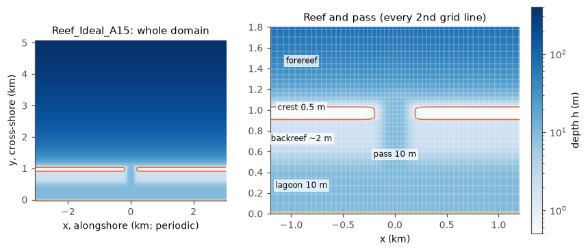
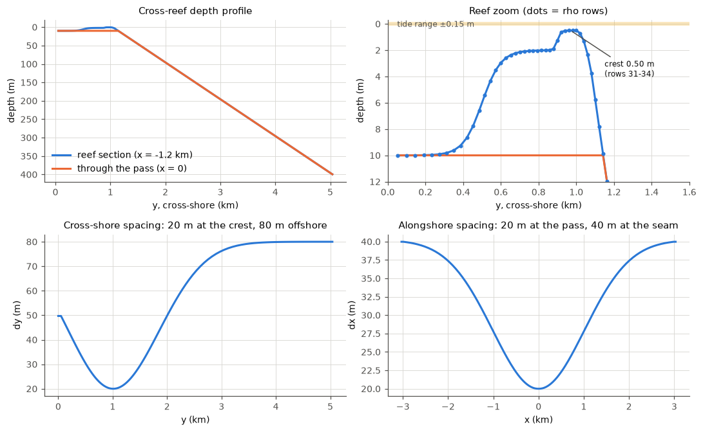
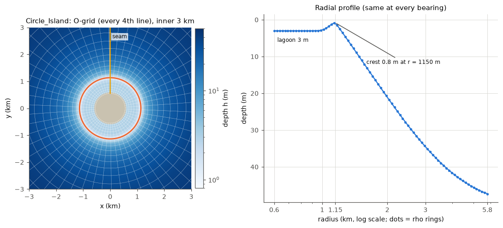

# Idealized reef cases for COAWST (ROMS + SWAN)

A family of idealized coral-reef simulations with the COAWST modelling
system: the ocean model ROMS coupled two-way to the wave model SWAN (no
atmosphere model). They are made for studying how reef structure, waves,
tides, canopy roughness, stratification and heating drive flow over and
through reefs, and for running many variations of them (ensembles) cheaply
on cloud machines.

Every case here is a complete, standard COAWST project folder: a cpp header,
`ocean.in`, `swan.in`, `coupling.in`, any analytical `ana_*.h` routines, and
the grid and initial files. The cases were built and tested with
**coawst-cloud**, a companion repository that builds a patched COAWST v3.9
into a container image and runs it on Google Cloud Batch (see
[How to run](#how-to-run)).

## The cases at a glance

| Case | Grid (rho points, levels) | Spacing | Domain | What it adds | Forcing | Typical cost |
|---|---|---|---|---|---|---|
| [Reef_Ideal_A15](docs/Reef_Ideal_A15.md) | 203 x 111, 10 | 20-40 m alongshore, 20-80 m cross-shore | 6 km alongshore (periodic) x 5 km; fringing reef with one pass | the base case: waves on currents (vortex force), GLS mixing, wave bottom boundary layer; T and S fixed | Hs 1 m, Tp 10 s from the north; 0.15 m, 12 h tide | 68 s wall per simulated hour on a 16-vCPU machine (10 ROMS + 6 SWAN processes) |
| [Reef_Ideal_A15_bulk](docs/Reef_Ideal_A15_bulk.md) | as A15 | as A15 | as A15 | bulk (monochromatic) Stokes drift instead of the spectral one | as A15 | as A15 |
| [Reef_Ideal_A15_veg](docs/Reef_Ideal_A15_veg.md) | as A15 | as A15 | as A15 | coral canopy as rigid cylinders (vegetation drag, canopy turbulence, wave dissipation in SWAN); spatial patterns | as A15 | as A15 (DT 3 s, or the implicit drag, for patchy canopies) |
| [Reef_Ideal_A15_veg_strat](docs/Reef_Ideal_A15_veg_strat.md) | as A15 | as A15 | as A15 | temperature and salinity evolve; constant initial stratification; open north boundary with nudging | as A15, tide set at run time | as A15 |
| [Reef_Ideal_A15_veg_therm](docs/Reef_Ideal_A15_veg_therm.md) | as A15 | as A15 | as A15 | diurnal solar heating absorbed with depth; far-field ocean column for the boundary | as strat, plus surface heat flux | 77 s wall per simulated hour (16 vCPUs) |
| [Reef_Ideal_A15_veg_10m](docs/Reef_Ideal_A15_veg_10m.md) | 404 x 220, 10 | half of A15's | as A15 | grid-convergence twin of `_veg` (generated, not stored) | as A15 | about 8x A15 |
| [A15 thin-crest variants](docs/Reef_Ideal_A15_thin_crest.md) | as A15 | as A15 | as A15 | shallower and steeper crests (0.30 m, steep flanks), for bottom-stress tests (generated) | as A15 | as A15 |
| [Swan_Periodic_Test](docs/Swan_Periodic_Test.md) | 100-200 x 121 (SWAN only), and A15's grid | 20 m, or A15's | 2-4 km periodic x 2.4 km; A15's cross-shore profile with a pass | standalone SWAN test of periodic lateral boundaries on regular and curvilinear grids | Hs 1 m, Tp 10 s from 20 degrees | about 15 min on 4 cores for the whole set |
| [Circle_Island](docs/Circle_Island.md) | 218 x 82, 10 | 17.5 m at the shore to 169 m offshore | round island, radius 0.6 km, domain radius 5.8 km | a closed O-grid round an island (SWAN and ROMS periodic round the island) | Hs 1 m, Tp 10 s from the north (or inward all round); 0.15 m, 12 h tide | 139 s wall per simulated hour on 8 vCPUs (6 + 2) |

Wall times are from Google Cloud `c2d` machines (AMD EPYC). On Spot
(interruptible) machines a simulated day of A15 costs roughly $0.10; on
regular machines about $0.50.

### Geometries



*Reef_Ideal_A15: depth (log colour scale), whole domain and a zoom on the reef
with every second grid line. The orange contour is h = 1 m (the crest).*



*Cross-reef depth through the reef and through the pass, a zoom on the reef
with the rho rows, and the grid spacing in each direction.*



*Circle_Island: the log-polar O-grid (every fourth line) and the radial depth
profile, the same at every bearing. The seam, where the grid closes on itself,
is at north.*

More figures: [canopy patterns](figures/canopy_patterns.png),
[thin-crest profiles](figures/a15_thin_crest_profiles.png),
[stratification and heating](figures/a15_strat_therm.png),
[20 m vs 10 m grid](figures/a15_refined_10m.png). All are made by
[`figures/make_figures.py`](figures/make_figures.py) from the files in this
repository.

## Modelling conventions used in every A15 case

- **Coral canopy elements are rigid cylinders: `plant_thickness = (pi/4) x
  plant_diameter`.** ROMS's vegetation model takes each plant's horizontal
  footprint as diameter x thickness (it was written for flat seagrass blades).
  For a cylinder the thickness stands in for the second horizontal dimension,
  and t = pi D / 4 makes D x t the true cross-section pi D² / 4. The footprint
  sets the solid fraction D t n and the gap between plants
  L = c_l sqrt((1 - D t n)/n) in the canopy turbulence (`VEG_TURB`,
  Uittenbogaard 2003). With t = D a canopy of 0.5 m elements at 4 m⁻² fills
  the bed (D t n = 1), L = 0, and ROMS divides by zero. Drag and SWAN's wave
  dissipation use only diameter, density and height. `VEG_FLEX` and SWAN's
  flexible vegetation assume flat blades and stay off.
- **Canopy turbulence as shipped in COAWST v3.9**: the vegetation source of
  dissipation uses only the canopy time scale (set by the gap between plants),
  not the free-turbulence time scale k/epsilon. The published model
  (COAWST v3.2-v3.7) used min(k/epsilon, tau_veg); restoring it lowered the
  canopy eddy viscosity by 65 % in a test. Kept as shipped for now.
- **Canopy drag explicit by default; `VEG_DRAG_IMPLICIT` for patchy or dense
  canopies** (coawst-cloud patch `roms-veg-implicit`, build option
  `CPP_OPTIONS="+VEG_DRAG_IMPLICIT"`). See [Reef_Ideal_A15_veg](docs/Reef_Ideal_A15_veg.md).
- **`VISC2 = 0`.** The third-order upstream advection supplies the lateral
  viscosity; `UV_VIS2` stays compiled so a sponge can still be switched on.
  Circle_Island too since 2026-11-02 (its tests ran with 0.001 m²/s).
- **North open boundary of the stratified and thermal cases: nudged radiation
  (`RadNud`) plus an interior nudging band**; the viscous sponge stays off.
- **Thermal case: constant non-solar heat flux**, chosen so the daily net heat
  input is zero. A surface-temperature feedback or full bulk fluxes would be
  the next refinements.
- **Output is compressed NetCDF-4** (coawst-cloud's default build; lossless,
  about 3x smaller files).

## How to run

### With coawst-cloud (what these cases were tested with)

coawst-cloud builds COAWST at a pinned commit with a series of fixes and
optional improvements (each documented and tested), and produces a container
image: a self-contained Linux system with the compiled model, OpenMPI and
NetCDF, which runs the same on a laptop with Docker, on a cluster with
Apptainer, or on Google Cloud.

```bash
# build an image for one case (the header name must be the application flag in lower case)
coawst-cloud/build/coawst/build.sh --case cases/Reef_Ideal_A15_veg --app REEF_IDEAL_A15 --tag reef_a15_veg
# with an extra cpp option, e.g. the implicit canopy drag
coawst-cloud/build/coawst/build.sh --case cases/Reef_Ideal_A15_veg --app REEF_IDEAL_A15 \
    --tag reef_a15_veg_imp -- --build-arg CPP_OPTIONS="+VEG_DRAG_IMPLICIT"
coawst-cloud/build/coawst/build.sh --case cases/Circle_Island --app CIRCLE_ISLAND

# run it: the .in files name each other without paths, so run inside a copy of the case
mkdir run && cd run
docker run --rm -u "$(id -u):$(id -g)" -v "$PWD:/work" -w /work reef_a15_veg bash -c '
    cp -r /opt/coawst/Projects/Reef_Ideal_A15_veg/. . && mkdir -p output
    mpirun --use-hwthread-cpus --bind-to none -np 12 coawstM coupling.in > log.txt 2>&1'
```

The number of processes is set by `NtileI x NtileJ` in `ocean.in` (ROMS) and
`NnodesWAV` in `coupling.in` (SWAN); `NnodesOCN` must equal the ROMS tiles and
`mpirun -np` takes the sum (as shipped, A15 uses 4 x 2 ROMS + 4 SWAN = 12).
ROMS and SWAN write their NetCDF output under `output/`.

On the cloud, the image is pushed to a private container registry, and each
run is one task of a Cloud Batch job: Batch starts a virtual machine, runs the
container with the case's input files, copies the output to a Cloud Storage
bucket and deletes the machine. coawst-cloud's documentation covers this.

### With a plain COAWST build

The cases are ordinary COAWST v3.9 projects: put a case folder under
`Projects/`, point `MY_HEADER_DIR` and `MY_ANALYTICAL_DIR` at it, and set
`COAWST_APPLICATION` to the application flag (`REEF_IDEAL_A15` for every A15
case, `CIRCLE_ISLAND`). Point `VARNAME` in `ocean.in` at your
`ROMS/External/varinfo.yaml`. Stock COAWST v3.9 needs these coawst-cloud
patches for these cases:

| Needed for | Patch |
|---|---|
| SWAN periodic on A15's curvilinear grid (`COORDINATES CARTESIAN REPEATING`) | `swan-periodic-curvilinear`, `swan-periodic-fixes` |
| SWAN's NetCDF `BLOCK` output | `swan-netcdf-output` |
| any vegetation case (stock crashes with periodic boundaries) | `roms-vegetation` |
| SWAN `VEGETATION 3` (plant fields from ROMS) | `swan-vegetation-fixes` |
| spectral Stokes drift (index errors in v3.9) | `roms-wec-stokes-fixes` |
| exact restarts with waves | `roms-restart-wec`, `swan-exact-restart` |
| Circle_Island's grid that closes round the island | `swan-closed-ring` (with the two periodic patches) |
| optional: implicit canopy drag, implicit bottom stress, AB3-AM4 barotropic kernel | `roms-veg-implicit`, `roms-bstress-implicit`, `roms-step2d-fb` |

## Repository layout

| Folder | What |
|---|---|
| [`cases/`](cases) | one complete COAWST project per case (grids and initial files included; the largest is 5.5 MB) |
| [`docs/`](docs) | one page per case: geometry, grid, physics and why, forcing, boundaries, outputs, test results, caveats |
| [`figures/`](figures) | the figures and the script that makes them |
| [`tools/`](tools) | scripts that make case variants: canopy patterns, stratified initial files, the far-field column of the thermal case, 2x refinement, thin crests, Courant-number checks |
| [`reference/Reef_Ideal_A15_v3.7/`](reference/Reef_Ideal_A15_v3.7) | the original COAWST v3.7 project the A15 cases derive from (MATLAB grid and initial-file generators, inputs) |
| [`notebook/`](notebook/README.md) | the lab notebook: one dated entry per experiment, with an index |
| [`results/`](results) | results of the options test campaign (to be added) |

The Python scripts need numpy, scipy, netCDF4 and matplotlib. Run them from
the repository root, e.g. `python3 -I tools/vegetation/make_veg_init.py ...`.

## Provenance and citation

Reef_Ideal_A15 is the author's idealized fringing-reef project for COAWST
v3.7 (grid from `Make_grid_Reef_Ideal_A14.m`, initial file from
`Make_init_Reef_Ideal_A15.m`, both in `reference/`), ported to COAWST v3.9
in October 2026: the same grid and initial file bit for bit, `ocean.in` and
`coupling.in` moved to v3.9's formats, SWAN made periodic like ROMS, and
SWAN output written as NetCDF. The variants and Circle_Island were built from
it in October-November 2026.

Many thanks to Walter Torres, whose COAWST single-channel idealized reef
test case, [wingtorres/reef](https://github.com/wingtorres/reef), was the
inspiration and a guide for these cases. They have grown in their own
direction since, so anyone starting a reef model in COAWST will find that
compact set-up well worth a look too.

COAWST: Warner, J.C., Armstrong, B., He, R., and Zambon, J.B. (2010),
Development of a Coupled Ocean-Atmosphere-Wave-Sediment Transport (COAWST)
modeling system, Ocean Modelling 35, 230-244. ROMS, SWAN, MCT and SCRIP keep
their own licences.

To cite this repository, use GitHub's "Cite this repository" button (from
[`CITATION.cff`](CITATION.cff)). A DOI per release can be added later through
Zenodo's GitHub integration; papers that use the cases will be listed here.

## License

- **Code and case files** (`tools/`, `figures/make_figures.py`, the case
  headers, `.in` files and analytical routines in `cases/`, the scripts in
  `reference/`): [MIT](LICENSE).
- **Documentation, figures, the notebook and the data files** (`docs/`,
  `notebook/`, `results/`, the PNG figures, the NetCDF grid and initial files
  and SWAN grid/bathymetry files): [CC BY 4.0](LICENSE-CC-BY-4.0.txt). Reuse
  them freely, with credit to this repository.
- The `ana_*.h` files in `cases/` are modified ROMS source and keep ROMS's own
  MIT licence and copyright notice ([License_ROMS.md](License_ROMS.md)).
  COAWST, SWAN (GPL), MCT and SCRIP are not included here; they keep their own
  licences.
