# Idealized reef cases for COAWST (ROMS + SWAN)

A family of idealized coral-reef simulations with the COAWST modelling
system: the ocean model ROMS coupled two-way to the wave model SWAN (no
atmosphere model). They are made for studying how reef structure, waves,
tides, canopy roughness, stratification and heating drive flow over and
through reefs, and for running many variations of them (ensembles) cheaply
on cloud machines.

Every case here is a complete, standard COAWST project folder: a cpp header,
`ocean.in`, `swan.in`, `coupling.in`, any analytical `ana_*.h` routines, and
the grid and initial files. The cases were built and tested with
**coawst-cloud**, a companion repository that builds a patched COAWST v3.9
into a container image and runs it on Google Cloud Batch (see
[How to run](#how-to-run)).

Since the port in October 2026 the cases have been through a test campaign
of well over a hundred runs: numerics, SWAN settings, wave physics, canopy, mixing,
resolution. [What we have learned about the physics](#what-we-have-learned-about-the-physics)
summarizes it with figures; the [notebook](notebook/README.md) has every run
and the [results summary](results/README.md) the full tables.

## The cases at a glance

| Case | Grid (rho points, levels) | Spacing | Domain | What it adds | Forcing | Typical cost |
|---|---|---|---|---|---|---|
| [Reef_Ideal_A15](docs/Reef_Ideal_A15.md) | 203 x 126, 15 | 20-40 m alongshore; cross-shore 20-80 m, with 10 m rows across the breaking zone (850-1150 m from the shore) | 6 km alongshore (periodic) x 5 km; fringing reef with one pass | the base case: waves on currents (vortex force), roller, wave streaming, GLS mixing, wave bottom boundary layer; T and S fixed | Hs 1 m, Tp 10 s from the north, 30 degree spread; 0.15 m, 12 h tide | about 120-140 s wall per simulated hour on a 16-vCPU machine (10 ROMS + 6 SWAN processes) |
| [Reef_Ideal_A15_bulk](docs/Reef_Ideal_A15_bulk.md) | as A15 | as A15 | as A15 | bulk (monochromatic) Stokes drift instead of the spectral one | as A15 | as A15 |
| [Reef_Ideal_A15_veg](docs/Reef_Ideal_A15_veg.md) | as A15 | as A15 | as A15 | coral canopy as rigid cylinders (vegetation drag, canopy turbulence, canopy wave streaming, wave dissipation in SWAN); spatial patterns | as A15 | as A15 (DT 6 s for every canopy, with the implicit drag) |
| [Reef_Ideal_A15_veg_strat](docs/Reef_Ideal_A15_veg_strat.md) | as A15 | as A15 | as A15 | temperature and salinity evolve; constant initial stratification; open north boundary with nudging | as A15, tide set at run time | as A15 |
| [Reef_Ideal_A15_veg_therm](docs/Reef_Ideal_A15_veg_therm.md) | as A15 | as A15 | as A15 | diurnal solar heating absorbed with depth; far-field ocean column for the boundary | as strat, plus surface heat flux | as A15 |
| [Reef_Ideal_A15_veg_10m](docs/Reef_Ideal_A15_veg_10m.md) | 404 x 220 | half of the old 20 m grid's | as A15 | uniform 10 m twin of the old 20 m grid (generated, not stored); the breaking-zone grid now gives its answer at a sixth of the cost | as A15 | about 8x the old 20 m grid |
| [A15 thin-crest variants](docs/Reef_Ideal_A15_thin_crest.md) | as A15 | as A15 | as A15 | shallower and steeper crests (0.30 m, steep flanks), for bottom-stress tests (generated) | as A15 | as A15 |
| [Swan_Periodic_Test](docs/Swan_Periodic_Test.md) | 100-200 x 121 (SWAN only), and A15's grid | 20 m, or A15's | 2-4 km periodic x 2.4 km; A15's cross-shore profile with a pass | standalone SWAN test of periodic lateral boundaries on regular and curvilinear grids | Hs 1 m, Tp 10 s from 20 degrees | about 15 min on 4 cores for the whole set |
| [Island_A15](docs/Island_A15.md) (2 or 4 passes) | 362 x 132, 10 | 10.5 m at the shore, 28 m on the crest, 101 m offshore | round island, radius 0.6 km, domain radius 5.8 km | A15's reef and pass wrapped round an island: 2 passes (north, south) or 4 (every 90 degrees) | as A15, waves from the north on the outer ring | 194 s wall per simulated hour on 16 vCPUs (10 + 6) |
| [Circle_Island](docs/Circle_Island.md) | 218 x 82, 10 | 17.5 m at the shore to 169 m offshore | round island, radius 0.6 km, domain radius 5.8 km | a closed O-grid round an island (SWAN and ROMS periodic round the island) | Hs 1 m, Tp 10 s from the north (or inward all round); 0.15 m, 12 h tide | 139 s wall per simulated hour on 8 vCPUs (6 + 2) |

Wall times are from Google Cloud `c2d` machines (AMD EPYC). On Spot
(interruptible) machines a simulated day of A15 costs roughly $0.15 with the
defaults of 2026-11-03 (34 SWAN frequencies and the breaking-zone grid made
it about 60 % dearer than before); on regular machines about $0.75. Exact
restarts make the Spot runs possible: a run cut into 4 h segments reproduces
the uninterrupted one to round-off.

### Geometries


*Reef_Ideal_A15: depth (log colour scale), whole domain and a zoom on the reef
with every second grid line. The orange contour is h = 1 m (the crest).*


*Cross-reef depth through the reef and through the pass, a zoom on the reef
with the rho rows, and the grid spacing in each direction (the 20 m grid; the
rows between 850 and 1150 m from the shore are now 10 m).*


*Circle_Island: the log-polar O-grid (every fourth line) and the radial depth
profile, the same at every bearing. The seam, where the grid closes on itself,
is at north.*

More figures: [canopy patterns](figures/canopy_patterns.png),
[thin-crest profiles](figures/a15_thin_crest_profiles.png),
[stratification and heating](figures/a15_strat_therm.png),
[20 m vs 10 m grid](figures/a15_refined_10m.png),
[Island_A15](figures/island_a15_grid.png). All are made by
[`figures/make_figures.py`](figures/make_figures.py) from the files in this
repository; the `results_*.png` figures below are made by
[`figures/make_results_figures.py`](figures/make_results_figures.py) from the
numbers in the notebook.

## What we have learned about the physics

Everything below comes from 24 h runs of the A15 cases (the forcing settles
into a repeating 12 h tidal cycle by hour 12, and the metrics are taken over
hours 12-24), unless a longer run is named. The standard test configuration
since 2026-11-03 is `Reef_Ideal_A15_veg` with a **density-1 canopy** (1
plant per m², 0.5 m diameter, 0.4 m tall: frontal area 0.2, close to measured
reef canopies), because a dense canopy (4 per m², frontal area 0.8)
holds the flow at a few percent of the bare reef's and hides everything else. The case
folders hold density 1 since 2026-11-04 (the author's decision).
The metrics: the lagoon set-up (mean sea level in the lagoon minus offshore),
the transport over the crest and through the pass (per 6 km of reef), the
crest and pass jets, Hs, SWAN's dissipation terms and the lagoon flushing
time.

### The circulation and what drives it

Waves break at the top of the fore reef and on the 0.5 m crest; the momentum
they lose raises the lagoon by one to several centimetres, and that set-up
drives water over the crest, round the lagoon and out through the pass as a
jet. On the bare reef with 1 m waves the set-up is about 6 cm, the crest
transport about 1400 m³/s per 6 km of reef, the crest jet 0.8 m/s and the
pass jet 1 m/s; the tide (0.15 m) modulates all of it. The whole reef flow
hangs on how much wave momentum reaches the water and where, and that is
what most of the campaign turned out to be about.

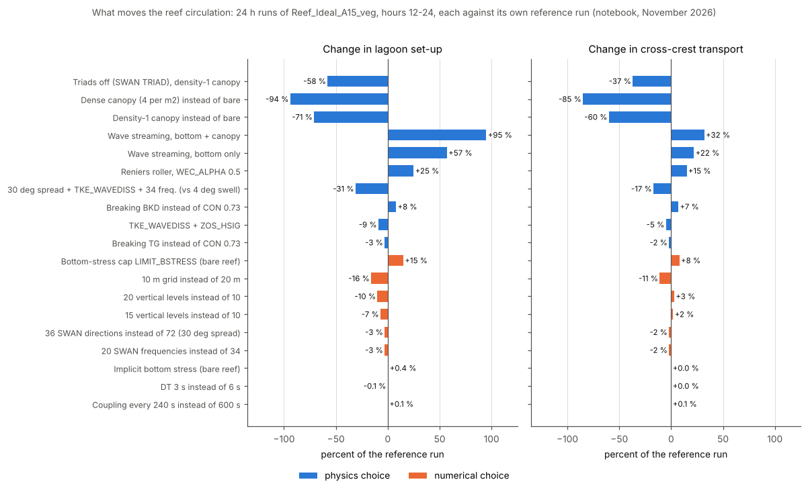

*Every choice tested, ranked by what it does to the lagoon set-up and the
cross-crest transport, each against its own reference run (blue: physics,
orange: numerics). The physics the model was missing (triads, wave
streaming, the roller) and the canopy move the answer by tens of percent;
once they are in, the time stepping, coupling and SWAN settings are converged
to a percent or so, and the grid, in both directions, is the remaining
numerical uncertainty.*

### Where the waves lose their energy, and the wave streaming

SWAN dissipates the incoming 1 m waves in three ways on this reef: breaking
(about 40 % of the total), bottom friction (34 %) and the canopy (26 %).
Breaking is concentrated on the crest; friction and canopy drag act on the
crest and over the top of the fore reef, where the near-bottom orbital
velocity is 0.4 m/s. In the vortex-force formulation (`WEC_VF`) each kind of
dissipation hands its momentum to the mean flow only through its own force
term, and COAWST's options for the friction and canopy parts
(`BOTTOM_STREAMING`, `VEG_STREAMING`) were off as "second order". On this
reef they are not: with both on, the lagoon set-up nearly doubles (14 to
28 mm) and the crest and pass transports rise by about 30 %, at no cost and
converged in the time step. The canopy force needed five fixes in COAWST v3.9
first (coawst-cloud `roms-veg-streaming-fixes`). Both are now A15 defaults.
The flow is then set directly by the roughness (`grain_diameter`, SWAN's
`FRICTION MADSEN`) and the canopy parameters, not only through the wave
height, which moves them up the list of ensemble parameters.
([entry](notebook/2026-11-03_wave-streaming.md))

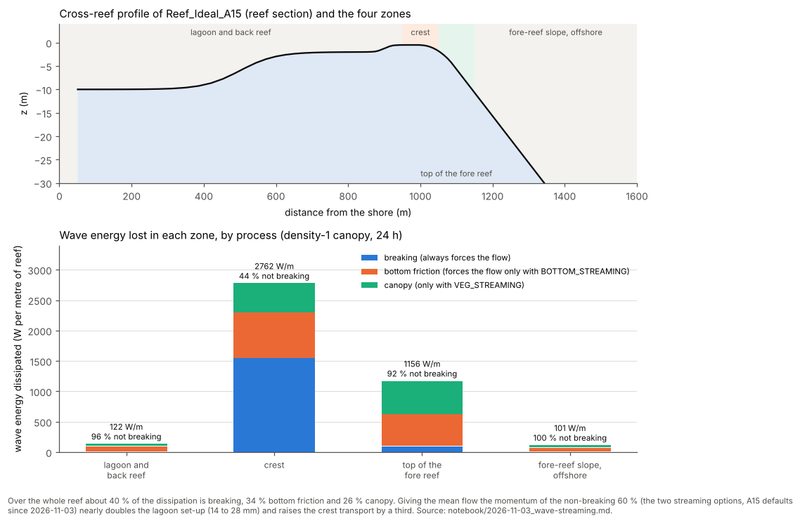

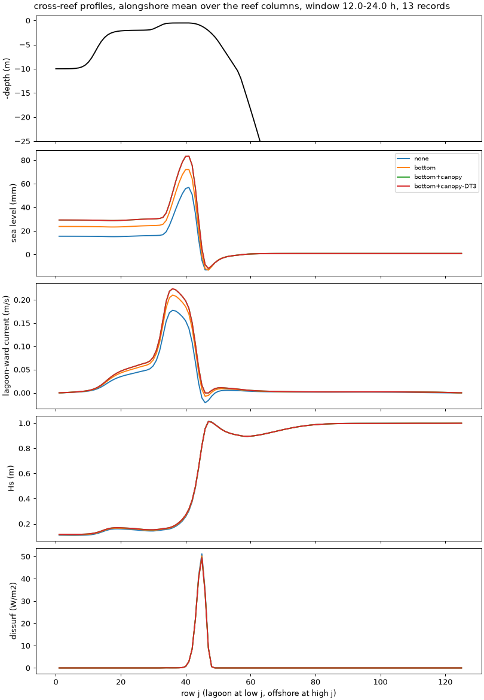

*Alongshore-mean cross-reef profiles over hours 12-24 without streaming
(blue), with bottom streaming (orange) and with bottom and canopy streaming
(green; red: the same at DT 3 s, on top of it). From the top: depth, sea
level, lagoon-ward current, Hs and breaking dissipation against the row
index (lagoon at the left, offshore at the right). The waves and the
breaking are the same in all four; only the water they push changes.*

### SWAN's triads are first order

SWAN's triad interactions (`TRIAD`) shift wave energy from the peak to its
harmonics as the waves shoal over the fore reef. COAWST's SWAN skipped the
triad term in the first iteration of every time step whenever there are
currents, and a coupled run makes one iteration per step: **triads were never
computed in any coupled COAWST run** (fixed: coawst-cloud
`swan-triads-nonstationary`). With triads acting the lagoon set-up of the
density-1 canopy is about 2.5x larger, that of the dense canopy 5.6x, and
that of the bare reef 1.5x. The likely mechanism: energy at higher frequencies has
less orbital motion at the bottom, so the canopy and the bottom friction take
less of it, more reaches the crest (Hs there +86 % on the dense canopy) and
breaks there. A result that depends on the wave forcing over a reef needs
triads, and with the fix one SWAN iteration per step is converged (1, 2 and
5 iterations within 0.6 %).
([entries](notebook/2026-11-02_swan-triads-skipped-first-iteration.md),
[triads on](notebook/2026-11-02_options-triads-on.md))

### The canopy controls the circulation

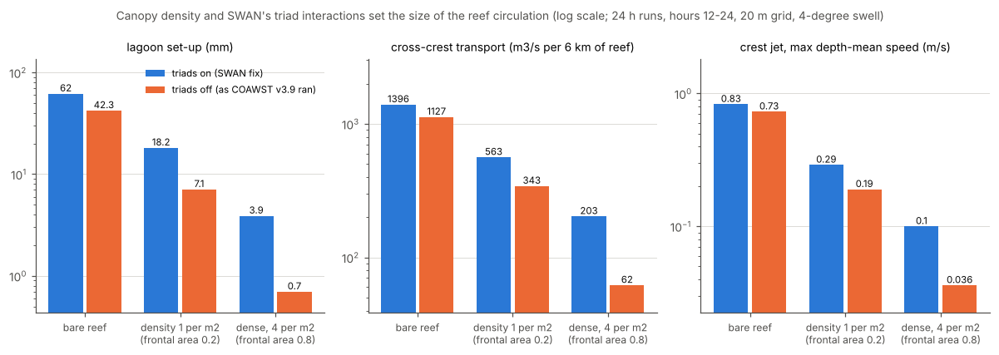

A canopy of rigid cylinders (ROMS's vegetation model with the thickness set
so that the footprint is a circle) damps the whole reef: against the bare
reef, the density-1 canopy cuts the set-up by 71 % and the crest transport by
60 %, the dense canopy by 94 % and 85 %; a patchy canopy (30 % dense, 30 %
sparse) sits in between, with the flow funnelling through the bare gaps on
the crest at 0.35-0.6 m/s and dropping to a few cm/s inside the dense patches.
The canopy acts in three ways at once: drag on the current, dissipation of
the waves in SWAN (so less breaks on the crest) and, since the streaming fix,
a force on the mean flow from that dissipation. Its turbulence source
(`VEG_TURB`) raises the reef-flat diffusivity by 60 % and changes the flow by
2-4 %. The canopy is also the stiffest part of the time stepping: the
explicit drag blows up at DT 6 s wherever 2 alpha |U| DT exceeds about 1
(the dense canopy at the fore-reef bottom, once triads bring 0.5 m/s there);
the implicit drag (`VEG_DRAG_IMPLICIT`) runs at DT 6 s within 2.5 % of the
explicit drag at DT 3 s and is the default.
([entries](notebook/2026-10-22_spatial-vegetation-patterns.md),
[density-1 tests](notebook/2026-11-03_density1-canopy-tests.md),
[implicit drag](notebook/2026-10-27_implicit-vegetation-drag.md))

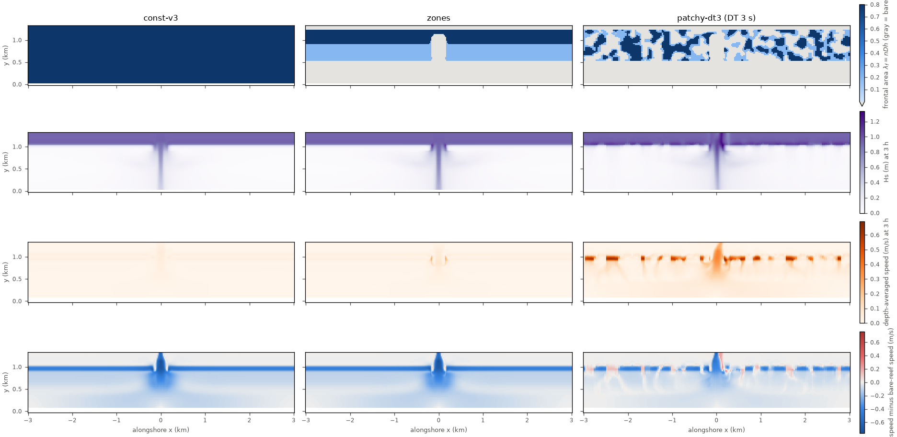

*Constant, zoned and patchy canopy after 3 h. Rows: frontal area; Hs;
depth-averaged speed; speed minus the bare-reef run.*

### The surface roller delays the breaking force

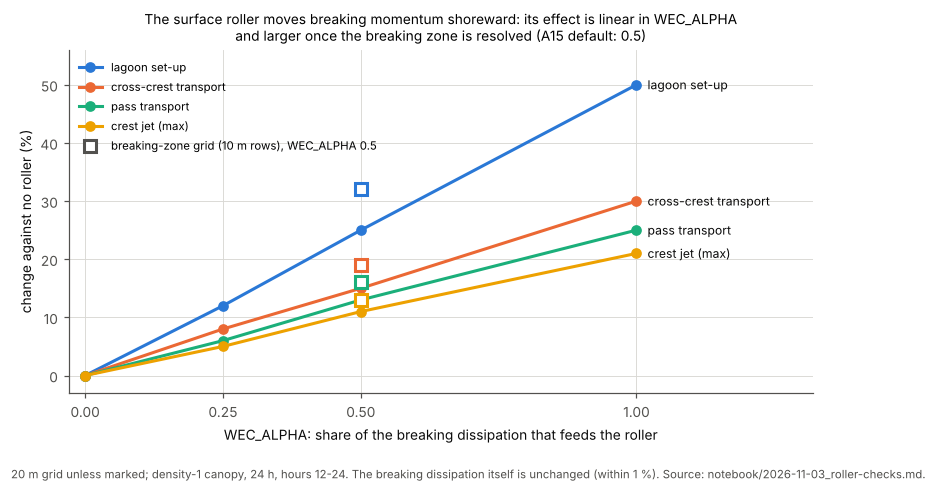

Breaking waves do not hand their momentum to the water at once: a roller of
aerated water rides the front and releases it further shoreward. On A15 the
Reniers roller (`ROLLER_RENIERS`) moves the breaking force from the fore
reef onto the crest and reef flat, where it pushes water over the crest:
set-up +25 % and crest transport +15 % at `WEC_ALPHA` 0.5, linearly in that
share, with the breaking dissipation itself unchanged. The effect grows when
the breaking zone is resolved (set-up +32 % on the breaking-zone grid) and
makes the answer less grid-sensitive, so it is physics the model was
otherwise missing on a steep reef, as the flume measurements of Buckley et
al. (2015) found. `WEC_ALPHA` is a tuning parameter: 0.5 is the default and
0.25 / 1.0 the sensitivity pair for anything that depends on the set-up.
COAWST advected the roller with one explicit step per DT, unstable at DT 6 s
on a reef crest, and left its state out of the restart file; both fixed
(coawst-cloud `roms-roller-substeps`, `roms-restart-roller`).
([entries](notebook/2026-11-03_roller-substeps.md),
[roller checks](notebook/2026-11-03_roller-checks.md))

### Breaking, breaking turbulence and the incoming spectrum

- **Breaking formulation.** With triads acting the choice is a 10 % question:
  `BKD` (Salmon et al. 2015, SWAN's defaults) gives 7-11 % more set-up and
  crest transport than `CON 0.73`, and the crest jet +11 %; gamma 0.80 is
  within 1 % of 0.73; `TG` (Thornton-Guza) leaves the flow within 3 % but
  changes the fore-reef shear, Hs on the crest and the flushing time. `BKD`
  is the default since 2026-11-03. Without triads the three formulations had
  spread the set-up from -24 % to +108 %: an artefact of the missing triads.
- **Turbulence from breaking** (`TKE_WAVEDISS` + `ZOS_HSIG`: SWAN's breaking
  dissipation as a surface TKE flux, with a wave-height roughness) makes the
  fore-reef flow less surface-intensified (surface/mean speed -32 %), slows
  the crest jet 17 % and lowers the set-up 9 %. Adopted. (With triads off it
  had done the opposite, another artefact.)
- **The incoming spectrum.** The v3.7 project sent a 4 degree swell, narrower
  than SWAN's 5 degree direction bins, so the answer depended on the number
  of directions (36: -16 % set-up; 144: +5 %). With a 30 degree spread, as
  measured swell has, 72 directions is converged (144 within 1 %, 36 within
  3 %), and the set-up is a third lower because less energy arrives straight
  onto the reef. Frequencies converge by 34 (20 is 3 % low).
  ([entry](notebook/2026-11-03_spread30-baseline-and-resolution.md))
- Whitecapping on opposing currents and the wave-number-dependent current
  felt by SWAN (`UV_BANIHASHEMI` instead of `UV_KIRBY`) change nothing on A15
  (within 0.5 %).

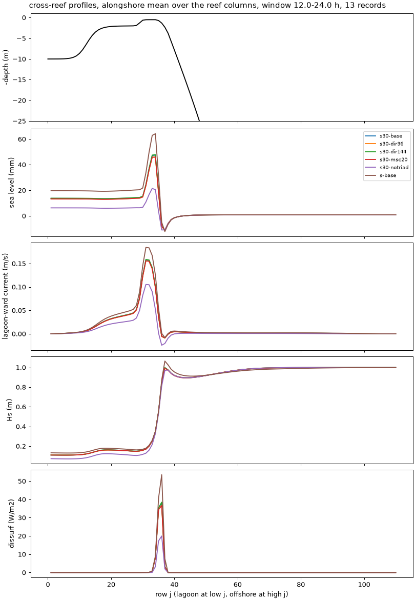

*The 30-degree baseline (blue), 36 and 144 directions (orange, green), 20
frequencies (red), no triads (purple) and the old 4-degree baseline (brown):
sea level, lagoon-ward current, Hs and breaking dissipation across the reef.
The three resolution members lie on the baseline; triads and the spread do
not.*

### Resolution: the breaking zone and the vertical

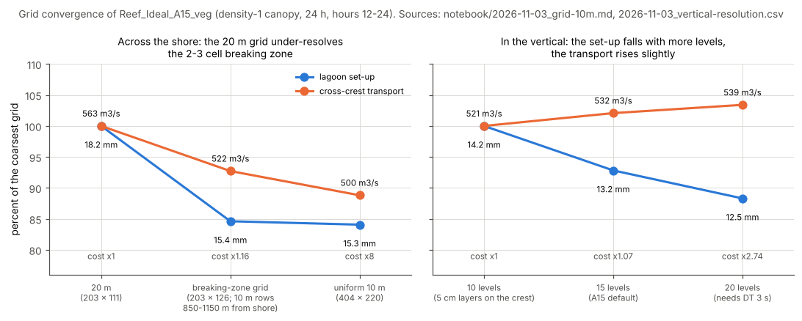

The 20 m grid was not converged: a uniform 10 m grid lowered the set-up by
16 % and the crest transport by 11-18 %, in both canopy regimes. The waves
lose the same energy on both grids; the difference comes from one strip, the
breaking zone at the top of the fore reef (0.7-1.6 m deep), which is two or
three 20 m cells wide, and everything shoreward follows. Refining only the
rows between 850 and 1150 m from the shore to 10 m (the **breaking-zone
grid**, 203 x 126) recovers the 10 m answer at +16 % cost
instead of 8x, and is the grid of every A15 case since 2026-11-03.

In the vertical, 10 levels (5 cm layers on the crest) were not converged
either: the set-up falls 7 % at 15 levels and 10-12 % at 20, while the crest
and pass flows rise 2-3 % (pass jet +9 %); the waves are untouched, so it is
how the ocean model spreads the wave forcing and the drag over depth. 15
levels is the default (+7 % cost; at the smaller time step since adopted, see below); 20 levels
costs 2.7x at the time when it was tested, and the remaining 3-4 % is noted as a resolution uncertainty. A caveat on
going finer: the k-epsilon closure is columnwise and hydrostatic, sound
while cells are much wider than the water is deep, which at 10 m holds on
the crest and reef flat but not in the pass or on the fore reef.
([entries](notebook/2026-11-03_grid-10m.md),
[vertical](notebook/2026-11-03_vertical-resolution.md))

### Mixing: the TKE floor, the closures, the stratified lagoon

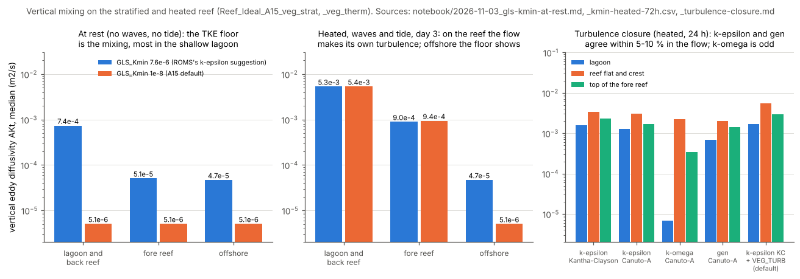

At rest, the stratified case mixed its 2 m back reef out within hours with a
diffusivity of 1e-3 m²/s. That is the GLS minimum TKE floor (`GLS_Kmin`
7.6e-6 m²/s², ROMS's 2005 suggestion for k-epsilon), not the canopy
turbulence: with the Galperin limit the k-epsilon diffusivity tends to
0.05 Kmin / N, so the floor sets the background mixing, most of all in
unstratified shallow water (15x more than offshore for the same floor).
`GLS_Kmin` 1e-8 brings the quiet-water mixing down to the background
coefficients (`AKT_BAK` 5e-6, `AKV_BAK` 5e-5 m²/s), lets the calm lagoon keep
its stratification, and ran 72 h of waves, tide and 1000 W/m² heating as
smoothly as the default (1e-10 gives the same answer to three digits). On
the forced reef the floor hardly matters (the lagoon's own mixing is 1000x
larger); offshore below the mixed layer it is the mixing, which matters over
weeks. 1e-8 is the default of every A15 case, and the background
coefficients are the number to report. The closure itself is a 5-10 % effect
on the heated reef: k-epsilon with Kantha-Clayson or Canuto-A stability
functions agree within 1-3 %, the generic closure within 5 %; k-omega lets
the lagoon diffusivity fall to the background and would need a closer look.
([entries](notebook/2026-11-03_gls-kmin-at-rest.md),
[72 h heated](notebook/2026-11-03_kmin-heated-72h.md),
[closures](notebook/2026-11-03_turbulence-closure.md),
[docs/gls_kmin.md](docs/gls_kmin.md))

Stratification also limits the time step: the internal-wave Courant number
must stay below about 0.4-0.5, so N² 1e-4 s⁻² runs at DT 6 s and 3e-4 needs
3 s ([entry](notebook/2026-10-22_constant-stratification-courant.md)).

### Heating and the open boundary

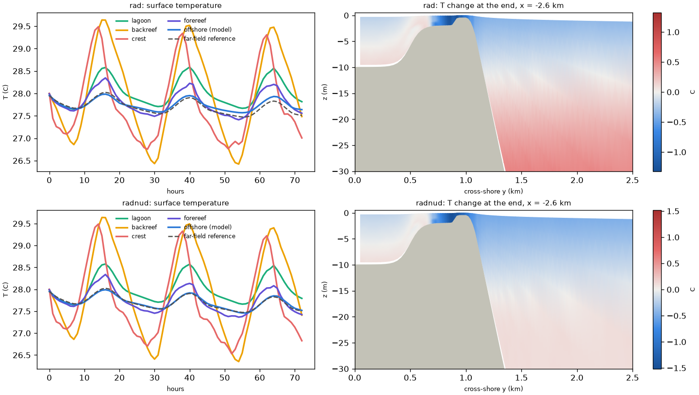

*Three days of diurnal heating. Top: a radiation boundary alone; bottom:
nudged radiation plus the interior nudging band. Left: surface temperature by
region against the far-field reference (dashed); right: the temperature change
over 3 days on a cross-shore section.*

With a 1000 W/m² solar peak balanced by a constant loss, the reef-flat
surface temperature swings 2.6-3 C a day, the lagoon and fore reef about 1 C,
and the heat budget closes. The waves add a transport the far field does not
have: at the north boundary the Stokes drift is onshore near the surface and
the Eulerian return flow offshore at every depth, so a plain radiation
boundary imports warm surface water and the domain warms 0.35 C in 3 days.
Nudged radiation plus an interior nudging band toward the far-field column
holds it to 0.004 C and is the default. The nonlinear equation of state
changes nothing at these temperatures (within 0.5 %, no spurious currents at
rest), and the stability functions are a few percent.
([entries](notebook/2026-10-23_thermal-forcing-3day.md),
[north boundary](notebook/2026-10-22_stratified-north-boundary-24h.md),
[results p0-p2](notebook/2026-11-02_options-campaign-results-p0-p2.md))

### Bottom stress on a thin crest

The wave-current bottom stress (`SSW_BBL`) on the 0.5 m crest, and on 0.30 m
and steeper variants, is stable without any cap: the uncapped explicit
stress, the implicit stress (`BSTRESS_IMPLICIT`) and a halved time step agree
within 1 %. The cap that COAWST applies with `LIMIT_BSTRESS` (and with
`WET_DRY`) binds on half of the crest cells, halves the effective drag, makes
the crest flow 15 % faster on the default crest and 40-75 % faster on thin
ones, and gives an answer that depends on DT. The implicit stress is the
default since it needs no cap on any crest; the earlier "not recommended"
verdict on it was wrong. A 2 m sea switched on without a ramp blows up the
pass jet with every scheme: a forcing shock, cured by the ramp, which
`OMEGA_IMPLICIT` does not help with.
([entries](notebook/2026-11-02_a15-thin-crest-bottom-stress.md),
[implicit stress](notebook/2026-10-27_implicit-bottom-stress.md),
[OMEGA_IMPLICIT](notebook/2026-11-02_options-p2-omega-diag.md))

### A round island with passes

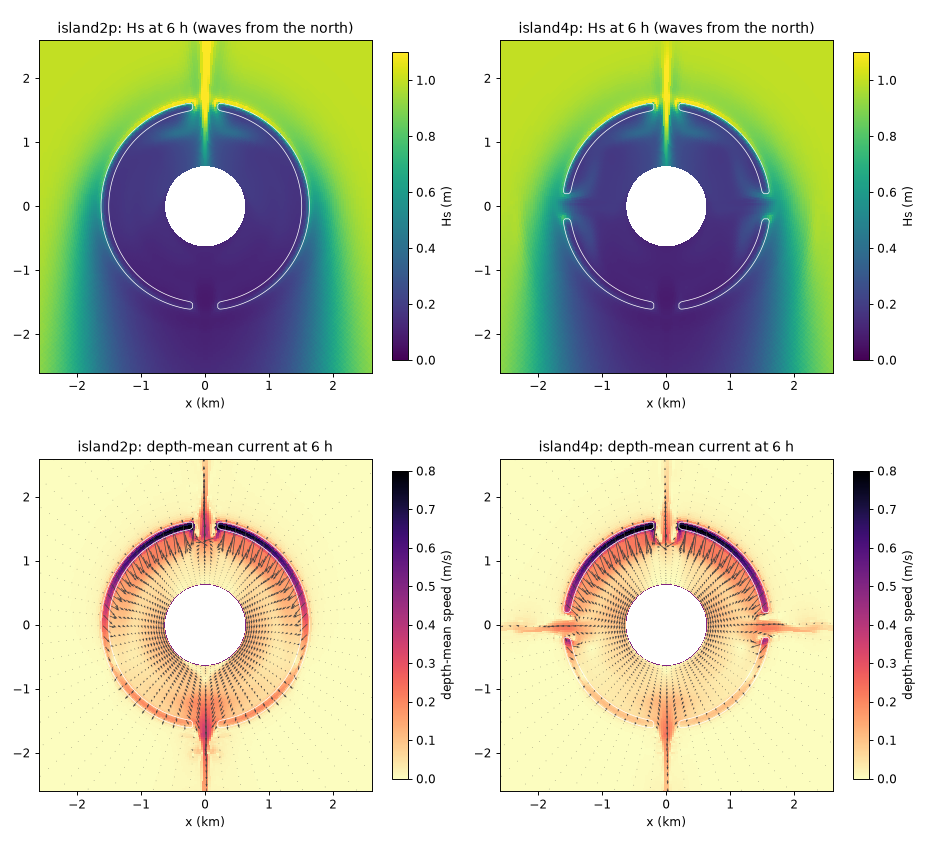

*Island_A15 with 2 and 4 passes after 6 h, waves from the north: Hs (top)
and the depth-mean current (bottom).*

Wrapping A15's profile round a 0.6 km island gives the expected island-lagoon
circulation: the waves break on the windward reef (depth-mean 0.6-0.8 m/s
over the crest, about 1150 m³/s into the lagoon), the water spreads round
the lagoon and leaves through every pass as a jet. The leeward pass carries
the most, but the windward pass, straight into the waves, still drains most
of what the leeward one does, because breaking on the reef either side of it
raises the lagoon more than the waves in the pass push back; with 4 passes
the side passes take 45 % of the outflow. (Snapshots at hour 6; tidal
averages need a longer run.)
([entry](notebook/2026-11-02_island-a15-first-runs.md))

### What is converged, and the noise floor

On the bare reef with triads acting (a flow that moves), halving the time
step moves nothing by more than 1.6 %. Within that floor: the AB3-AM4
barotropic kernel (19 % faster), the implicit bottom stress, 1 against 2 or 5
SWAN iterations per step, the coupling interval (240 s = 600 s within 0.1 %),
SWAN's time step, the refraction and frequency-shift limiters (`CTHETA`,
`CSIGMA`, `DIRIMPL`), `NDTFAST`, the tiling (1e-7), `VISC2` 0.001 against 0
and whitecapping on opposing currents. Not within it: everything in the
figure above with a bar longer than a few percent.
([entries](notebook/2026-11-02_options-triads-on.md),
[limiters](notebook/2026-11-03_swan-limiters.md),
[new-defaults check](notebook/2026-11-03_a15-new-defaults-check.md))

### Problems found in COAWST along the way

All fixed in coawst-cloud unless noted; the details are in the
[results summary](results/README.md#problems-found-in-the-code-along-the-way).

| Problem | Effect |
|---|---|
| SWAN never computed `TRIAD` in coupled runs | set-up -32 % (bare) to -82 % (dense canopy) |
| the canopy streaming force replaced the bottom one, scaled with the canopy height in metres, lacked ghost points and a restart record | the force was 0.29 of its value |
| the Reniers roller took one explicit step per DT, and its area was not restarted | blow-up at DT 6 s; each restarted segment began with no roller |
| with `TS_FIXED` the barotropic densities were computed once at start-up | restarts drifted (3.7e-7 m/s) |
| the vegetation model crashed with periodic boundaries; SWAN read the plant fields on the wrong grids; `tau_veg` units; the Stokes drift index errors; empty turbulence ghost columns at a restart | crashes, or restart drift |
| a coupling interval that is not a multiple of both steps is silently replaced | 300 s ran as 600 s; check the coupler log |
| `VEG_HMIXING` lost its routine in COAWST v3.6 (not fixed); `UV_BANIHASHEMI` replaces `UV_KIRBY`, it cannot be added to it | - |

### Still open

- The uncertainty budget of the set-up and the crest transport now rests on
  physics parameters rather than numerics: `WEC_ALPHA` (0.25-1.0 spans
  +12 to +50 % in set-up), the breaking formulation (about 10 %), the
  roughness and canopy parameters (they set the streaming forces), the
  remaining 3-4 % from 15 to 20 vertical levels and the breaking-zone grid.
- Infragravity waves: none of the runs has them. A standalone SWAN
  `SURFBEAT` estimate of their energy on the reef flat is the planned first
  step.
- The canopy turbulence as shipped in COAWST v3.9 uses only the canopy time
  scale, not min(k/epsilon, tau_veg) as published; restoring it lowered the
  canopy eddy viscosity by 65 % in a test. Kept as shipped for now.
- k-omega in the lagoon; `TKE_WAVEDISS`, the roller and the breaking
  formulations on the stratified and heated cases with triads on.
- The ensemble axes (roughness, canopy, `BKD` parameters, `WEC_ALPHA`,
  `SZ_ALPHA`, `ZOS_HSIG_ALPHA`) and lagoon residence times with ROMSPath.

## The A15 defaults (since 2026-11-03) and why

Every A15 case shares these; each line names the test that set it.

| Choice | Setting | Why |
|---|---|---|
| grid | the breaking-zone grid, 203 x 126, 10 m rows from 850 to 1150 m from the shore | recovers the uniform 10 m answer for +16 % cost ([grid](notebook/2026-11-03_grid-10m.md)) |
| vertical levels | 15 (`Vstretching` 4) | N 10 was 7-12 % off in the set-up; N 20 needs DT 3 s ([vertical](notebook/2026-11-03_vertical-resolution.md)) |
| time step | **DT 2.5 s, `NDTFAST` 10 (since 2026-11-04)**, AB3-AM4 barotropic kernel (`STEP2D_FB_AB3_AM4`) | every Courant number stays below 1: with streaming at 15 levels, DT 6 s had the vertical Courant number above 1 on 90-96 % of steps on density 1, and the bare reef blows up at DT 6 and 4 s; AB3-AM4 within the noise and 19 % faster ([entry](notebook/2026-11-02_options-triads-on.md)) |
| waves on currents | `WEC_VF`, spectral Stokes drift, `UV_KIRBY`, `WDISS_WAVEMOD` | COAWST v3.9's vortex force; Banihashemi within 0.5 % |
| wave streaming | `BOTTOM_STREAMING`, and `VEG_STREAMING` in the canopy cases | set-up +95 %, transports +30 % ([entry](notebook/2026-11-03_wave-streaming.md)) |
| roller | `ROLLER_RENIERS`, `WEC_ALPHA` 0.5 | moves the breaking force onto the crest; linear in `WEC_ALPHA` ([entry](notebook/2026-11-03_roller-checks.md)) |
| breaking turbulence | `TKE_WAVEDISS` + `ZOS_HSIG` (`SZ_ALPHA` 0.25, `ZOS_HSIG_ALPHA` 0.5) | fore-reef flow less surface-intensified, as expected ([entry](notebook/2026-11-03_density1-canopy-tests.md)) |
| bottom stress | `SSW_BBL` wave-current boundary layer, implicit (`BSTRESS_IMPLICIT`), no cap; `grain_diameter` 0.12 m, `Zob` 0.01 m | equals the uncapped explicit stress; the cap is wrong and DT-dependent ([entry](notebook/2026-11-02_a15-thin-crest-bottom-stress.md)) |
| canopy (`_veg` cases) | rigid cylinders, thickness = (pi/4) x diameter; `VEG_DRAG` implicit, `VEG_TURB`, `VEG_SWAN_COUPLING`, `VEG_STREAMING`; Cd 1.0 | the cylinder footprint keeps `VEG_TURB`'s gap finite; the explicit drag fails at DT 6 s ([entries](notebook/2026-10-21_vegetation-cylinder-convention.md), [implicit](notebook/2026-10-27_implicit-vegetation-drag.md)) |
| roughness under a canopy | allowed (both the grain roughness and the canopy) | a reef can be a rough bottom and a canopy at once; a suggestion, not a rule |
| vertical mixing | GLS k-epsilon, Kantha-Clayson, `GLS_Kmin` 1e-8, `AKT_BAK` 5e-6, `AKV_BAK` 5e-5 m²/s; `SPLINES_VVISC` off | the floor set the lagoon's mixing at rest; the implicit schemes need the tridiagonal solve ([entries](notebook/2026-11-03_gls-kmin-at-rest.md), [72 h](notebook/2026-11-03_kmin-heated-72h.md)) |
| horizontal viscosity | `VISC2` 0 (`UV_VIS2` compiled, so a sponge can be switched on) | the third-order upstream advection supplies it; 0.001 m²/s is invisible |
| SWAN | 72 directions, 34 frequencies (0.04-1 Hz), `GEN3`, `TRIAD`, `BREAKING BKD` (SWAN's defaults), `FRICTION MADSEN 0.3`, `OFF QUAD`, one iteration per 120 s step, periodic in x | converged in directions with the 30-degree spread and in frequencies at 34; triads need the coawst-cloud fix ([entry](notebook/2026-11-03_spread30-baseline-and-resolution.md)) |
| incoming waves | JONSWAP, Hs 1 m ramped over 30 min, Tp 10 s, 30 degree spread, from the north | the 4 degree swell of the v3.7 project was narrower than the direction bins |
| coupling | every 600 s (100 ROMS steps, 5 SWAN steps) | 240 s within 0.1 %; the interval must be a multiple of both steps |
| north boundary, stratified and thermal cases | nudged radiation (`RadNud`) plus an interior nudging band toward the far-field column; the viscous sponge off | a plain radiation boundary imports heat through the wave-driven overturning ([entry](notebook/2026-10-23_thermal-forcing-3day.md)) |
| thermal forcing | 1000 W/m² solar peak absorbed with depth, constant non-solar loss, zero net over a day | a surface-temperature feedback or bulk fluxes would be the next refinement |
| output | compressed NetCDF-4, hourly history, averages, diagnostics and restarts; `PERFECT_RESTART` with the coawst-cloud restart fixes | lossless, about 3x smaller; restarts to round-off |

The islands (`Island_A15`, `Circle_Island`) keep the earlier settings (10
levels, LF-AM3, explicit bottom stress, `CON 0.73` breaking, no roller,
breaking turbulence or streaming) until those are tested there; Island_A15
does have the 30 degree spread, 72 directions and 34 frequencies. Build with coawst-cloud `4abff12` or later so that the triad, roller,
streaming and restart fixes are in.

## How to run

### With coawst-cloud (what these cases were tested with)

coawst-cloud builds COAWST at a pinned commit with a series of fixes and
optional improvements (each documented and tested), and produces a container
image: a self-contained Linux system with the compiled model, OpenMPI and
NetCDF, which runs the same on a laptop with Docker, on a cluster with
Apptainer, or on Google Cloud.

```bash
# build an image for one case (the header name must be the application flag in lower case)
coawst-cloud/build/coawst/build.sh --case cases/Reef_Ideal_A15_veg --app REEF_IDEAL_A15 --tag reef_a15_veg
# with an extra cpp option, e.g. the explicit canopy drag instead of the implicit default
coawst-cloud/build/coawst/build.sh --case cases/Reef_Ideal_A15_veg --app REEF_IDEAL_A15 \
    --tag reef_a15_veg_exp -- --build-arg CPP_OPTIONS="-VEG_DRAG_IMPLICIT"
coawst-cloud/build/coawst/build.sh --case cases/Circle_Island --app CIRCLE_ISLAND

# run it: the .in files name each other without paths, so run inside a copy of the case
mkdir run && cd run
docker run --rm -u "$(id -u):$(id -g)" -v "$PWD:/work" -w /work reef_a15_veg bash -c '
    cp -r /opt/coawst/Projects/Reef_Ideal_A15_veg/. . && mkdir -p output
    mpirun --use-hwthread-cpus --bind-to none -np 12 coawstM coupling.in > log.txt 2>&1'
```

The number of processes is set by `NtileI x NtileJ` in `ocean.in` (ROMS) and
`NnodesWAV` in `coupling.in` (SWAN); `NnodesOCN` must equal the ROMS tiles and
`mpirun -np` takes the sum (as shipped, A15 uses 4 x 2 ROMS + 4 SWAN = 12).
ROMS and SWAN write their NetCDF output under `output/`.

On the cloud, the image is pushed to a private container registry, and each
run is one task of a Cloud Batch job: Batch starts a virtual machine, runs the
container with the case's input files, copies the output to a Cloud Storage
bucket and deletes the machine. coawst-cloud's documentation covers this.

### With a plain COAWST build

The cases are ordinary COAWST v3.9 projects: put a case folder under
`Projects/`, point `MY_HEADER_DIR` and `MY_ANALYTICAL_DIR` at it, and set
`COAWST_APPLICATION` to the application flag (`REEF_IDEAL_A15` for every A15
case, `CIRCLE_ISLAND`). Point `VARNAME` in `ocean.in` at your
`ROMS/External/varinfo.yaml`. Stock COAWST v3.9 needs these coawst-cloud
patches for these cases:

| Needed for | Patch |
|---|---|
| SWAN periodic on A15's curvilinear grid (`COORDINATES CARTESIAN REPEATING`) | `swan-periodic-curvilinear`, `swan-periodic-fixes` |
| SWAN's NetCDF `BLOCK` output | `swan-netcdf-output` |
| SWAN's triads in coupled runs | `swan-triads-nonstationary` |
| any vegetation case (stock crashes with periodic boundaries) | `roms-vegetation` |
| SWAN `VEGETATION 3` (plant fields from ROMS) | `swan-vegetation-fixes` |
| the canopy wave-streaming force (`VEG_STREAMING`) | `roms-veg-streaming-fixes` |
| spectral Stokes drift (index errors in v3.9) | `roms-wec-stokes-fixes` |
| the roller at DT 6 s and its restart | `roms-roller-substeps`, `roms-restart-roller` |
| exact restarts with waves, with `TS_FIXED` | `roms-restart-wec`, `swan-exact-restart`, `roms-ts-fixed-density` |
| Circle_Island's grid that closes round the island | `swan-closed-ring` (with the two periodic patches) |
| the defaults: implicit canopy drag, implicit bottom stress, AB3-AM4 barotropic kernel | `roms-veg-implicit`, `roms-bstress-implicit`, `roms-step2d-fb` |

## Repository layout

| Folder | What |
|---|---|
| [`cases/`](cases) | one complete COAWST project per case (grids and initial files included; the largest is 5.5 MB) |
| [`docs/`](docs) | one page per case: geometry, grid, physics and why, forcing, boundaries, outputs, test results, caveats; and [`gls_kmin.md`](docs/gls_kmin.md) on the TKE floor |
| [`figures/`](figures) | the figures and the two scripts that make them (geometry from the case files, results from the notebook) |
| [`tools/`](tools) | scripts that make case variants: canopy patterns, stratified initial files, the far-field column of the thermal case, grid refinement (uniform or a cross-shore band), the number of levels, thin crests, Courant-number checks |
| [`reference/Reef_Ideal_A15_v3.7/`](reference/Reef_Ideal_A15_v3.7) | the original COAWST v3.7 project the A15 cases derive from (MATLAB grid and initial-file generators, inputs) |
| [`notebook/`](notebook/README.md) | the lab notebook: one dated entry per experiment, with an index, figures and CSV tables |
| [`results/`](results/README.md) | the running summary of the test campaign: physics and numerics tables, the defaults adopted, the problems found in the code |

The Python scripts need numpy, scipy, netCDF4 and matplotlib. Run them from
the repository root, e.g. `python3 -I tools/vegetation/make_veg_init.py ...`.

## Provenance and citation

Reef_Ideal_A15 is the author's idealized fringing-reef project for COAWST
v3.7 (grid from `Make_grid_Reef_Ideal_A14.m`, initial file from
`Make_init_Reef_Ideal_A15.m`, both in `reference/`), ported to COAWST v3.9
in October 2026: the same grid and initial file bit for bit, `ocean.in` and
`coupling.in` moved to v3.9's formats, SWAN made periodic like ROMS, and
SWAN output written as NetCDF. The variants and Circle_Island were built from
it in October-November 2026; the breaking-zone grid and 15 levels replaced
the original grid and levels on 2026-11-03 (the 20 m cases remain in the git
history).

Many thanks to Walter Torres, whose COAWST single-channel idealized reef
test case, [wingtorres/reef](https://github.com/wingtorres/reef), was the
inspiration and a guide for these cases. They have grown in their own
direction since, so anyone starting a reef model in COAWST will find that
compact set-up well worth a look too.

COAWST: Warner, J.C., Armstrong, B., He, R., and Zambon, J.B. (2010),
Development of a Coupled Ocean-Atmosphere-Wave-Sediment Transport (COAWST)
modeling system, Ocean Modelling 35, 230-244. ROMS, SWAN, MCT and SCRIP keep
their own licences.

To cite this repository, use GitHub's "Cite this repository" button (from
[`CITATION.cff`](CITATION.cff)). A DOI per release can be added later through
Zenodo's GitHub integration; papers that use the cases will be listed here.

## License

- **Code and case files** (`tools/`, the scripts in `figures/`, the case
  headers, `.in` files and analytical routines in `cases/`, the scripts in
  `reference/`): [MIT](LICENSE).
- **Documentation, figures, the notebook and the data files** (`docs/`,
  `notebook/`, `results/`, the PNG figures, the NetCDF grid and initial files
  and SWAN grid/bathymetry files): [CC BY 4.0](LICENSE-CC-BY-4.0.txt). Reuse
  them freely, with credit to this repository.
- The `ana_*.h` files in `cases/` are modified ROMS source and keep ROMS's own
  MIT licence and copyright notice ([License_ROMS.md](License_ROMS.md)).
  COAWST, SWAN (GPL), MCT and SCRIP are not included here; they keep their own
  licences.
