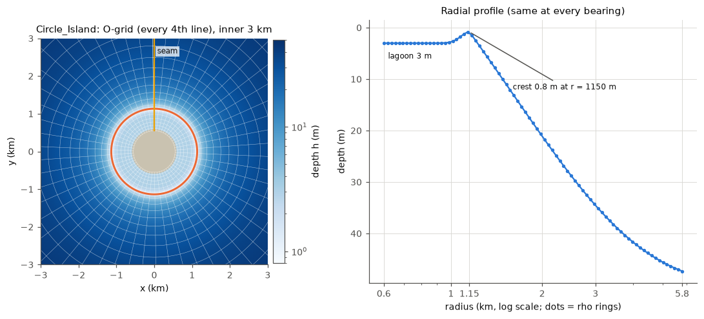

# Circle_Island: a round island with a fringing reef on a closed O-grid

Folder: [`cases/Circle_Island`](../cases/Circle_Island). Application flag
`CIRCLE_ISLAND`. Every input file is written by
[`make_case.py`](../cases/Circle_Island/make_case.py)
(`python3 -I cases/Circle_Island/make_case.py [OUTDIR]`; regenerated files are
bit-identical to the stored ones).

Made to test grids that go round an island and close on themselves (O-grids),
where both ROMS and SWAN must be periodic round the island with no gap, and as
an idealized island counterpart to the straight A15 reef.

## Geometry and grid

- **Log-polar O-grid**, 216 columns round the island (xi, clockwise, periodic:
  column 217 is column 1 again) and 80 interior rings outwards (eta); 218 x 82
  rho points with the copy columns and boundary rings. Rho column i is at the
  bearing (i - 0.5) x 1.667 degrees from north, ring j at the radius
  550 m x exp(j x 2 pi / 216), so the cells are square: 17.5 m at the shore
  (radius 600 m) to 169 m at the outer edge (radius 5.8 km). 10 levels with
  A15's vertical grid. `CURVGRID` (metric terms); Coriolis parameter 0.
- **Seam:** between column 216 and column 1, at north. `*_roll54.*` hold the
  same domain numbered from 90 degrees further on (seam at east), to check that
  results do not depend on where the seam is.
- **Bathymetry**, the same at every bearing: land inside 595 m (rings 0-2), a
  3 m deep lagoon, a reef crest 0.8 m deep at radius 1150 m (Gaussian
  backreef, 100 m wide), then a fore reef deepening exponentially (e-folding
  1.6 km) to 47 m at the outer edge.

## Physics, forcing, boundaries

- Physics as Reef_Ideal_A15 (vortex-force WEC with spectral Stokes drift, GLS
  k-epsilon, SSW bottom boundary layer with the same bed properties, T and S
  fixed at 27 C and 36), plus `CURVGRID`. `VISC2` 0, as the A15
  cases (since 2026-11-02; the tests below ran with 0.001 m²/s).
- ROMS `DT` 4 s, `NDTFAST` 10 (barotropic Courant number 0.18); `NTIMES` 900
  (1 h); output every 10 min. SWAN: 36 directions (so 6 columns = one direction
  bin), time step 60 s. Coupling every 600 s; as shipped ROMS 6 x 1 tiles + 2
  SWAN processes.
- **Boundaries:** the island side (ROMS south) is closed; the outer ring (ROMS
  north) is open with a 0.15 m, 12 h tide, the same all round (`ana_fsobc.h`),
  and carries SWAN's wave boundary. East-west in ROMS's index space is the
  periodic direction round the island.
- **Waves:** JONSWAP Hs 1 m, Tp 10 s, 30 degree spreading, from the north. The
  lines starting `$INWARD ` in `swan.in` hold the alternative: at every point of
  the outer ring the same waves aimed straight inward, so forcing and depth are
  the same all round and the solution must repeat every 6 columns.
- **Start date:** the initial file's time is 2000-01-01 ("seconds since
  2000-01-01"), and `ocean.in` has `DSTART = 730119` days, the same date counted
  from year 0. With `DSTART = 0` ROMS's 4-byte step counter overflows; a fresh
  run does not notice, but a restarted run would start its time stepping cold
  (Euler instead of AB3) and not be exact.

| Variant | Change in `ocean.in` | Change in `swan.in` |
|---|---|---|
| seam at east | `circle_grid.nc` -> `circle_grid_roll54.nc` | `swan_coord.grd`, `swan_bathy.bot` -> the `_roll54` files |
| waves from all sides | | remove the `$INWARD ` prefix from those lines and comment out the `BOUNDSPEC ... CONSTANT` line |

## Needs

`COORDINATES CARTESIAN REPEATING` on a curvilinear grid that closes on itself:
coawst-cloud's `swan-periodic-curvilinear` and `swan-closed-ring`. Without the
second, SWAN stops with "REPeating curvilinear grid: no period found".

## Known results

([notebook](../notebook/2026-10-31_circle-island-swan-closed-ring.md),
[restart](../notebook/2026-10-31_circle-island-restart-dstart.md))

| Check (1 h runs) | Result |
|---|---|
| coupler, SWAN -> ROMS | ROMS's wave height equals SWAN's Hs exactly, also in the copy columns, with 1, 2 or 3 SWAN processes |
| coupler, ROMS -> SWAN | SWAN's water level = ROMS's zeta of the previous exchange within 1.1e-4 m |
| process layouts (6x1+2, 1x6+1, 2x2+3) | identical |
| seam moved by 90 degrees | 0.3 mm zeta, 6 mm Hs, 2 cm/s radial current on the crest beside the seams; 3-6x smaller with 5 SWAN iterations per step (SWAN's sweeps start at the seam) |
| waves from all sides | Hs repeats every 10 degrees within 0.55 %, no worse at the seam |
| restart 30 + 30 min vs 60 min | 1e-11 relative, SWAN Hs bit-identical (after the DSTART setting) |

- Speed: 139 s wall per simulated hour on a c2d-standard-8 with 6 ROMS + 2 SWAN;
  with the AB3-AM4 kernel 133 s (the 2-D kernel 2.4x cheaper, SWAN sets the pace).
- AB3-AM4 vs LF-AM3 against a 4x-smaller-step reference: equally close
  (sea level 4.6e-5 m, vbar 1e-3 m/s largest differences).
- Bottom stress: capped vs implicit within 4.7 cm/s at 99.9 % of cells; the
  0.8 m crest is too deep for the cap to bind much.

## Caveats

- Only 1 h runs have been made; no long or ensemble runs yet.
- The two boundary-row points beside the seam are 2.2 cm low in Hs with waves
  from all sides (segment ends of SWAN's boundary).
- With non-uniform cell sizes (17.5-169 m), the outer cells are coarse for
  wave refraction far offshore; the reef itself is at 30-40 m resolution.
