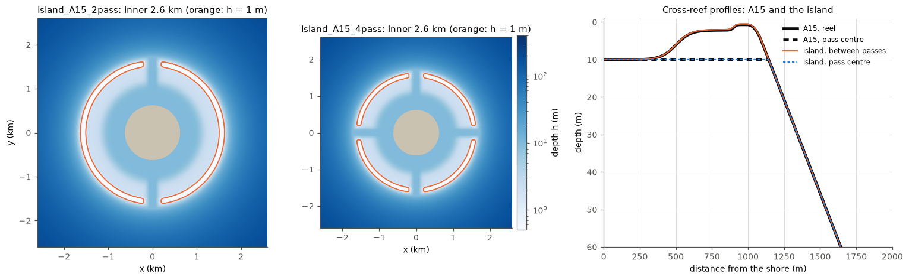

# Island_A15: the A15 reef round a round island, with 2 or 4 passes

Folders: [`cases/Island_A15_2pass`](../cases/Island_A15_2pass),
[`cases/Island_A15_4pass`](../cases/Island_A15_4pass). Application flag
`CIRCLE_ISLAND`. Every file is written by
[`tools/island/make_island_a15.py`](../tools/island/make_island_a15.py)
(`python3 -I tools/island/make_island_a15.py --passes N`, any N that divides
360); do not edit the folders by hand.

The round counterpart of [Reef_Ideal_A15](Reef_Ideal_A15.md): the same reef
and pass, closing round an island instead of repeating along a straight
coast. [Circle_Island](Circle_Island.md), made earlier to test SWAN and the
coupler on ring grids, has a simpler, different profile (3 m lagoon, 0.8 m
crest, a fore reef three times gentler, no pass).

## Geometry

- **Bathymetry: A15's own.** A point at radius r and bearing b gets A15's
  depth at distance y = r - 600 m from the shore and at alongshore distance
  x from A15's pass centre, where x is the arc length r * db to the nearest
  pass of the island (db its angular distance), capped at half of A15's
  6061 m period (where A15 is plain reef again). So the island has A15's
  10 m channel along the shore, the 2.2 m reef flat, the crest 0.5-0.7 m
  deep about 1 km from the shore, the fore reef (crest to 20 m in 270 m),
  400 m at the outer ring, and passes 360 m wide and 10 m deep with A15's
  shape. The pass keeps its width in metres at every radius.
- **Island** radius 600 m; domain radius 5.8 km (A15's 5 km offshore).
- **Passes:** 2 (north and south: windward and leeward for waves from the
  north) or 4 (north, east, south, west). Along the crest (radius about
  1.6 km, 10 km round) that is one pass per 5 km (A15: one per 6 km) or per
  2.5 km.

## Grid

Closed log-polar O-grid as Circle_Island (square cells, the grid closes on
itself, `CURVGRID`): 360 columns (1 degree each), 130 interior rows, 10
levels (A15's vertical grid). Cells 10.5 m at the shore, 28 m on the crest,
101 m at the outer ring. SWAN on the same grid, `CIRCLE 72` (5 degree bins,
5 columns each), so a pass layout that repeats every 360/N degrees lines up
with SWAN's direction bins.

## Physics and forcing

As Reef_Ideal_A15: vortex-force WEC with spectral Stokes drift, GLS
k-epsilon, SSW bottom boundary layer with A15's bed properties, T and S fixed
(27 C, 36), no canopy, `VISC2` 0. Waves Hs 1 m, Tp 10 s from the north on the
whole outer ring, ramped from 0.125 m over the first 30 min with A15's own
`wavebc_north.txt` (as `wavebc_ring.txt`); SWAN dt 120 s, `TRIAD`,
`BREAKING CON 1.0 0.73`, 72 directions x 34 frequencies (since 2026-11-03; 20
before), 30 degree spread (4 before); 0.15 m, 12 h tide on the outer ring; coupling every
600 s. ROMS DT 4 s, NDTFAST 10 (barotropic Courant number 0.51), 24 h, hourly
output.

## Running

`build.sh --case cases/Island_A15_2pass --app CIRCLE_ISLAND` (coawst-cloud),
10 ROMS processes (10 x 1 tiles round the island) + 6 SWAN on a 16-vCPU
machine. About twice A15's cells (360 x 130 against 203 x 111) and a smaller
time step: 2.4x A15's wall time per simulated hour (measured).

## Status

New (2026-11-02). First 6 h runs of both islands: stable (Courant numbers at
most 0.03 / 0.17 / 0.37), 194 s of wall time per simulated hour on a 16-vCPU
machine (about 78 min per simulated day), wave-driven inflow over the windward
reef and outflow through the passes
([notebook](../notebook/2026-11-02_island-a15-first-runs.md)).
