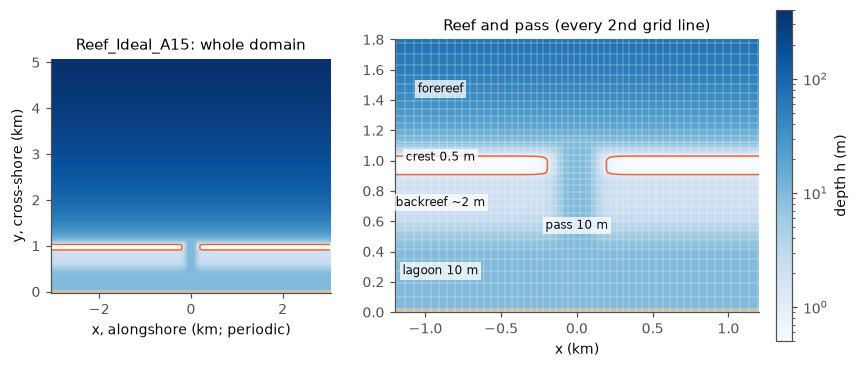
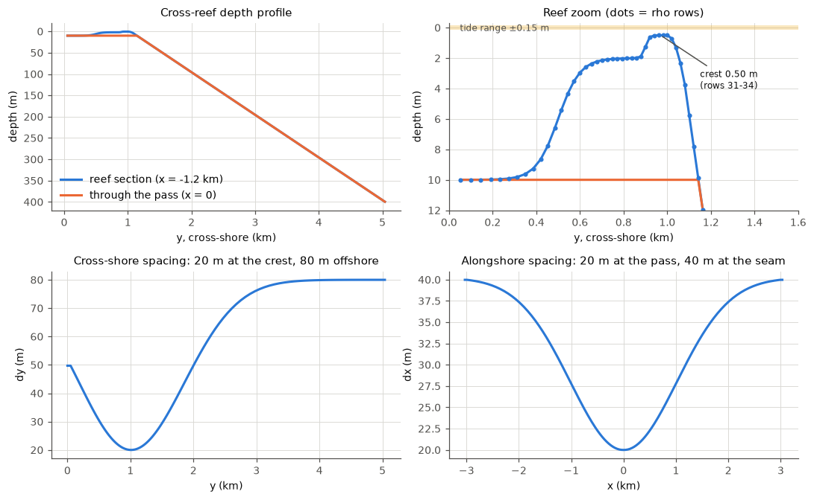

# Reef_Ideal_A15: idealized fringing reef with a pass

The base case of the family. Folder: [`cases/Reef_Ideal_A15`](../cases/Reef_Ideal_A15).
Application flag `REEF_IDEAL_A15` (all A15 variants use the same flag; the
header in each folder decides the physics).

## Geometry and bathymetry

An alongshore-uniform fringing reef, 6 km long and periodic east-west, cut by
one pass at x = 0. From the coast (south) to the open ocean (north):

| Zone | Cross-shore position (y) | Depth |
|---|---|---|
| land | southern grid row (y = 0) | masked |
| lagoon | 0 to about 0.4 km | 10 m |
| backreef (reef flat) | about 0.5 to 0.9 km | shoaling to about 2 m |
| reef crest | y = 955-995 m (rows 37-41 of the breaking-zone grid; 0.6 m or shallower from 925 to 1005 m, rows 34-42) | 0.50 m |
| forereef | from the crest seaward, slope 1:10 | 7.8 m at 1.1 km, 30 m at 1.35 km, ... |
| open ocean | to the north boundary at y = 5.04 km | 400 m |

The pass is 10 m deep (the lagoon depth) through the crest and backreef, about
380 m wide at crest level (columns 92-110, x = -180 to +180 m) and narrowing to
100 m at its bottom. Seaward of the crest it joins the forereef.

*The 20 m grid as ported; since 2026-11-03 the rows between 850 and 1150 m
from the shore are split in two (10 m), see Grid.*

The grid and initial file come from the author's COAWST v3.7 project
(`reference/Reef_Ideal_A15_v3.7/Make_grid_Reef_Ideal_A14.m`,
`Make_init_Reef_Ideal_A15.m`). The bathymetry is unchanged; the grid rows
across the breaking zone and the number of levels were changed on
2026-11-03 (below).

## Grid

- ROMS: **the breaking-zone grid**, 203 x 126 rho points (`Lm` 201, `Mm`
  124), 15 terrain-following levels (`Vtransform` 2, `Vstretching` 4,
  `THETA_S` 3, `THETA_B` 2, `TCLINE` 20 m). Until 2026-11-03: 203 x 111 and
  10 levels (in the git history). The breaking-zone grid is the 20 m grid
  with every row between 850 and 1150 m from the shore (the crest, the
  breaking zone at the top of the fore reef and the upper slope) split in
  two, made with `tools/reef/refine_a15_grid.py --band 850 1150 --factor 2`;
  the 15-level initial files with `tools/reef/set_nlevels.py`. Why: the
  breaking zone was only 2-3 cells wide at 20 m and the set-up was 16 % too
  high; 10 levels gave 5 cm layers on the crest and a set-up 7-12 % too
  high ([grid](../notebook/2026-11-03_grid-10m.md),
  [vertical](../notebook/2026-11-03_vertical-resolution.md)).
- Stretched in both directions: dx 20 m at the pass to 40 m at the periodic
  seam (x = ±3 km); dy about 50 m at the coast, 20 m on the back reef, 10 m
  from 850 to 1150 m from the shore, then 20 m growing to 80 m offshore. The
  grid is rectilinear (no `CURVGRID`); the Coriolis parameter in the grid
  file is 0 (`UV_COR` is compiled but has no effect).
- SWAN runs on the same points as ROMS (`CGRID CURVILINEAR 202 125` with A15's
  coordinate file), so no interpolation between the models.
- Analyses that pick regions by row number must map them by distance from
  the shore (the crest is on rows 37-41 now, 31-34 before).

## Physics (header `reef_ideal_a15.h`)

The defaults of 2026-11-03; the test behind each is in the
[README's defaults table](../README.md#the-a15-defaults-since-2026-11-03-and-why)
and the [results summary](../results/README.md).

| Process | Option | Notes |
|---|---|---|
| waves on currents | `WEC_VF` (vortex force), `WDISS_WAVEMOD` (breaking dissipation from SWAN), `UV_KIRBY` | spectral Stokes drift (COAWST v3.9's default, summed over SWAN's frequencies); the variant `_bulk` uses bulk Stokes drift; `UV_BANIHASHEMI` instead of `UV_KIRBY` changes nothing here (within 0.5 %) |
| surface roller | `ROLLER_RENIERS`, `WEC_ALPHA` 0.5 (since 2026-11-03) | moves the breaking force shoreward onto the crest (set-up +25 % at 0.5, linear in `WEC_ALPHA`); needs coawst-cloud `roms-roller-substeps` (stable at DT 6 s) and `roms-restart-roller` |
| wave streaming | `BOTTOM_STREAMING` (since 2026-11-03) | the wave momentum lost to bottom friction goes to the mean flow; set-up +57 %, crest transport +22 %. The canopy cases add `VEG_STREAMING` |
| breaking turbulence | `TKE_WAVEDISS` + `ZOS_HSIG` (since 2026-11-03), `SZ_ALPHA` 0.25, `ZOS_HSIG_ALPHA` 0.5 | surface TKE flux and roughness from SWAN's breaking; the fore-reef flow less surface-intensified |
| bottom stress | `SSW_BBL` with `SSW_CALC_ZNOT`, `SSW_LOGINT`, `SSW_LOGINT_WBL`; `BSTRESS_IMPLICIT` (since 2026-11-02) | wave-current bottom boundary layer; grain diameter 0.12 m in the initial file, `Zob` 0.01 m; the implicit stress equals the uncapped explicit one within 0-3 %; no `LIMIT_BSTRESS` (the cap halves the drag on a thin crest and depends on DT) |
| vertical mixing | `GLS_MIXING`, `KANTHA_CLAYSON`, `RI_SPLINES`, `N2S2_HORAVG`; `GLS_Kmin` 1e-8 (since 2026-11-03), `AKT_BAK` 5e-6, `AKV_BAK` 5e-5 m²/s | k-epsilon (`GLS_P` 3, `GLS_M` 1.5, `GLS_N` -1); the low TKE floor hands the quiet-water mixing to the background coefficients ([gls_kmin.md](gls_kmin.md)) |
| vertical operators | `SPLINES_VDIFF` (inert with MPDATA tracers); `SPLINES_VVISC` off since 2026-11-02 | the implicit bottom stress and canopy drag need the tridiagonal viscous solve |
| momentum advection | `UV_ADV` (3rd-order upstream horizontal, 4th-order centred vertical) | |
| horizontal viscosity | `UV_VIS2`, `VISC_GRID`, `MIX_S_UV`, `VISC2 = 0` | the upstream scheme supplies the lateral viscosity |
| pressure gradient | `DJ_GRADPS` | |
| tracers | `SALINITY`, `TS_FIXED` (T 18 C, S 35), MPDATA advection | the strat and thermal variants let T and S evolve; with `TS_FIXED` restarts need coawst-cloud `roms-ts-fixed-density` |
| barotropic kernel | AB3-AM4 (`STEP2D_FB_AB3_AM4`, coawst-cloud `roms-step2d-fb`) since 2026-11-02 | within the noise floor of LF-AM3 (ROMS's default) and 19 % faster; before: LF-AM3 |
| vegetation | `#undef VEGETATION` | vegetation input files are present but unused; see `_veg` |
| restarts | `PERFECT_RESTART` | |
| output | `AVERAGES`, `DIAGNOSTICS_UV` | |

Time stepping: `DT` 3 s, `NDTFAST` 12 since 2026-11-04 (barotropic Courant number
0.81; the AB3-AM4 limit is 0.890, LF-AM3's about 0.9). `NTIMES` 28800 = 24 h. All Courant
numbers must stay below 1 (the author's rule): DT 6 s, the default until then, is unsafe
once streaming and 15 levels are on.

SWAN (`swan.in`): nonstationary, 72 directions, 34 frequencies 0.04-1.0 Hz
(20 until 2026-11-03, about 3 % low), time step 120 s, one iteration per
step; `GEN3`, `FRICTION MADSEN 0.3`, `BREAKING BKD 1.0 0.54 7.59 -8.06 8.09`
(SWAN's defaults for Salmon et al. 2015; `CON 1.0 0.73` until 2026-11-03,
which gives 7-11 % less set-up and crest transport), `TRIAD` (acts only
with coawst-cloud `swan-triads-nonstationary`; without it the set-up is
32 % lower on the bare reef), `OFF QUAD`, `PROP BSBT`; `COORDINATES
CARTESIAN REPEATING` (periodic in x, like ROMS). Coupling every 600 s
through MCT (`coupling.in`), so 100 ROMS steps and 5 SWAN steps per
exchange (240 s changes nothing beyond 0.1 %; the interval must be a
multiple of both models' steps or COAWST silently keeps the old one).

## Forcing and boundaries

- **Waves:** JONSWAP (gamma 3.3), Hs ramped from 0.125 m to 1.0 m over the
  first 30 min, Tp 10 s, from the north, 30 degree directional spread (4 degrees
  until 2026-11-03, as in the v3.7 project), on the
  north boundary only (`wavebc_north.txt`, TPAR format). `wavebc_east.txt` and
  `wavebc_west.txt` are left from the non-periodic v3.7 setup and unused.
- **Tide:** zeta at the north boundary = -0.15 sin(2 pi t / 12 h)
  (`ana_fsobc.h`, `REEF_IDEAL_A15` branch). The flow settles into a repeating
  12 h cycle by about hour 12.
- **ROMS boundaries:** east-west periodic; south closed; north: Chapman (sea
  level), Shchepetkin (2-D momentum), zero gradient (3-D momentum, tracers,
  TKE). No wind, no surface heat or salt flux.
- **SWAN boundaries:** periodic in x; waves enter along the north edge
  (`BOUNDPAR2 SEGMENT IJ 0 125 201 125`).

## Outputs

ROMS writes history, averages, diagnostics and restart files hourly
(`NHIS`, `NAVG`, `NDIA`, `NRST` = 600 steps) under `output/`; history includes
the WEC stresses, Stokes drift and wave fields. SWAN writes `BLOCK 'COMPGRID'`
NetCDF fields (Hs, direction, periods, dissipation terms, radiation stress,
...) at the end of the run and a restart file hourly. On the 20 m grid with
10 levels a simulated day made about 2.85 GB (restart 1.24 GB, diagnostics
0.82 GB, history 0.51 GB, averages 0.47 GB) in classic NetCDF; the
compressed NetCDF-4 output of coawst-cloud's builds is about 3x smaller,
which more than pays for the 15 levels and the extra rows.

## Known results

- **Port from v3.7 to v3.9** ([notebook](../notebook/2026-10-20_reef-a15-port-to-v39.md)).
  ROMS is the bottleneck, not SWAN; most ROMS time is the WEC kernel
  (spectral Stokes drift recomputed every step). v3.9's spectral Stokes drift
  is a physics difference from the v3.7 runs (bulk Stokes).
- **Periodic SWAN** ([notebook](../notebook/2026-10-21_a15-coupled-periodic-test.md)).
  With non-periodic SWAN, ROMS's periodic seam received mismatched wave forcing:
  a 58 mm/s jump in the alongshore depth-mean current at the seam and up to
  0.32 m different crest Hs near the sides. With periodic SWAN the seam is
  clean (Hs jump 0.02 mm, current jump 2 mm/s, like neighbouring columns).
  SWAN's period is one 40 m column longer than ROMS's (the coupler passes ROMS
  columns 0..201); harmless here (< 0.1 mm in Hs).
- **24 h on Cloud Batch** ([notebook](../notebook/2026-10-21_a15-periodic-batch-24h.md)):
  no NaN, seam clean all day (zeta within 6e-6 m), Hs up to 1.8 m over the pass,
  pass jet 0.88 m/s, tide range -0.17 to +0.20 m.
- **Speed** ([notebook](../notebook/2026-10-21_a15-split-tiling-benchmarks.md)):
  best on c2d-standard-16 with 10 ROMS (tiles 1 x 10) + 6 SWAN processes,
  68 s wall per simulated hour (a week in about 3.2 h). C2D machines were
  25-30 % faster than C3D. 1 x N tilings give bit-identical results across
  tilings; results are bit-identical across CPU types (EPYC 7B13 vs 9B14).
- **Exact restarts** ([notebook](../notebook/2026-10-24_perfect-restart-spot.md),
  [turbulence halo](../notebook/2026-10-31_restart-residual-turbulence-halo.md)):
  with coawst-cloud's `roms-restart-wec` and `swan-exact-restart`, a run
  stopped and restarted continues as the uninterrupted one to round-off
  (base A15: 5.8e-11 m/s), which allows cheap interruptible (Spot) machines.
- **AB3-AM4 barotropic kernel** (`STEP2D_FB_AB3_AM4`, coawst-cloud
  `roms-step2d-fb`): in 1 h tests as close as LF-AM3 to a 4x-smaller-step
  reference, 2-D kernel 2.4-2.6x less CPU; wall time 4-5 % less with 6 + 2
  processes because SWAN then sets the pace
  ([notebook](../notebook/2026-10-24_ab3-am4-barotropic-kernel.md)).
- **Bottom stress** on the default and thinner crests: the uncapped explicit
  stress, the implicit stress (`BSTRESS_IMPLICIT`) and DT 3 s agree; the
  `LIMIT_BSTRESS` cap changes the answer and depends on DT. See
  [thin-crest variants](Reef_Ideal_A15_thin_crest.md).
- **The bare reef with the current defaults** (triads, 20 m grid, 4-degree
  swell; [notebook](../notebook/2026-11-02_options-triads-on.md)): lagoon
  set-up 62 mm, cross-crest transport 1396 m³/s, crest jet 0.83 m/s, pass
  jet 1.03 m/s, breaking dissipation 3044 W/m. DT 3 s, two SWAN iterations
  and the AB3-AM4 kernel are all within 1.6 % (the noise floor of the case).
  The bare reef is the stiffest member of the family: on the breaking-zone
  grid it needs DT 3 s (blow-ups at DT 6 s and DT 4 s, where the flow is 3-4x
  faster than with a canopy; [notebook](../notebook/2026-11-03_swan-limiters.md)).
- **The options test campaign** (November 2026; summary in
  [`results/`](../results/README.md), figures in the
  [README](../README.md#what-we-have-learned-about-the-physics)): SWAN's
  triads, the wave streaming, the roller, the breaking formulation, the
  spectral resolution and the 30-degree spread, the grid across the shore
  and in the vertical, the TKE floor. The numerics (DT, `NDTFAST`, SWAN's
  step and iterations, the coupling interval, tiling, `VISC2`, SWAN's
  limiters) are converged to a percent or so; the physics choices and the
  grid are what move the answer.

## Caveats

- `UV_COR` is defined but f = 0 in the grid file: no rotation.
- The original v3.7 project's numbers in some old notes (crest 0.63 m at
  600 m) came from a coarse profile; the grid's crest is 0.50 m at 940-1000 m
  ([notebook](../notebook/2026-10-23_a15-crest-depth.md)).
- SWAN's directional spreading at the boundary was 4 degrees (as in the v3.7
  project) until 2026-11-03, now 30 degrees: at 4 degrees, 72 direction bins did
  not resolve the incoming spectrum and the set-up depended strongly on the
  number of directions ([notebook](../notebook/2026-11-03_swan-spectral-resolution.md)).
- With varying alongshore spacing (20-40 m), SWAN's Hs varies by about 0.1-0.2 %
  along an alongshore-uniform crest (finer mesh, higher Hs), periodic or not
  ([Swan_Periodic_Test](Swan_Periodic_Test.md)).
- `ocean.in` sets `NtileI 4 x NtileJ 2` and `coupling.in` 8 ROMS + 4 SWAN; set
  your own layout (both files) for your machine.
- Build with coawst-cloud `4abff12` or later: the triad, roller, streaming
  and restart fixes the defaults rely on are all in by then.
- `VARNAME` in `ocean.in` points to `/opt/coawst/ROMS/External/varinfo.yaml`
  (the path inside coawst-cloud images); change it for other builds.
