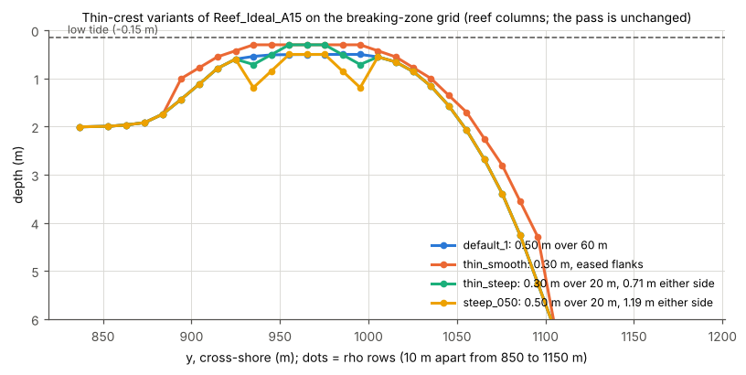

# Reef_Ideal_A15 thin-crest variants (generated)

Three variants of A15's bathymetry with a shallower or steeper reef crest, made
to test how bottom-stress schemes behave where the stress is large and the
bottom layer thin. They are generated next to the default grid in a copy of the
case:

```bash
python3 -I tools/reef/make_thin_crest.py cases/Reef_Ideal_A15 cases/Reef_Ideal_A15_thin
```

This writes `roms_grid_<name>.nc` and `swan_bathy_<name>.bot` for each variant;
point `GRDNAME` in `ocean.in` and the bottom `READINP` in `swan.in` at the pair
you want. Only the reef columns change (those whose shallowest wet point is
less than 0.6 m deep); the pass and everything else are untouched.

The variants are depth profiles against the distance from the crest centre,
in metres. The script finds the crest by depth (the centre is midway between
the two places where the reef's median profile crosses 1 m), puts each
profile point on the row nearest its offset and interpolates the rows in
between, so it works on any A15 grid. On the 20 m grid (203 x 111, the A15
grid until 2026-11-03) every profile point has its own row and the grids are
those of the tests below, bit for bit; on today's breaking-zone grid (10 m
rows across the crest) the same profiles are sampled every 10 m. The slope
factor rx0 is a per-cell number, so the "steep" variants are less steep per
cell on 10 m rows (0.26 and 0.37 instead of 0.41): the profile is the same,
the numerical difficulty is not. The tests below were run on the 20 m grid
with 10 levels and LF-AM3; their conclusions do not depend on either.



| Grid | Crest | Flanks (slope factor rx0 on the 20 m grid) | Isolates |
|---|---|---|---|
| `default_1` | 0.50 m over 60 m (the 20 m grid's rows 31-34) | 0.34 | A15 as used elsewhere |
| `thin_smooth` | 0.30 m over the same 60 m | eased over 140 m either side, <= 0.32 | depth alone |
| `thin_steep` | 0.30 m over 20 m (rows 32-33); 0.71 m 20 m either side (rows 31 and 34) | 0.41 | a narrow two-row crest |
| `steep_050` | 0.50 m over 20 m; 1.19 m 20 m either side | 0.41 | steepness alone |

On the 0.30 m crest the bottom layer is 3 cm thick at rest and about 1.5 cm
near low tide (0.15 m of water over the crest), with 10 levels.

## The bottom-stress schemes compared

ROMS (here with `SSW_BBL`) applies the bottom stress explicitly. Two
alternatives exist as build options (the implicit one is the A15 default
since 2026-11-02, on the strength of these tests):

- `LIMIT_BSTRESS`: caps the stress at 0.75 Hz_1 |u_1| / DT (coawst-cloud's
  `roms-limit-bstress` makes it its own option; COAWST ties it to `WET_DRY`).
- `BSTRESS_IMPLICIT` (coawst-cloud `roms-bstress-implicit`): the drag inside
  the tridiagonal vertical-viscosity solve, as UCLA ROMS does, with an explicit
  remainder where the bottom flow opposes the depth mean. It needs
  `-SPLINES_VVISC`.

## Known results

([notebook](../notebook/2026-11-02_a15-thin-crest-bottom-stress.md); 3 h runs
through low tide on Cloud Batch, ROMS 1x6 + 2 SWAN, all with `-SPLINES_VVISC`)

| Grid | Scheme | Fastest 3-D current (m/s) | Max vertical Courant | Crest depth-mean v (m/s) | Lagoon set-up (mm) |
|---|---|---|---|---|---|
| default_1 | cap | 1.14 | 0.54 | -0.58 | 53.5 |
| default_1 | no cap | 1.01 | 0.46 | -0.50 | 42.0 |
| default_1 | implicit | 1.00 | 0.44 | -0.50 | 41.4 |
| thin_smooth | cap | 1.48 | 1.56 | -0.98 | 32.4 |
| thin_smooth | no cap | 0.95 | 0.76 | -0.56 | 16.1 |
| thin_smooth | implicit | 0.94 | 0.75 | -0.56 | 16.0 |
| thin_steep | cap | 1.17 | 2.03 | -1.12 | 43.3 |
| thin_steep | no cap | 0.91 | 1.21 | -0.79 | 26.1 |
| thin_steep | implicit | 0.92 | 1.21 | -0.79 | 26.2 |
| steep_050 | cap | 1.11 | 0.77 | -0.56 | 51.3 |
| steep_050 | no cap | 1.06 | 0.65 | -0.53 | 46.3 |
| steep_050 | implicit | 1.05 | 0.66 | -0.52 | 45.6 |

(Crest v: `vbar` on row 32 over the reef columns, negative = into the lagoon;
set-up: mean zeta rows 5-25 minus rows 95-105.)

- **The implicit stress equals the uncapped explicit stress** to 1 % in crest
  current and 1 mm in set-up on every grid, and both are converged in DT
  (DT 6 vs 3 s: 0.3-0.5 %).
- **The cap is the outlier and depends on DT.** It binds at 51-67 % of the
  crest cells and halves the effective drag; crest flow 15 % faster on the
  0.50 m crest and 40-75 % faster on the 0.30 m crests. With Hs ramped to 2 m,
  the capped set-up drops from 179 to 151 mm when DT goes from 6 to 3 s,
  while the others stay at 140 mm.
- The uncapped explicit stress ran stably at stress stability numbers
  S = tau DT / (Hz_1 |u_1|) up to 7-11 (median 1.4-1.9): vertical viscosity
  ties the thin bottom layer to the layers above.
- None of the grids blows up through low tide with any scheme. A 2 m sea
  switched on at t = 0 (no ramp) blows up with all three schemes in the pass jet
  (a forcing shock, not the crest); with a 1 h ramp every run survives.
- The barotropic kernel does not matter here: AB3-AM4 reproduces LF-AM3.

## Purpose

These grids are test cases for numerics; they are not part of the default
case family. Member `p2-omega-diag` of the options campaign, phase 2, uses
`thin_steep`: the pass-jet blow-up with an unramped 2 m sea is horizontal
(cross-shore Courant number about 0.75 at onset), `OMEGA_IMPLICIT` does not
help, DT 3 s does
([notebook](../notebook/2026-11-02_options-p2-omega-diag.md)).
