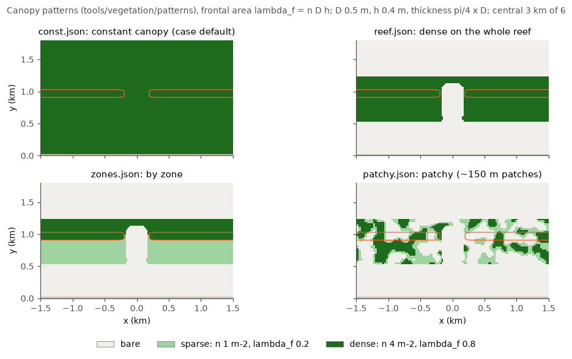
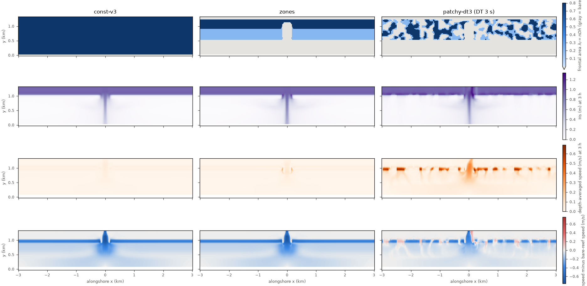

# Reef_Ideal_A15_veg: A15 with a coral canopy

Folder: [`cases/Reef_Ideal_A15_veg`](../cases/Reef_Ideal_A15_veg). Application
flag `REEF_IDEAL_A15`. Same domain, grid, waves, tide and periodic SWAN as
[Reef_Ideal_A15](Reef_Ideal_A15.md), plus canopy (form) drag from coral
represented with ROMS's vegetation model, and the matching wave dissipation in
SWAN. This is the case most other variants build on.

> **Vegetation elements are cylinders: `plant_thickness = (pi/4) x
> plant_diameter`.** ROMS takes each plant's horizontal footprint as
> diameter x thickness (a flat seagrass blade); for a cylinder that must be
> pi D² / 4. The footprint sets the gap between plants in `VEG_TURB`; with
> thickness = diameter this canopy would fill the bed (D t n = 1), the gap would
> be zero and ROMS would divide by zero (it blew up; coawst-cloud's
> `roms-vegetation` now stops with a message instead).

## What changes from A15

- **Header:** `VEGETATION`, `VEG_DRAG` (implicit, `VEG_DRAG_IMPLICIT`),
  `VEG_TURB`, `VEG_SWAN_COUPLING` and, since 2026-11-03, `VEG_STREAMING` (the
  wave momentum the canopy dissipates goes to the mean flow in the canopy
  layers; with `BOTTOM_STREAMING` the set-up nearly doubles,
  [notebook](../notebook/2026-11-03_wave-streaming.md)); `VEG_FLEX` off
  (rigid cylinders). `N2S2_HORAVG` is switched off with `VEG_TURB`. The grid,
  levels and the rest of the physics are A15's defaults of 2026-11-03.
- **Initial file** (`init_reef.nc`): the same constant canopy everywhere:
  density n = 4 m⁻², diameter D = 0.5 m, height h = 0.4 m (frontal area per
  bed area lambda_f = n D h = 0.8), thickness (pi/4) x 0.5 = 0.3927 m (bed
  coverage pi D² n / 4 = 0.785). Drag coefficient `CD_VEG` 1.0
  (`vegetation.in`). This dense canopy damps the reef flow to a few percent
  of the bare reef's; **the standard test canopy since 2026-11-03 is density
  1 m⁻²** (frontal area 0.2, closer to measured reef canopies), made with
  `tools/vegetation/patterns/sparse.json`, and most results below are for it.
- **SWAN:** `VEGETATION 3 0.4 0.5 1 1` selects COAWST's `SVEG_COAWST`, which
  takes density, height and diameter at each point from ROMS's plant fields
  through the coupler (so they may vary in space); the last value is the drag
  method, 1 = Cd 1.0, as in ROMS. `INPGRID NPLANTS` must stay in `swan.in`
  (it switches on the spatial density) although no file is read. With this
  constant canopy, `VEGETATION 3` and `VEGETATION 1 0.4 0.5 1 1.0` give the
  same result to single-precision rounding.
- The crest is 0.50 m deep, 0.35 m at low tide, so the 0.4 m canopy reaches the
  surface there around low tide: ROMS then applies the drag over the whole
  water column, and SWAN keeps Cd = 1 (coawst-cloud's `swan-vegetation-fixes`;
  stock `SVEG_COAWST` used 1.95 there).

## Physics choices and why

- **Drag** (`VEG_DRAG`): 0.5 Cd D n |U| U per unit volume within the canopy
  height. Thickness does not enter it; nor does it enter SWAN's dissipation
  (Mendez and Losada).
- **Canopy turbulence** (`VEG_TURB`, Uittenbogaard 2003, as in Beudin et al.
  2017 and Kalra et al. 2017): plant work adds TKE, and a dissipation source
  with the canopy time scale tau_veg = (L² / (c_k² P_veg))^(1/3), where
  L = c_l ((1 - D t n)/n)^(1/2) is the gap between plants. Kept as shipped in
  COAWST v3.9: only tau_veg is used, not min(k/epsilon, tau_veg) as in the
  published model and COAWST v3.2-v3.7 (author's choice, to revisit). The units
  of tau_veg are fixed in coawst-cloud's `roms-vegetation` (`tau_veg_units`:
  the plant work per unit mass, as published).
- **Drag time stepping: implicit by default since 2026-11-02**
  (`VEG_DRAG_IMPLICIT`, coawst-cloud `roms-veg-implicit`): backward Euler in
  the 3-D step and at every barotropic fast step, stable at any DT. With
  SWAN's triads acting, the explicit drag (COAWST as shipped) blew up at DT 6 s
  even on the constant canopy, at the fore-reef bed
  ([notebook](../notebook/2026-11-02_options-triads-on.md)); build with
  `CPP_OPTIONS="-VEG_DRAG_IMPLICIT"` to get it back.

## Spatial canopy patterns

[`tools/vegetation/make_veg_init.py`](../tools/vegetation/README.md) writes
plant fields into a copy of `init_reef.nc` from a small JSON pattern (plant
classes by density, diameter and height, thickness always pi/4 x D; reef zones
found from the bathymetry; classes per zone or box, or random patches that wrap
across the periodic seam). Point `ININAME` in `ocean.in` at the new file.

| Pattern | Layout |
|---|---|
| `const.json` | the case's constant dense canopy everywhere |
| `sparse.json` | the density-1 canopy everywhere (the standard test canopy) |
| `reef.json` | dense on backreef, crest and forereef; lagoon, pass and deep water bare |
| `zones.json` | dense forereef and crest, sparse backreef, bare lagoon and pass |
| `patchy.json` | 30 % dense, 30 % sparse, 40 % bare in about 150 m patches over the reef |

Classes: sparse n 1 m⁻² (lambda_f 0.2, bed cover 0.2), dense n 4 m⁻² (lambda_f
0.8, bed cover 0.79), both D 0.5 m, h 0.4 m. Zone areas in A15: lagoon 301 ha,
backreef 216 ha, crest 68 ha, forereef 123 ha, pass 23 ha.

## Known results

- **Stock COAWST crashed** on the first step with periodic boundaries (a work
  array exchanged with the wrong bounds in `vegetation_drag.F`); fixed in
  `roms-vegetation` ([notebook](../notebook/2026-10-21_vegetation-periodic-crash-fix.md)).
- **Cylinder convention** ([notebook](../notebook/2026-10-21_vegetation-cylinder-convention.md)):
  thickness 0.5 m blew up after 1 h 44 min; with 0.39 m, 3 h coupled runs are
  clean, seam sea level < 0.001 mm.
- **tau_veg units** ([notebook](../notebook/2026-10-21_veg-turb-tau-veg-units.md)):
  canopy medians TKE -3 %, epsilon +2 %, eddy viscosity -7 %; currents change by
  at most 4 mm/s.
- **tau_free** ([notebook](../notebook/2026-10-21_veg-turb-tau-free.md)):
  restoring it lowers canopy TKE by 42 % and eddy viscosity by 65 % (medians),
  currents by up to 2 cm/s.
- **Effect of the canopy** (3 h, last hour, depth-averaged speed): crest
  0.39 m/s bare, 0.02 m/s dense; crest Hs 0.28 m bare, 0.12 m dense. In the
  patchy run the flow funnels through bare gaps on the crest (0.35-0.60 m/s)
  and drops to 2-6 cm/s inside dense patches
  ([notebook](../notebook/2026-10-22_spatial-vegetation-patterns.md)).

*Columns: constant, zoned and patchy (DT 3 s) canopy after 3 h. Rows: frontal
area; Hs; depth-averaged speed; speed minus the bare-reef run.*

- **Explicit drag limits the time step.** The stability number
  2 alpha |U| DT (alpha = 0.5 Cd D n, 1 m⁻¹ for the dense class) must stay near
  or below about 1:

  | Run | DT | max 2 alpha \|U\| DT | Outcome |
  |---|---|---|---|
  | constant canopy | 6 s | 0.52 | ran |
  | zones | 6 s | 1.05 | ran (also 24 h on Batch) |
  | patchy | 6 s | about 1.0 at 30 min, growing | blew up at 42 min |
  | patchy | 3 s | 1.26 | ran |

  For DT 3 s set `DT == 3.0d0`, `NDTFAST == 12` and halve the output
  intervals in steps.
- **Implicit drag** ([notebook](../notebook/2026-10-27_implicit-vegetation-drag.md)):
  patchy at DT 6 s ran 6 h (explicit blew up at 42 min), within 1.0-1.3 cm/s
  of the explicit DT 3 s run at 99.9 % of cells, 1.65x faster.
- **AB3-AM4 kernel** with the canopy: within 4e-6 m/s of LF-AM3 for the
  constant canopy; patchy at DT 3 s 40 % faster
  ([notebook](../notebook/2026-10-24_ab3-am4-barotropic-kernel.md)).
- **Exact restarts:** 2e-10 m/s after a restart, SWAN bit-identical
  ([notebook](../notebook/2026-10-24_perfect-restart-spot.md)).
- **The canopy sets the size of the circulation** (24 h, hours 12-24, 20 m
  grid, triads on; [notebook](../notebook/2026-11-03_density1-canopy-tests.md),
  [triads on](../notebook/2026-11-02_options-triads-on.md)): lagoon set-up
  62 mm on the bare reef, 18 mm with the density-1 canopy, 3.9 mm with the
  dense one; crest transport 1396, 563 and 203 m³/s; crest jet 0.83, 0.29
  and 0.10 m/s. The patchy canopy sits in between.
- **SWAN's triads are first order on the canopy:** without them the set-up
  of the dense canopy is 82 % lower and that of the density-1 canopy 58-61 %
  lower, because the triads move energy to higher frequencies that the
  canopy and the bottom friction take less of. They act only with
  coawst-cloud `swan-triads-nonstationary`.
- **With triads the explicit drag fails on the dense canopy at DT 6 s** (the
  near-bottom flow at the top of the fore reef reaches 0.5 m/s, stability
  number 6); it is fine on the density-1 canopy (within 3 % of the implicit
  drag). The implicit drag is the default.
- **Canopy wave streaming:** the canopy takes about a quarter of the wave
  energy over this reef, bottom friction a third; `VEG_STREAMING` with
  `BOTTOM_STREAMING` raises the set-up 95 % and the crest transport 32 % on
  the density-1 canopy, stable at DT 6 s. The canopy force needed five fixes
  (coawst-cloud `roms-veg-streaming-fixes`).
- **`VEG_TURB`** raises the reef-flat and crest diffusivity by 60 % and
  changes the flow by 2-4 % on the heated reef; it is a k-epsilon source, so
  the closure stays k-epsilon
  ([notebook](../notebook/2026-11-03_turbulence-closure.md)).
- **The options test campaign** ran on this case: results in
  [`results/`](../results/README.md) and the
  [README](../README.md#what-we-have-learned-about-the-physics).

## Caveats

- Canopy parameters for real coral are open: match frontal area n D h and bed
  coverage pi D² n / 4 separately. With the streaming force the canopy
  parameters set the flow directly, not only through the wave height.
- At a patch edge ROMS averages the drag onto the face between a bare and a
  vegetated cell, so edges are half a cell wide; bare cells get no dissipation
  source (their gap is capped at 1e11 m).
- The vertical diffusivity of about 1e-3 m²/s on the 2 m backreef at rest,
  seen in the stratified case, was the GLS minimum-TKE floor, not the canopy
  turbulence (identical with `VEG_TURB` off); `GLS_Kmin` 1e-8 removes it
  ([gls_kmin.md](gls_kmin.md)).
- The canopy-edge viscosity (`VEG_HMIXING`, `VEGHMIXCOEF` in `vegetation.in`)
  does not compile in COAWST v3.9, which dropped its routine in v3.6
  ([notebook](../notebook/2026-11-03_veg-hmixing-and-banihashemi.md)).
