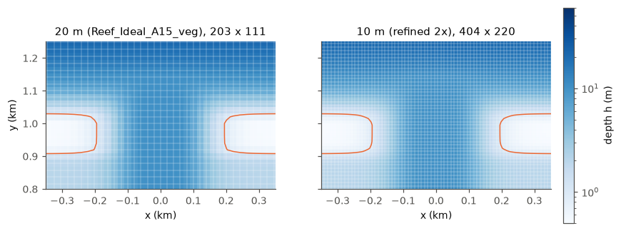

# Reef_Ideal_A15_veg_10m: the vegetated case at 10 m (generated)

The grid-convergence twin of the **20 m** [Reef_Ideal_A15_veg](Reef_Ideal_A15_veg.md)
(203 x 111, as the case was until 2026-11-03): every cell split into 2 x 2,
so 10 m cells over the reef and the pass. It is generated, not stored (the
folder is 47 MB):

```bash
python3 -I tools/reef/refine_a15_grid.py cases/Reef_Ideal_A15_veg cases/Reef_Ideal_A15_veg_10m
coawst-cloud/build/coawst/build.sh --case cases/Reef_Ideal_A15_veg_10m --app REEF_IDEAL_A15
```

The script is deterministic: a regenerated folder is bit-identical to the one
used in the options campaign (checked 2026-11-02), **when run on the 20 m
case** (git history before 2026-11-03). Run on today's breaking-zone grid it
halves that grid instead (5 m rows across the breaking zone), which has not
been tested.

**Superseded for production by the breaking-zone grid.** The same script with
`--band 850 1150 --factor 2` refines only the rows across the crest, the
breaking zone and the top of the fore reef; that grid reproduces the uniform
10 m answer (set-up and pass transport exactly, jets within 1-2 %) for 16 %
more cost instead of 8x, and is the grid of every A15 case since 2026-11-03
([notebook](../notebook/2026-11-03_grid-10m.md)). This page stays as the
record of the uniform twin.



## What the script changes

[`tools/reef/refine_a15_grid.py`](../tools/reef/refine_a15_grid.py) copies the
case folder and replaces:

| File | Change |
|---|---|
| `roms_grid_default_1.nc` | 404 x 220 rho points (`Lm` 402, `Mm` 218); x, y and h interpolated linearly in index space (the reef profile keeps its shape, crest still 0.50 m), pm and pn scaled by 2, masks by nearest cell, f, xl, el kept |
| `init_reef.nc` | rewritten at rest on the new grid with the same constant temperature, salinity, bed and plant fields (A15's initial file is uniform in every field) |
| `swan_coord_default_1.grd`, `swan_bathy_default_1.bot` | on the new grid, same layout |
| `swan.in` | `CGRID` / `INPGRID` dimensions and the boundary segments |
| `ocean.in` | `Lm`, `Mm`; `DT` 3 s (halved), `NDTFAST` 24 (kept, so the barotropic step halves to 0.125 s and the barotropic Courant number stays about 0.8; see the caveat), `NTIMES` 28800 (same 24 h); output intervals scaled to stay hourly |

The SWAN time step, the coupling interval and the wave boundary files are
unchanged. Any other factor: `--factor N`.

## Purpose and status

Member `p0-grid10` of the options test campaign, phase 0, and `s-grid10` with
triads on: does the lagoon set-up, the crest jet and the pass flow at 20 m
change when the grid is halved? About 8x the cost of the 20 m case per
simulated day (4x the cells, half the time step).

**Result** ([notebook](../notebook/2026-11-03_grid-10m.md)): the 20 m grid was
not converged. At 10 m the set-up is 15-16 % lower and the crest transport
11-18 % lower, in both regimes (dense canopy without triads; density-1 canopy
with triads). The waves lose the same energy on both grids (breaking
dissipation within 0.2 %); the difference comes from the breaking zone at the
top of the fore reef (0.7-1.6 m deep), which is only 2-3 cells wide at 20 m,
and everything shoreward follows. A caveat on refining further: the
k-epsilon closure is columnwise and hydrostatic, sound while cells are much
wider than the water is deep, which at 10 m holds on the crest and reef flat
but not in the pass or on the fore reef.

## Caveats

- **Barotropic Courant number: keep `NDTFAST`.** Halving `DT` alone
  halves the barotropic step with it, so the barotropic Courant number stays
  about 0.8 (limit about 0.9 for LF-AM3 and AB3-AM4 alike). Halving `NDTFAST` as well keeps the
  fast step at 0.25 s on cells half the size: Courant number about 1.6. The
  first phase 0 submission did exactly that (its hand-written `ocean.in`
  had `NDTFAST` 12) and blew up within a minute; the rerun keeps
  `NDTFAST` 24 ([phase 0 entry](../notebook/2026-11-02_options-campaign-phase0.md)).
- The SWAN seam period of the refined grid is the interpolated ghost-column
  distance, 20 m shorter than the original file's period (which is itself
  40 m longer than ROMS's); the seam effect is below 1e-3 m either way.
- Refinement interpolates the 20 m bathymetry; it adds resolution, not new
  topographic detail.
