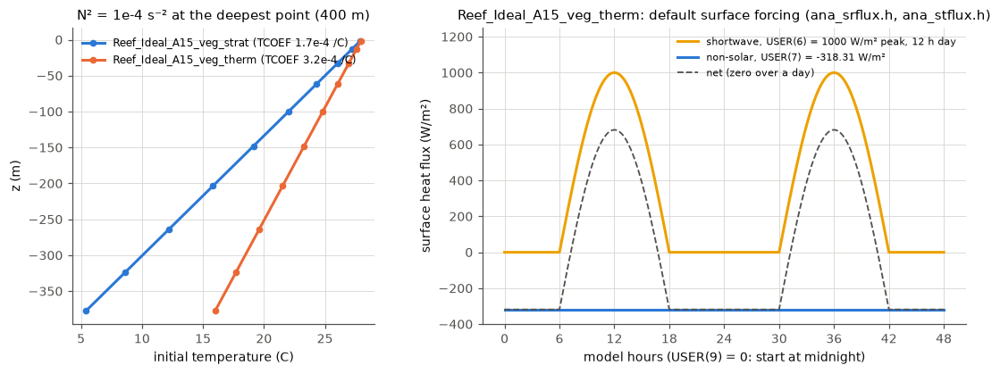

# Reef_Ideal_A15_veg_strat: A15 with a canopy and constant stratification

Folder: [`cases/Reef_Ideal_A15_veg_strat`](../cases/Reef_Ideal_A15_veg_strat).
Application flag `REEF_IDEAL_A15`. Same as
[Reef_Ideal_A15_veg](Reef_Ideal_A15_veg.md) (constant canopy, periodic ROMS and
SWAN, `VEGETATION 3`), plus:

- **Temperature and salinity evolve** (`TS_FIXED` off; A15 froze them at 18 C
  and 35). MPDATA tracer advection; no horizontal tracer diffusion outside an
  optional sponge band (`TS_DIF2`, `MIX_GEO_TS`, `TNU2` 0); vertical mixing from
  GLS. Wind, surface heat and salt fluxes are zero, so temperature changes only
  by advection, mixing and the open north boundary.
- **Constant initial stratification**: `init_reef.nc` holds N² = 1e-4 s⁻²
  (28 C at the surface to 5.4 C at 400 m, salinity 35), written by
  [`tools/stratification/make_strat_init.py`](../tools/stratification/make_strat_init.py).
  A15 uses ROMS's **linear** equation of state (`NONLIN_EOS` not defined;
  `R0` 1027, `TCOEF` 1.7e-4 /C), so constant N² is a linear temperature
  profile, N² = g (R0/rho0) Tcoef dT/dz, and temperature acts only through
  density.
- **Tide set at run time:** amplitude (m) and period (h) of the north-boundary
  tide are `USER(1)` and `USER(2)` in `ocean.in` (0.15 m, 12 h by default;
  amplitude 0 turns it off), so one build serves every tide.
- History output adds the density anomaly (`rho`).

*Left: initial temperature at the deepest point for this case and the thermal
case (same N², different TCOEF). Right: the thermal case's surface forcing.*

## North open boundary

Default (author's choice, after the 24 h tests): **nudged radiation plus an
interior nudging band; the sponge stays off.**

| Switch in `ocean.in` | What it does |
|---|---|
| `LBC(isUvel/isVvel/isTvar)` north = `RadNud`, `OBCFAC` 10 | radiation with nudging toward an exterior state (the initial stratification at rest, `ana_tobc.h`, ROMS's `ana_m3obc.h`); outflow 1 day, inflow 0.1 day |
| `Lm3CLM`, `LtracerCLM`, `LnudgeM3CLM`, `LnudgeTCLM` = T | interior nudging band: tracers toward the initial state, 3-D velocity toward rest, in a band `USER(3)` m wide with time scale `USER(4)` h at the boundary (`ana_tclima.h`, `ana_m3clima.h`, `ana_nudgcoef.h`) |
| `LuvSponge`, `LtracerSponge` = T (off) | viscous/diffusive sponge only (no reference state): `USER(5)` m²/s at the boundary (`ana_sponge.h`); the grid file's `visc_factor` is not used |

`USER = 0.15 12 1000 1 10`: tide amplitude (m), period (h), band width (m),
nudging time scale (h), sponge viscosity (m²/s). Nudging (toward a reference)
and a sponge (extra viscosity and diffusivity only) are different things.

## Known results

- **The internal-wave Courant number limits DT**
  ([notebook](../notebook/2026-10-22_constant-stratification-courant.md)).
  The baroclinic step is explicit; the first-mode speed N H / pi is largest at
  the 400 m deep north boundary, on the 20 m pass columns.
  [`tools/cfl_check.py`](../tools/cfl_check.py) prints it before a run
  (barotropic number 0.81 here).

  | N² (s⁻²) | DT 6 s | DT 3 s | Outcome (A15 waves and tide, 3 h) |
  |---|---|---|---|
  | 0 | 0 | - | clean; matches the TS_FIXED case to rounding |
  | 1e-5 | 0.12 | - | clean |
  | 1e-4 | 0.39 | 0.20 | clean |
  | 3e-4 | 0.68 | 0.34 | 6 s blew up at 34 min (also without tide and waves); 3 s clean |
  | 1e-3 | 1.24 | 0.62 | 6 s blew up at 4.5 min; 3 s ran but the deep north became garbage |
  | 3e-3 | 2.15 | 1.08 | 6 s blew up at 1.6 min |

  Keep it below about 0.4-0.5. Boundary treatments and sponges only delayed
  the blow-ups; `OMEGA_IMPLICIT` turned a crash into a wrong solution (5 m/s
  and 15 C errors) and is not recommended.
- **Over 24 h the north boundary matters**
  ([notebook](../notebook/2026-10-22_stratified-north-boundary-24h.md)). With
  A15's zero-gradient condition, errors near the boundary grow through the day
  (domain-mean drift +0.40 C, 2.1 C near the boundary), because the boundary row
  copies the next row on a sloping bed (the bottom boundary cell starts 0.45 C
  too warm) and the tide carries the error in. RadNud plus the band: 0.03 C near
  the boundary, domain drift +0.013 C. Rad plus the band is equivalent over 24 h.
- At rest with N² = 1e-4 the pressure-gradient error over A15's slopes keeps
  currents below 0.4 cm/s over 24 h.
- **Restarts:** exact to 9e-5 m/s in averages but see the caveat below
  ([notebook](../notebook/2026-10-24_perfect-restart-spot.md)).

## Caveats

- Over 400 m a constant N² above about 1.3e-4 needs temperatures outside the
  seawater range; harmless with the linear equation of state (temperature is
  only a density proxy) but such runs are numerical stress tests, not oceans.
- The nudging reference is copied from the model state at the first call of
  `ana_tobc.h` / `ana_tclima.h`; after a restart that is the restart-time
  state, so a run in restart segments nudges toward a drifting state. Giving
  the reference as files would remove this (open).
- Stratification on the shallow backreef erodes within hours even at rest
  (vertical diffusivity about 1e-3 m²/s there); cause not traced.
- The canopy drag is explicit (see the vegetation case).
