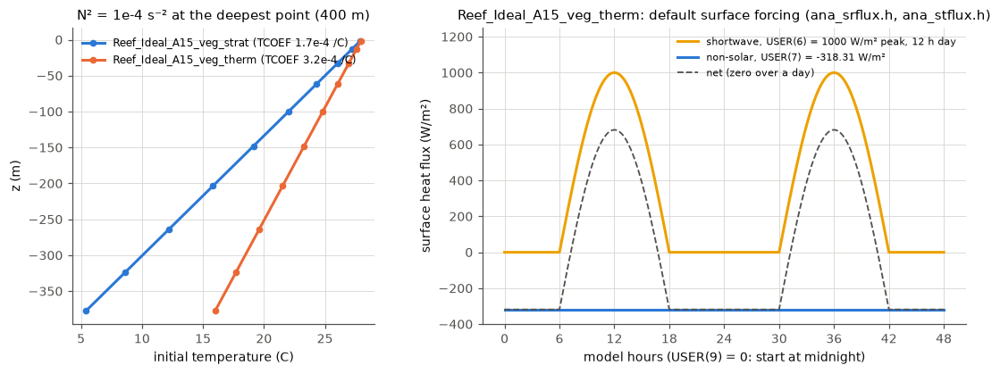
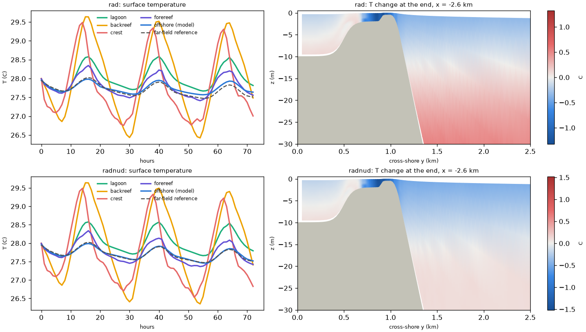

# Reef_Ideal_A15_veg_therm: A15 with a canopy, stratification and solar heating

Folder: [`cases/Reef_Ideal_A15_veg_therm`](../cases/Reef_Ideal_A15_veg_therm).
Application flag `REEF_IDEAL_A15`. Same as
[Reef_Ideal_A15_veg_strat](Reef_Ideal_A15_veg_strat.md) (constant canopy,
periodic ROMS and SWAN, temperature and salinity evolving, run-time tide), plus
surface heating.

## Surface heat flux

From the case's `ana_srflux.h` and `ana_stflux.h`, set in `ocean.in`:

- **Shortwave** entering the water: a clear-sky diurnal half sine, `USER(6)`
  W/m² at noon over a day of `USER(8)` h centred on noon; `USER(9)` is the hour
  of day at model time 0. Defaults 1000 W/m², 12 h, start at midnight.
  `SOLAR_SOURCE` spreads it over depth (Paulson and Simpson, Jerlov `WTYPE` 1,
  clear water); light reaching the bed heats the bottom cell (ROMS's default).
- **Non-solar flux** (longwave + latent + sensible): a constant `USER(7)` W/m²,
  default -318.31 W/m², which balances the shortwave over a day (net zero).
  A surface-temperature feedback or ROMS's bulk flux formulae are possible
  refinements, not in this case.
- **Thermal expansion** `TCOEF` = 3.2e-4 /C (TEOS-10 at 28 C and salinity 35;
  A15 had 1.7e-4, which would weaken heating-driven flows by about 45 %). The
  linear equation of state stays. `init_reef.nc`: N² = 1e-4 with this TCOEF
  (28 C at the surface to 16 C at 400 m).
- History output adds the net surface heat flux (`shflux`) and the shortwave
  (`swrad`).

`USER` order: tide amplitude (m), tide period (h), band width (m), nudging time
scale (h), sponge viscosity (m²/s), peak shortwave (W/m²), non-solar flux
(W/m²), day length (h), hour at time 0.



## North boundary and the far-field ocean

Default (author's choice after the 3-day test): **RadNud plus the interior
nudging band toward a far-field ocean column** (`Lm3CLM`, `LtracerCLM`,
`LnudgeM3CLM`, `LnudgeTCLM` = T, `OBCFAC` 10; 3-D velocity relaxed toward
rest). The far field comes from
[`tools/thermal/far_field.py`](../tools/thermal/far_field.py): a 1-D 400 m
water column under the same heating, light absorption and equation of state,
with a background diffusivity (5e-5 m²/s) and convective adjustment instead of
GLS (no wind, weak currents offshore). It writes `ocean_clm.nc` (temperature and
salinity for the band) and `ocean_bndry.nc` (temp_north, salt_north) into the
run folder; its heat budget closes to 1e-10.

**Every run needs these files, made for that run's `ocean.in` and initial
file** (forcing, TCOEF, USER, run length from NTIMES x DT); without them ROMS
stops at start-up:

```bash
python3 -I tools/thermal/far_field.py --ocean-in RUN/ocean.in --init RUN/init_reef.nc -o RUN
```

The alternative, `Rad` for 3-D velocity and tracers with the four nudging
switches off and `OBCFAC` 1, needs no exterior state but lets heat pile up
(below).

## Known results

- **6 h tests** ([notebook](../notebook/2026-10-23_thermal-forcing-6h.md)):
  forcing in ROMS within 3e-5 W/m² of the analytic one; heat budgets close;
  offshore water within 0.01 C of the far field. Reef response in 6 h from
  09:00: backreef surface 28.0 -> 30.2 C, crest +1.5 C then cooling as tide
  and waves flush it, lagoon +1.0 C, forereef +0.9 C.
- **3-day test** ([notebook](../notebook/2026-10-23_thermal-forcing-3day.md),
  77 s wall per simulated hour on c2d-standard-16, 10 + 6). With Rad the
  domain gains 6.7 million GJ through the north boundary in 3 days (+0.35 C);
  with RadNud plus the band the domain changes by +0.004 C and offshore water
  stays within 0.044 C of the reference. The cause is a **wave-driven
  overturning**: at the north face the Stokes drift is onshore near the surface
  and the Eulerian return flow offshore at every depth, so warm surface water
  moves toward the reef and cooler deep water out (the reef blocks the onshore
  Stokes transport). The far-field column has no waves, so the band removes the
  imported heat the way a much larger ocean would.
- Daily surface swing about 3 C on the crest and backreef (26.4-29.6 C; crest
  peak around 14:00, backreef around 16:00), about 0.9 C in the lagoon and on
  the forereef, nearly the same with either boundary.



*Top Rad, bottom RadNud + band. Left: surface temperature by region and the
far-field reference (dashed). Right: temperature change over 3 days on a
cross-shore section at x = -2.6 km.*

- **Exact restarts:** 6e-9 m/s and 2e-6 C after a restart; also with the
  AB3-AM4 kernel ([notebook](../notebook/2026-10-24_perfect-restart-spot.md)).

## Caveats

- `BOTTOM_ALBEDO` is not used: in ROMS it would send the absorbed light into
  the seabed and lose it, whereas on a reef flat most of that heat returns
  within hours. A version keeping the absorbed part in the bottom cell is
  planned, not done.
- The internal-wave Courant limit and the explicit canopy drag of the
  stratified case apply here too.

Vertical mixing in calm or weakly stratified water is set by the GLS
minimum TKE, not by `AKT_BAK`: see [gls_kmin.md](gls_kmin.md).
