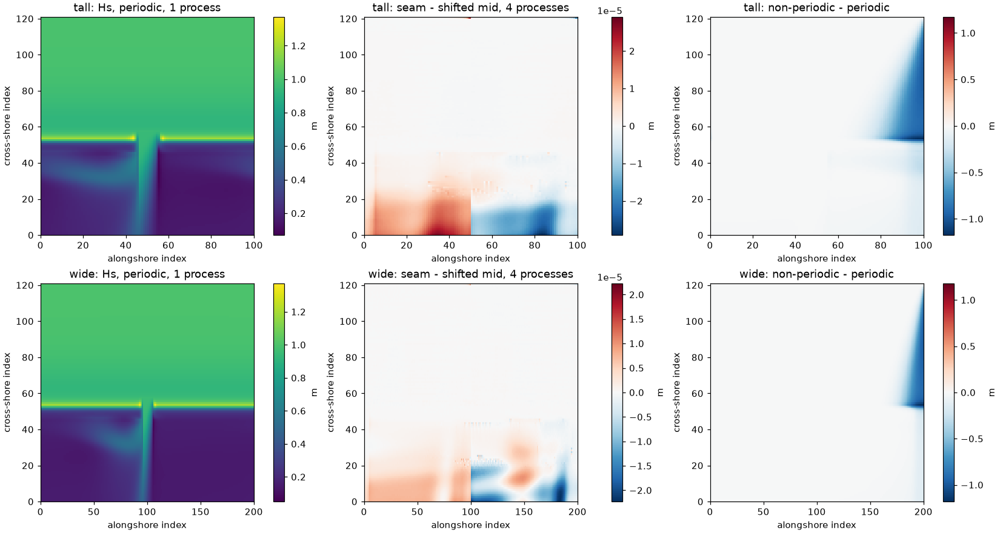
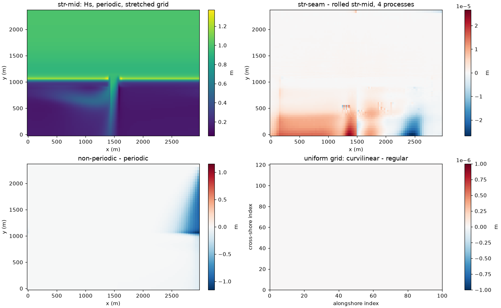

# Swan_Periodic_Test: standalone SWAN on periodic reef grids

Folder: [`cases/Swan_Periodic_Test`](../cases/Swan_Periodic_Test). Application
flag `SWAN_PERIODIC_TEST` (the header defines only `SWAN_MODEL`: SWAN alone,
no ROMS). Inputs are written by scripts; nothing large is stored.

The A15 cases run ROMS periodic in x. For the wave forcing to match at ROMS's
seam, SWAN must be periodic too, with `COORDINATES CARTESIAN REPEATING`, which
the SWAN manual calls "only for academic cases". This test checks that SWAN's
periodic option is right: in serial and in parallel, on regular grids and (with
coawst-cloud's `swan-periodic-curvilinear`) on stretched curvilinear grids
like A15's.

## Setup

A15's cross-shore profile (lagoon 10 m, crest 0.5 m at y = 960 m, forereef to
136 m at y = 2400 m) on a uniform 20 m grid, alongshore uniform except one
200 m wide, 10 m deep pass. Waves Hs 1 m, Tp 10 s from 20 degrees east of north
(oblique on purpose, so lateral boundaries matter), on the north side only;
`GEN3`, Madsen friction, breaking, triads; 1 h nonstationary, dt 60 s.

| Set | Script | Runs |
|---|---|---|
| regular grids | `make_inputs.py`, `run_tests.sh`, `compare.py` | `tall` (2 km period, 100 x 121 points, cut into y-strips) and `wide` (4 km, 200 x 121, x-strips); pass in the middle or on the seam; periodic or not; 1 and 4 SWAN processes. About 13 min on 4 cores |
| curvilinear grids | `make_curv_inputs.py`, `run_curv_tests.sh`, `compare_curv.py` | the uniform grid as REGULAR and as CURVILINEAR; a grid stretched like A15 (20-40 m alongshore, 3 km period); A15's own SWAN grid and bathymetry (read from `cases/Reef_Ideal_A15`); seam through the pass; output across the seam. About 15 min |

```bash
coawst-cloud/build/coawst/build.sh --case cases/Swan_Periodic_Test --app SWAN_PERIODIC_TEST --tag coawst:swan_periodic
python3 -I cases/Swan_Periodic_Test/make_inputs.py RUN_DIR
cases/Swan_Periodic_Test/run_tests.sh RUN_DIR          # IMAGE=... to test another image
python3 -I cases/Swan_Periodic_Test/compare.py RUN_DIR
```

With `REPEATING`, `CGRID CURVILINEAR mxc myc` has mxc points per row, and the
coordinate file has mxc + 1 columns, the last being column 1 shifted by one
period (A15's file already is).

## Known results

Regular grids ([notebook](../notebook/2026-10-21_swan-periodic-regular-grids.md)):

| Check | Stock SWAN (v3.9) | With coawst-cloud's `swan-periodic-fixes` |
|---|---|---|
| seam vs shifted mid, 1 process | 3e-5 m | same |
| 4 vs 1 process, `tall` (y-strips) | identical | identical |
| 4 vs 1 process, `wide` (x-strips) | segfault (once: Hs < 0.02 m everywhere) | identical |
| `BLOCK 'COMPGRID'` output, periodic | about half the points missing | equals output on the grid points |
| non-periodic vs periodic | up to 1.2 m Hs at the crest near the upwave side | same |



Curvilinear grids ([notebook](../notebook/2026-10-21_swan-periodic-curvilinear-grids.md)):

| Check | Result |
|---|---|
| uniform grid as CURVILINEAR vs REGULAR | identical, bit for bit |
| seam through the pass vs pass in the middle, rolled (stretched grid) | 2.7e-5 m (1 and 4 processes) |
| the same on A15's own grid and bathymetry | 1.3e-4 m, in the lagoon |
| 4 vs 1 SWAN processes | identical |
| non-periodic vs periodic | up to 1.16 / 1.17 m Hs at the crest |
| closing column not a shifted column 1 | stops with a message |



- The seam residuals are SWAN's iteration error where the sweep order meets
  the seam; a geometric seam error would show at the 0.1-1 m level.
- Varying alongshore spacing (20-40 m) makes Hs vary by about 0.2 % along a
  uniform crest (finer mesh, higher Hs), with or without periodicity; uniform
  spacing removes it.

## Caveats

- Not usable with SWAN's own `SETUP` (in coupled runs ROMS computes set-up).
- Merging `FRAME` output from several SWAN processes crashes on curvilinear
  grids (an old SWAN bug, not fixed): use `COMPGRID` output or one process.
- The run scripts use Docker and `mpirun --bind-to none` (without it,
  simultaneous runs were all pinned to one core).
