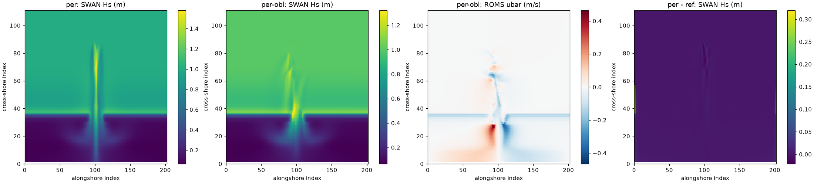

# Coupled periodic A15: ROMS and SWAN both periodic (periodic_coupled_stokes)

- **Date:** 2026-10-21
- **Status:** done; periodic SWAN is A15's default

## Question / why

With periodic curvilinear SWAN working standalone, does the coupled A15
(ROMS east-west periodic + SWAN `REPEATING` on the same grid) give a clean
seam, and does it beat A15's original non-periodic SWAN?

## What was run

`tests/a15_periodic_test.sh` on the control VM, 3 h each, checks
`tests/a15_periodic_check.py`: `per` (periodic, A15's waves), `per-obl`
(periodic, waves from 20 deg), `ref` (A15's original non-periodic SWAN).
`swan.in` changes: `COORDINATES CARTESIAN REPEATING`, north boundary
`IJ 0 110 201 110`, east/west boundaries commented out. No cloud cost.

## Results

- First try blew up after 35 min: the coupler sent the spectral Stokes
  fields (`KSS`, `USS`, `VSS`) shifted by j-1 columns in row j, so the
  deep pass's spectra landed on the 0.5 m crest (row 33 shifted by 32
  columns) and Stokes drift reached 1.4 m/s. Fixed as `periodic_coupled_stokes` in coawst-cloud's `swan-periodic-fixes`
  (Stokes drift then 0.13 m/s, as in the non-periodic run).

After the fix:

| | periodic, A15 waves | periodic, waves from 20 deg | non-periodic SWAN |
|---|---|---|---|
| finished (wall time) | yes (26 min, CPU shared with a build) | yes, 7.7 min | yes, 7.4 min |
| Hs jump across the seam (SWAN / ROMS) | 0.02 / 0.02 mm | 0.08 / 0.13 mm | - / 0.03 mm |
| ubar jump across ROMS's seam | 2.2 mm/s | 2.1 mm/s | **58 mm/s** |
| largest neighbour jump, uniform reef | 2.1 mm/s | 5.6 mm/s | 2.1 mm/s |
| ROMS Hwave = SWAN Hs | yes (< 0.1 mm) | yes | no: 0.27 m at the edges |

- With non-periodic SWAN, crest Hs near the sides differed by up to 0.32 m
  from the periodic run even at normal incidence.
- SWAN's period is one 40 m column longer than ROMS's 6021 m (the coupler
  passes ROMS columns 0..201); harmless with the seam in the uniform part
  of the reef (< 0.1 mm in Hs).

## Figures

Last output time of the 3 h coupled runs (`tests/a15_periodic_check.py`).
From left: SWAN Hs, periodic, A15's waves; SWAN Hs, periodic, waves from
20 deg; ROMS depth-averaged alongshore current `ubar` in that oblique run
(continuous across the seam at the left and right edges); periodic minus
non-periodic SWAN Hs at normal incidence, up to 0.32 m at the side edges
near the crest.

## Decision / outcome

**Periodic SWAN is A15's default (author's decision, 2026-10-21).** Image
`v3.9-26e6fb7-reef_a15-per` (alias `reef_a15`, `sha256:85dede9b...`,
all SWAN fixes up to periodic_coupled_stokes) reproduces the test runs bit for bit.

## Open questions

- The benchmark specs in `batch/ensemble/bench/` keep the old
  non-periodic `swan.in`; new A15 specs should copy the case's file.

## Details and links

- [`docs/Reef_Ideal_A15.md`, Periodic SWAN](../docs/Reef_Ideal_A15.md); figure [`figures/a15_periodic_coupled.png`](../figures/a15_periodic_coupled.png)
- coawst-cloud's patch document `swan-periodic-fixes` (`periodic_coupled_stokes`)
- Next: [24 h on Batch](2026-10-21_a15-periodic-batch-24h.md)
