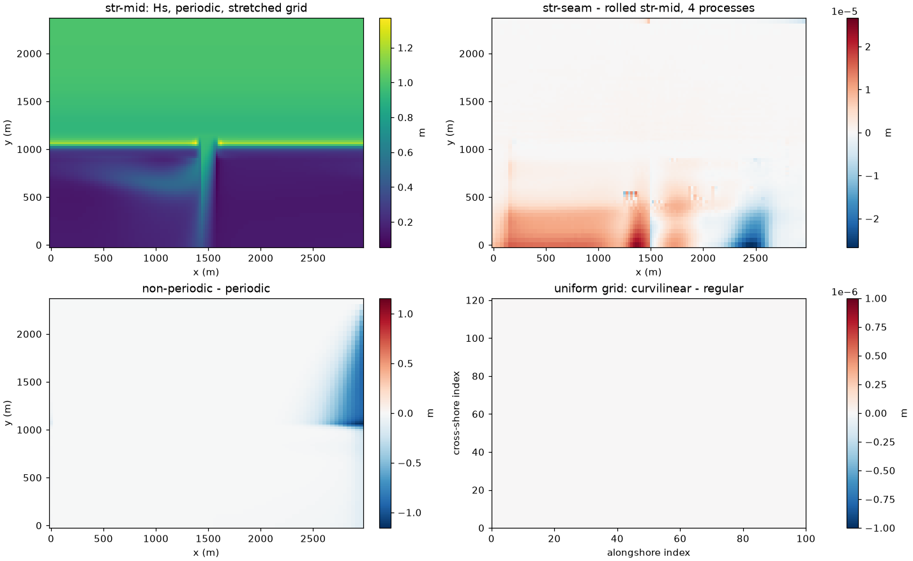

# Periodic curvilinear grids in SWAN (swan-periodic-curvilinear)

- **Date:** 2026-10-21
- **Status:** done

## Question / why

SWAN stopped with "Curvilinear grid cannot be REPeating", so periodic SWAN
on the ROMS grid would have needed a uniform ROMS grid (A15's 6 x 5 km at
20 m: 75k points, 3.3x A15's 22.5k). The author chose to keep A15's grid,
stretched in both directions, so SWAN had to learn periodic curvilinear
grids. Estimated beforehand: half a day to a day with tests.

## What was run

- coawst-cloud's `swan-periodic-curvilinear`: `READGRID COORDINATES` reads one extra column
  (column 1 shifted by one period, which A15's file already has); the
  period vector is that column minus column 1, averaged in double
  precision and checked row by row; neighbour coordinates across the seam
  are shifted by the period in the stencil geometry, `FORCE` output and
  output-location search.
- `cases/Swan_Periodic_Test` curvilinear set (`make_curv_inputs.py`,
  `run_curv_tests.sh`, `compare_curv.py`): uniform grid as REGULAR and as
  CURVILINEAR; a grid stretched like A15 (20-40 m alongshore, 3 km
  period); A15's own grid and bathymetry; seam through the pass; output
  across the seam. About 15 min on the control VM, no cloud cost.

## Results

| check | result |
|---|---|
| uniform grid as CURVILINEAR vs REGULAR | identical, bit for bit |
| seam through the pass vs pass in the middle, rolled (stretched grid) | 2.7e-5 m (1 and 4 processes) |
| the same on A15's own grid and bathymetry | 1.3e-4 m, in the lagoon |
| 4 vs 1 SWAN processes | identical |
| non-periodic vs periodic | up to 1.16 / 1.17 m Hs at the crest |
| FORCE at the seam of regular periodic grids | was 1.27 N/m2 wrong; now 4e-4 |
| old build vs new on earlier tests | identical (192 variables) except the FORCE fix |

- Found on the way (`output_obstacle_flags`, coawst-cloud's `swan-output-fixes`): output between grid points (`FRAME`,
  `POINTS`, `CURVE`, `SPECOUT`) was randomly missing (uninitialised
  obstacle flags): 4 of 9 TABLE points in one run, a different set in the
  next. Grid-point output (what A15 and the coupler use) was not affected.
- Alongshore stretching itself makes Hs vary by about 0.1-0.2 % along a
  uniform crest (finer mesh, higher Hs), periodic or not.

## Figures

Hs after 1 h (`cases/Swan_Periodic_Test/compare_curv.py`). Top left: Hs
on the grid stretched like A15 (20-40 m alongshore, 3 km period), pass in
the middle. Top right: seam through the pass minus the pass-in-the-middle
run rolled to match, 4 processes; at most 2.7e-5 m. Bottom left:
non-periodic minus periodic, crest Hs up to about 1.16 m lower towards
the upwave (right) side. Bottom right: uniform grid read as CURVILINEAR
minus REGULAR, zero everywhere (bit-identical).

## Decision / outcome

Author's decision: keep A15's grid stretched in both directions; periodic
SWAN runs on it with `swan-periodic-curvilinear` and the output fix.

## Open questions

- Not fixed: merging `FRAME` output from several SWAN processes crashes on
  curvilinear grids (old bug); use `COMPGRID` output or one process.

## Details and links

- [`docs/Swan_Periodic_Test.md`, Curvilinear periodic grids](../docs/Swan_Periodic_Test.md); figure [`swan_periodic_curv.png`](../figures/swan_periodic_curv.png); coawst-cloud's patch documents `swan-periodic-curvilinear` and `swan-output-fixes` (`output_obstacle_flags`); [docs, Decisions and answers](../docs/Reef_Ideal_A15.md); Next: [coupled periodic A15 test](2026-10-21_a15-coupled-periodic-test.md)
