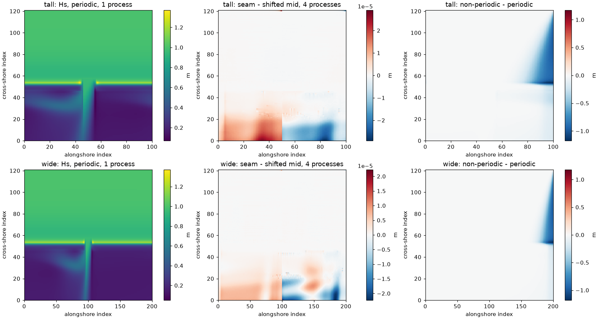

# Periodic lateral boundaries in SWAN, regular grids (swan-periodic-fixes)

- **Date:** 2026-10-21
- **Status:** done

## Question / why

ROMS is east-west periodic, and the author prefers periodic SWAN too
(decision 6 in the case pages in `docs/`); the fallback was a SWAN grid wider
than ROMS. The SWAN manual calls `COORDINATES ... REPEATING` "only for
academic cases". Does it work, in serial and in parallel?

## What was run

`cases/Swan_Periodic_Test`: standalone SWAN on a uniform 20 m grid with
A15's cross-shore profile (crest 0.5 m), alongshore uniform except one
200 m wide, 10 m deep pass; waves Hs 1 m, Tp 10 s from 20 deg east of
north (oblique on purpose); 1 h, dt 60 s. Grids `tall` (2 km period,
100 x 121, y-strips) and `wide` (4 km, 200 x 121, x-strips); pass in the
middle or on the seam; periodic or not; 1 and 4 SWAN processes. About
13 min on the control VM, no cloud cost.

## Results

| check | stock SWAN (v3.9) | with periodic_compgrid_frame and periodic_y_strips |
|---|---|---|
| seam vs shifted mid, 1 process | 3e-5 m | same |
| 4 vs 1 process, `tall` (y-strips) | identical | identical |
| 4 vs 1 process, `wide` (x-strips) | segfault in `SWRECVAC` (once: Hs < 0.02 m everywhere) | identical |
| `BLOCK 'COMPGRID'` output, periodic | about half the points missing, the rest interpolated | equals output on the grid points |
| non-periodic vs periodic | up to 1.2 m Hs at the crest near the upwave side | same |

- `periodic_compgrid_frame`: the `COMPGRID` frame was one mesh too long on periodic grids;
  the coupler evaluates the fields sent to ROMS on the same frame, so a
  coupled run would also have got misplaced fields.
- `periodic_y_strips`: SWAN's halo exchange never wraps in x, so x-strips lost the
  periodic wrap; now periodic grids are always cut into y-strips (22
  places in the code).

## Figures

Hs after 1 h (`cases/Swan_Periodic_Test/compare.py`). Top row grid
`tall` (2 km period, y-strips), bottom row `wide` (4 km, x-strips). Left:
Hs on the periodic grid, 1 SWAN process. Middle: pass on the seam minus
pass in the middle (shifted to match), 4 processes; scale 1e-5 m, so at
most 3e-5 m. Right: non-periodic minus periodic; crest Hs is up to about
1.2 m lower towards the upwave (right) side.

## Decision / outcome

Periodic SWAN works once patched; non-periodic lateral boundaries changed
crest Hs by up to 1.2 m at 20 deg incidence, so periodic is worth it.
Still limited to regular (uniform) grids at this point, which led to the
curvilinear work the same day.

## Open questions

- Not with SWAN's own `SETUP` (ROMS computes setup in coupled runs).
- Not reported upstream (not in the COAWST issue tracker).

## Details and links

- [`docs/Swan_Periodic_Test.md`, Results](../docs/Swan_Periodic_Test.md); figure [`swan_periodic_test.png`](../figures/swan_periodic_test.png)
- coawst-cloud's patch document `swan-periodic-fixes`
- [docs, Decisions and answers](../docs/Reef_Ideal_A15.md)
- Next: [curvilinear periodic grids](2026-10-21_swan-periodic-curvilinear-grids.md)
