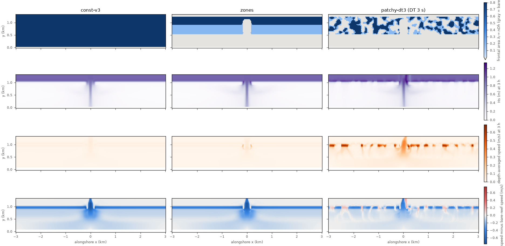
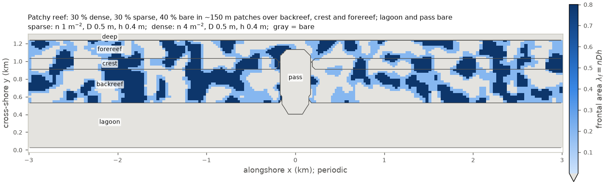

# Spatially varying coral canopy

- **Date:** 2026-10-22
- **Status:** done

## Question / why

The author's request: vary the presence/absence and the amount (little vs a
lot) of coral canopy in space, per ensemble member.

## What was run

- `tools/vegetation/make_veg_init.py`: a JSON pattern -> plant fields in
  the ROMS initial file (classes by density, diameter, height; thickness
  = pi/4 x D enforced; reef zones from the bathymetry; layers per zone or
  box; random patches periodic across the seam). Examples `const.json`,
  `zones.json` (dense forereef and crest, sparse backreef, bare lagoon and
  pass), `patchy.json` (30 % dense, 30 % sparse, 40 % bare in about 150 m
  patches). Classes: sparse 1 m-2 (lambda_f 0.2), dense 4 m-2 (lambda_f
  0.8), both D 0.5 m, h 0.4 m.
- SWAN `VEGETATION 3` (height and diameter per cell from ROMS, not only
  density) in `Reef_Ideal_A15_veg`.
- `tests/veg_spatial_tests.sh` (3 h each, control VM) and
  `tests/veg_spatial_check.py`.
- Batch `veg-spatial-24h` (spec `batch/ensemble/tests/veg-spatial-24h`,
  image `sha256:7a437bc7...`, c2d-standard-16, 10 + 6): `zones` and
  `patchy`, 24 h; about $0.55.

## Results

- `veg3_emergent_cd` (coawst-cloud's `swan-vegetation-fixes`): `VEGETATION 3` used Cd = 1.95 wherever plants reach the
  surface (the 0.4 m canopy does on A15's 0.5 m crest at low tide) and no
  dissipation where depth = plant height; now the drag method applies
  (method 1: Cd = 1, as ROMS's `CD_VEG`). `dicd_output`: `DICD` output was
  always 0 (wrong quantity index); output only.
- Constant canopy: `VEGETATION 3` = `VEGETATION 1` to single-precision
  rounding (currents 2e-6 m/s, Hs 4e-7 m); bare reef clean with zero
  vegetation dissipation; zones clean, plant fields reach SWAN exactly.
- Zones 24 h on Batch: clean, bit-identical to the local run at 1-3 h,
  1654 s wall (as without plants).
- Effect of the canopy (last hour of 3 h, depth-averaged speed): crest
  0.39 m/s bare, 0.02 m/s dense; crest Hs 0.28 m bare, 0.12 m dense. In
  the patchy run the flow funnels through bare gaps (0.35-0.60 m/s) and
  drops to 2-6 cm/s inside dense patches.
- The patchy pattern blew up at DT 6 s: see the explicit-drag entry.

## Figures

3 h coupled periodic runs (`tests/veg_spatial_check.py`). Columns:
constant canopy (`VEGETATION 3`), zoned canopy, patchy canopy at DT 3 s.
Rows: frontal area lambda_f = n D h (gray = bare); Hs at 3 h;
depth-averaged speed at 3 h; speed minus the bare-reef run. The canopy
slows the flow over the reef (blue); in the patchy run the flow is
faster than on the bare reef in some of the gaps across the crest (red).

The `patchy.json` pattern (`make_veg_init.py --png`): 30 % dense
(4 m-2, lambda_f 0.8), 30 % sparse (1 m-2, 0.2), 40 % bare in about
150 m patches over backreef, crest and forereef; lagoon and pass bare;
periodic across x = +-3 km.

## Decision / outcome

`VEGETATION 3` in the vegetation case; `make_ensemble.py` takes a
`veg_pattern` column per member. Image `reef_a15_veg`
(`v3.9-26e6fb7-reef_a15_veg-dicd`, `sha256:dd15f392...`, all SWAN fixes up to `dicd_output`).

## Open questions

- Which canopy parameters for real coral (match frontal area D h n and
  bottom coverage pi D^2 n / 4 separately).

## Details and links

- [`tools/vegetation/README.md`](../tools/vegetation/README.md); [docs, Spatially varying vegetation](../docs/Reef_Ideal_A15_veg.md); Figures: [`figures/veg_spatial_tests.png`](../figures/veg_spatial_tests.png), [`figures/veg_pattern_patchy.png`](../figures/veg_pattern_patchy.png); [`docs/Reef_Ideal_A15_veg.md`, Spatially varying vegetation](../docs/Reef_Ideal_A15_veg.md); coawst-cloud's patch document `swan-vegetation-fixes` (`veg3_emergent_cd`, `dicd_output`)
