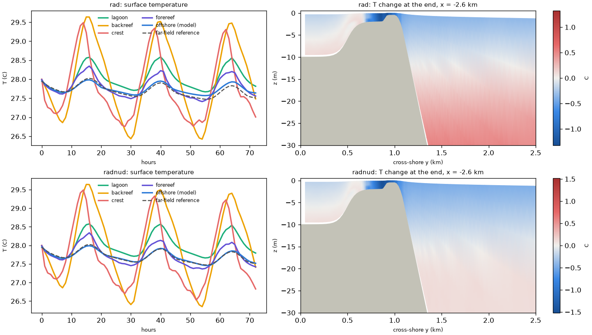

# Thermal A15, 3 days on Batch: a wave-driven overturning imports heat

- **Date:** 2026-10-23
- **Status:** decision (author): RadNud plus the nudging band toward the far field

## Question / why

Do the two north-boundary options (Rad, or RadNud plus the interior
nudging band toward the far-field column) stay apart or together over
several days of diurnal heating?

## What was run

Batch `therm-3d` (spec `batch/ensemble/tests/therm-3d`, 2 members: Rad;
RadNud + band), image `sha256:0eac0912...`, c2d-standard-16, 10 + 6;
72 h from midnight, A15's waves and tide, N^2 = 1e-4. Far-field files
made per member by the spec's `generate` step. 77 s per simulated hour.
Cost: about $2.5.

## Results

Both runs clean, forcing exact, heat budget closed (remainders 85 and
1 219 GJ against fluxes of 1-7 million GJ).

| every 12 h | 0 | 12 | 24 | 36 | 48 | 60 | 72 h |
|---|---|---|---|---|---|---|---|
| Rad: band mean \|T - reference\| (C) | 0 | 0.030 | 0.058 | 0.113 | 0.164 | 0.231 | 0.323 |
| RadNud + band: same | 0 | 0.006 | 0.009 | 0.007 | 0.009 | 0.007 | 0.009 |
| RadNud + band: cumulative nudging (10^3 GJ) | 0 | -119 | -336 | -569 | -808 | -1048 | -1289 |

- Rad: the domain gains 6.7 million GJ through the north boundary in
  3 days (+0.35 C domain mean; offshore up to 0.53 C above the reference
  at depth).
- RadNud + band: domain +0.004 C; offshore within 0.044 C of the
  reference; a steady ~5 GW enters through the boundary and the band
  removes it.
- Why: at the north face the Stokes drift is onshore near the surface
  (-4.0 mm/s at 2 m, ~0 below 60 m) and the Eulerian return flow offshore
  at every depth, so warm surface water moves toward the reef and cooler
  deep water out. Physics of the geometry (the reef blocks the onshore
  Stokes transport); the 1-D far-field column has no waves.
- Reef: daily surface swing about 3 C on crest and backreef
  (26.4-29.6 C), about 0.9 C in the lagoon and on the forereef; the same
  with either boundary (within about 0.2 C).

## Figures

`tests/therm_check.py` on the Batch output, 72 h from midnight. Top row
Rad, bottom row RadNud + nudging band. Left: surface temperature by
region and the far-field reference (dashed); with Rad the offshore model
water (blue) drifts above the reference from the second day on, with the
band it stays on it. Right: temperature change over the 3 days on the
section at x = -2.6 km; with Rad the offshore water below about 15 m
warms by up to about 0.5 C (the heat brought in by the wave-driven
overturning), with the band much less.

## Decision / outcome

> **North open boundary of the stratified and thermal cases: RadNud plus
> the interior nudging band is the default** (author, 2026-10-23) ... The
> thermal case nudges toward the Python far-field column, so every run
> needs tools/thermal/far_field.py output. (the project conventions)

## Open questions

- The image's built-in `ocean.in` predates the switch (Rad); members bring
  their own `ocean.in`, and the next rebuild picks up the new one.

## Details and links

- [docs, Thermal forcing](../docs/Reef_Ideal_A15_veg_therm.md) ("3-day test"); figure [`figures/therm_3day_test.png`](../figures/therm_3day_test.png); [`docs/Reef_Ideal_A15_veg_therm.md`](../docs/Reef_Ideal_A15_veg_therm.md); Spec: `batch/ensemble/tests/therm-3d`
