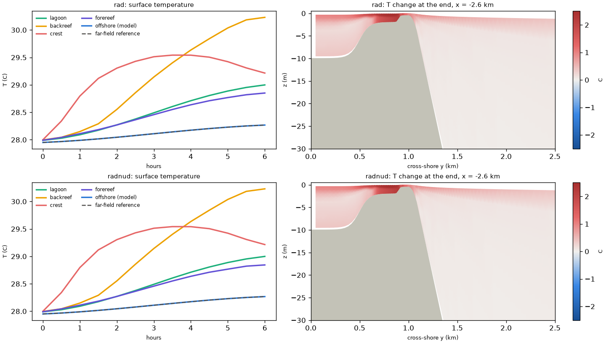
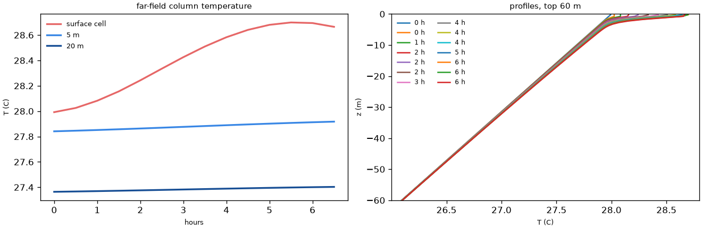

# Thermal forcing in A15: diurnal heating and a far-field ocean (6 h tests)

- **Date:** 2026-10-23
- **Status:** done

## Question / why

Next step after stratification: surface heating of the reef. The author's
choices: prescribed analytic surface heating first (bulk formulae later if
needed), thermal expansion for 28 C reef water, the north boundary nudged
toward a far field consistent with the open ocean, computed in Python
rather than with a separate ROMS run, and both boundary options
switchable.

## What was run

- `cases/Reef_Ideal_A15_veg_therm`: clear-sky diurnal shortwave (half
  sine, peak 1000 W/m2 over a 12 h day) plus a constant non-solar flux
  (-318.31 W/m2, so the day's net is zero), `SOLAR_SOURCE` (Jerlov type
  I), `TCOEF` 3.2e-4 /C (TEOS-10 at 28 C; A15 had 1.7e-4, which would
  weaken heating-driven flows by about 45 %), N^2 = 1e-4 (28 to 16 C).
- `tools/thermal/far_field.py`: a 1-D 400 m column with the same heating,
  light absorption and equation of state, background diffusivity 5e-5
  m2/s and convective adjustment; 72 h in about 2 s; its own heat budget
  closes to 1e-10. ROMS reference = initial file + the column's change.
- `tests/therm_tests.sh` / `tests/therm_check.py`: 6 h from 09:00, A15's
  waves and tide, constant canopy, Rad versus RadNud + nudging band; on the
  control VM. Image `v3.9-26e6fb7-reef_a15_veg_therm` (`sha256:0eac0912...`).

## Results

| | Rad | RadNud + nudging band |
|---|---|---|
| surface forcing in ROMS vs analytic | within 3e-5 W/m2 | same |
| heat budget (GJ): change = surface + boundary inflow + nudging | 524 034 = 370 382 + 153 774 + 0, remainder -122 | 427 746 = 370 382 + 124 607 - 66 923, remainder -320 |
| offshore water vs far-field reference | within 0.011 C | within 0.009 C |

- The band's 67 000 GJ in 6 h comes almost all from the deep levels: the
  tide heaves the stratified water and the band damps the internal tide.
- Reef response (both runs within 0.01 C): backreef surface 28.0 -> 30.2 C
  (2.4 m deep, bottom +1.4 C); crest +1.5 C, then cooling after 3.5 h as
  tide and waves flush it; lagoon +1.0 C; forereef +0.9 C.

## Figures

`tests/therm_check.py`, 6 h from 09:00. Top row Rad, bottom row RadNud +
nudging band. Left: surface temperature by region; the offshore model
water lies on the far-field reference (dashed). Right: temperature change
after 6 h on a cross-shore section at x = -2.6 km (lagoon left, crest at
about 1 km, open ocean right). The two boundary options look the same at
6 h.

The Python far-field column (`tools/thermal/far_field.py`) for the same
6 h: temperature of the surface cell, at 5 m and at 20 m (left), and
profiles of the top 60 m every 30 min (right); the heating stays in the
top few metres.

## Decision / outcome

Case built with Rad as the first default; the 3-day test decided the
boundary (next entry). `make_ensemble.py` gained a per-member `generate`
step to make the far-field files.

## Open questions

- `BOTTOM_ALBEDO` would send absorbed light into the seabed and lose it;
  planned: the albedo option plus a small patch keeping the absorbed part
  in the bottom cell (not done).
- The non-solar flux is constant here; the project conventions records ROMS
  `BULK_FLUXES` as the author's planned upgrade for thermal forcing.

## Details and links

- [docs, Thermal forcing](../docs/Reef_Ideal_A15_veg_therm.md); [`docs/Reef_Ideal_A15_veg_therm.md`](../docs/Reef_Ideal_A15_veg_therm.md); Figures: [`figures/therm_6h_test.png`](../figures/therm_6h_test.png), [`figures/therm_far_field_6h.png`](../figures/therm_far_field_6h.png)
