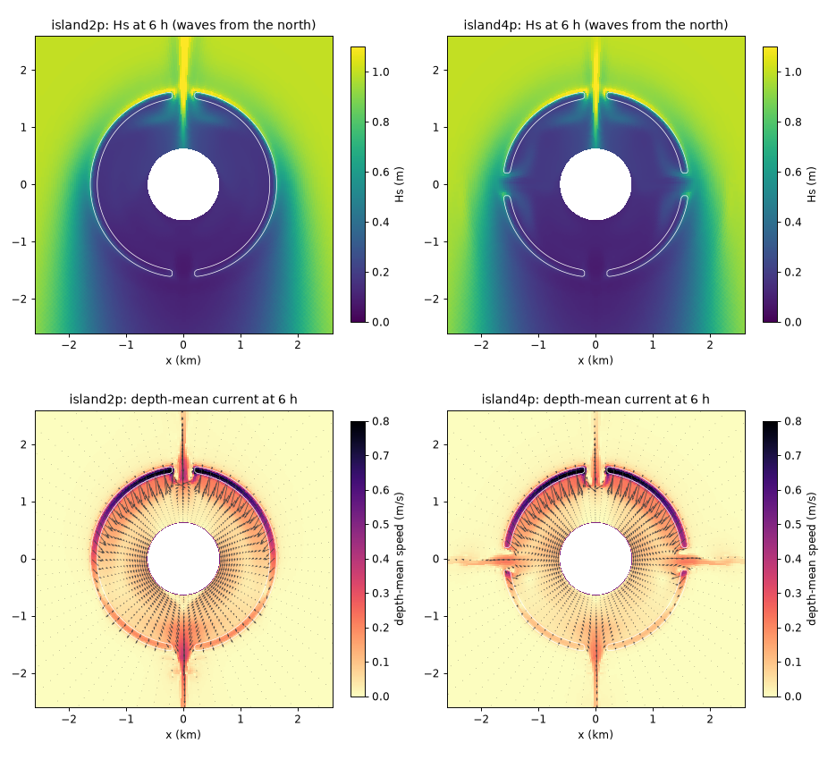

# Island_A15: first runs of the 2- and 4-pass islands (6 h)

- **Date:** 2026-11-02 (evening)
- **Status:** done: both islands run cleanly; the circulation is the expected
  island-lagoon pattern
- **Correction (2026-11-04):** "flushing time" in this entry is about 8x too long, and its relative changes don't carry over: `tests/options_compare.py` divided the lagoon volume by what is nearly only the Stokes transport. Fixed; see [default check](2026-11-04_default-check.md). Other columns are unaffected.
- **Builds:** coawst-cloud `2d5672c` (includes swan-triads-nonstationary)

## Question / why

The author asked for a round counterpart of Reef_Ideal_A15 with the same
cross-reef profile and "a few passes". [Island_A15](../docs/Island_A15.md)
wraps A15's own bathymetry (channel, reef flat, crest, fore reef, pass) round
a 600 m island, with 2 passes (north, south) or 4 (every 90 degrees). First
question: do they run, how fast, and does the flow look right?

## What was run

Island_A15_2pass and Island_A15_4pass as generated
(`tools/island/make_island_a15.py --passes 2|4`): 360 x 130 log-polar O-grid,
DT 4 s, NDTFAST 10; Hs 1 m, Tp 10 s from the north on the outer ring, ramped
over the first 30 min; 0.15 m, 12 h tide; `TRIAD` (now active), A15 physics,
no canopy. 6 h each, hourly history, 10 ROMS (10 x 1 tiles round the island)
+ 6 SWAN processes on c2d-standard-16 Spot, two restart segments (4 h + 2 h).

## Results

| | 2 passes | 4 passes |
|---|---|---|
| finished, blow-ups, NaN | yes, none, none | yes, none, none |
| largest Courant numbers Cu / Cv / Cw | 0.027 / 0.165 / 0.367 | 0.028 / 0.167 / 0.374 |
| fastest current (log) | 1.18 m/s | 1.18 m/s |
| largest depth-mean radial / along-ring current at 6 h | 0.88 / 0.29 m/s | 0.88 / 0.34 m/s |
| wall time | 1162 s for 6 h (194 s per simulated hour) | 1170 s |

About 2.4x A15's wall time per simulated hour (82 s), as expected from 1.9x
the cells and a 4 s instead of 6 s step: a simulated day is about 78 min of
wall time on one 16-vCPU Spot machine.

- **Waves:** Hs 1 m offshore breaks on the windward (northern) reef; inside
  the reef Hs is 0.1-0.3 m. Wave energy funnels through the north pass. The
  leeward side is sheltered (0.2-0.4 m offshore of the southern reef).
- **Currents:** breaking pushes water over the windward crest (depth-mean
  0.6-0.8 m/s on the crest); it spreads round the lagoon and leaves through
  the passes as jets. Depth-integrated flow across the crest ring (radius
  1568 m) at hour 6, outward positive:

  | | inflow over the reef | north pass (windward) | east | south (leeward) | west | net (falling tide) |
  |---|---|---|---|---|---|---|
  | 2 passes | -1131 m³/s | +590 | - | +704 | - | +163 |
  | 4 passes | -1180 m³/s | +261 | +287 | +432 | +287 | +87 |

  The leeward pass carries the most, but the windward pass, straight into
  the waves, still drains a large share (in the 2-pass island 84 % of the
  leeward pass's flow), most likely because breaking over the reef either side of it raises the
  lagoon level more than the waves in the pass push back. In the 4-pass
  island the side passes take 45 % of the outflow. (Single snapshot at
  hour 6, with the tide falling; tidal averages need a longer run.)

## Decision / outcome

Both cases are usable. Next: a day (or a tidal cycle with the waves
steady) for set-up, flushing and pass transports; waves from other
directions (the 4-pass island turned by 45 degrees puts no pass straight
into the waves).

## Details and links

- [docs/Island_A15.md](../docs/Island_A15.md),
  [`tools/island/make_island_a15.py`](../tools/island/make_island_a15.py)
- Cost: 2 x 0.33 h of c2d-standard-16 Spot, about $0.20 in all.
