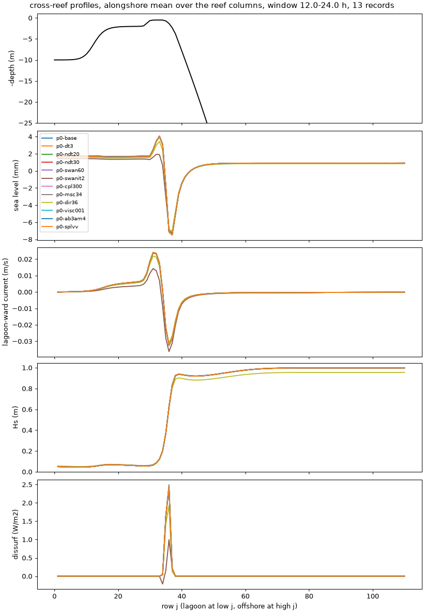
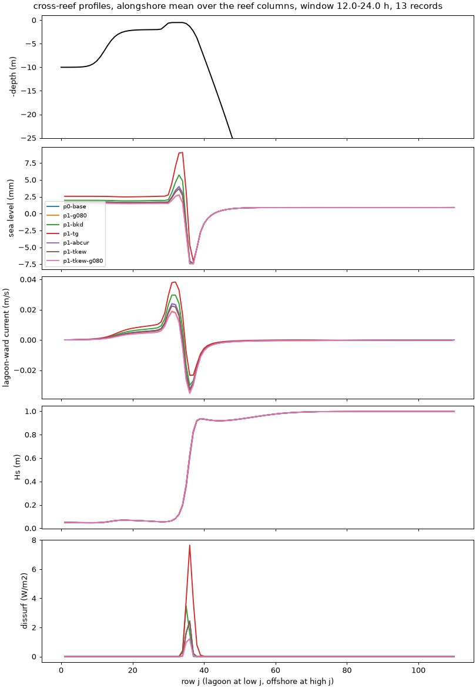

# Options campaign, phases 0-2: results (A15)

- **Date:** 2026-11-02 (evening)
- **Status:** phases 0, 1 (vegetated and stratified) and 2 analysed; the three
  72 h thermal members and the 10 m grid member still running (added when done)
- **Setup:** [phase 0](2026-11-02_options-campaign-phase0.md),
  [phases 1-2](2026-11-02_options-campaign-phases1-2.md)

## Question / why

Settle the numerics (phase 0), the reef physics (phase 1) and the bottom-stress
and canopy-drag schemes (phase 2) on A15, judging each candidate against the
baseline's own convergence noise.

## What was run

As in the setup entries: 24 h runs, metrics over hours 12-24 (the second tidal
cycle) from the hourly history, by `options_compare.py` (lagoon set-up = lagoon
rows 5-25 minus offshore rows 95-105; cross-crest transport at row 32; jets
are depth-averaged speeds over h <= 1 m and in the pass; surface/mean = surface
speed over depth-mean speed). Percentages are differences from the reference
named in each table.

## Results

### The baseline is a very damped flow

The vegetated baseline has the dense canopy (4 plants per m², 0.5 m diameter,
0.4 m tall) over the whole domain. Against the same case with a bare reef
(phase 2), it cuts the lagoon set-up from 42 mm to 0.75 mm, the cross-crest
transport from 1127 to 62 m³/s and the crest jet from 0.73 to 0.04 m/s. Every
phase 0 "noise floor" below is therefore the noise of a flow that the canopy
holds near equilibrium; it is not a test of the numerics on a 0.5-1 m/s crest
jet.

### Phase 0: numerics (reference p0-base)

| Member | set-up | crest transport | crest jet max | pass jet max | surface/mean crest | surface/mean forereef | SWAN breaking dissipation | wall s per sim h |
|---|---|---|---|---|---|---|---|---|
| p0-base (values) | 0.748 mm | 61.8 m³/s | 0.038 m/s | 0.107 m/s | 1.085 | 0.678 | 86.1 W/m | 82 |
| p0-dt3 (DT 3 s) | 0.0 % | 0.0 % | 0.0 % | 0.0 % | 0.0 % | 0.0 % | 0.0 % | 125 |
| p0-ndt20, p0-ndt30 | 0.0 % | 0.0 % | 0.0 % | 0.0 % | 0.0 % | 0.0 % | 0.0 % | 77, 87 |
| p0-swan60 (SWAN 60 s) | 0.0 % | 0.0 % | 0.0 % | 0.0 % | 0.0 % | 0.0 % | 0.0 % | 112 |
| **p0-swanit2 (2 SWAN iterations)** | **-40.7 %** | **-50.7 %** | -7.8 % | -16.2 % | -1.3 % | +53.2 % | **-73.0 %** | 113 |
| p0-cpl300 | not applied (identical to the baseline, see below) | | | | | | | 80 |
| p0-msc34 (34 frequencies) | +1.3 % | +1.1 % | +0.9 % | +0.5 % | +5.8 % | +3.6 % | +2.1 % | 100 |
| p0-dir36 (36 directions) | -11.3 % | -10.2 % | -6.1 % | -4.3 % | -13.2 % | +2.0 % | -18.8 % | 80 |
| p0-tile (2 x 5) | 1e-7 | 1e-7 | 1e-7 | 1e-7 | 1e-7 | 1e-7 | 1e-7 | 81 |
| p0-visc001 (`VISC2` 0.001) | 0.0 % | 0.0 % | 0.0 % | 0.0 % | 0.0 % | 0.0 % | 0.0 % | 79 |
| **p0-ab3am4** | 0.0 % | 0.0 % | 0.0 % | 0.0 % | 0.0 % | 0.0 % | 0.0 % | **67 (-18 %)** |
| p0-splvv (`-SPLINES_VVISC`) | -6.3 % | +1.2 % | +0.5 % | +1.7 % | **+10.9 %** | -1.6 % | -0.1 % | 81 |
| p0-splvd (`-SPLINES_VDIFF`) | bit-identical (T and S fixed in this case: nothing to diffuse) | | | | | | | 83 |
| p0-grid10 (10 m) | running | | | | | | | |

"0.0 %" means below 0.01 % (typically 1e-5 relative). All members stable;
largest Courant numbers 0.016 / 0.045 / 0.13 (Cu / Cv / Cw) at DT 6 s.

- **p0-cpl300 tested nothing.** The log shows the coupler still exchanging
  every 5 SWAN steps and 100 ROMS steps, as at 600 s: 300 s is not a multiple
  of SWAN's 120 s step, and COAWST silently keeps the old interval instead of
  stopping. A coupling-interval test needs 240 s (or 300 s with a 60 s SWAN
  step).
- **p0-swanit2** is the triad problem:
  [SWAN skips triads in the first iteration with currents](2026-11-02_swan-triads-skipped-first-iteration.md).
- The first p0-grid10 submission blew up (wrong `NDTFAST`, see the phase 0
  entry); the rerun is still going.

### Phase 1a: reef physics, vegetated case (reference p0-base; triads inactive throughout)

| Member | set-up | crest transport | crest jet max | pass jet max | surface/mean crest | surface/mean forereef | SWAN breaking dissipation |
|---|---|---|---|---|---|---|---|
| p1-g080 (`BREAKING CON 1.0 0.80`) | -23.5 % | -25.6 % | -13.9 % | -9.0 % | -12.4 % | +45.9 % | -47.8 % |
| p1-bkd (`BREAKING BKD`) | +30.7 % | +31.0 % | +53.4 % | +9.8 % | +12.4 % | +0.4 % | +26.8 % |
| p1-tg (`BREAKING TG`) | +108.5 % | +73.7 % | +62.8 % | +32.8 % | +12.4 % | -31.3 % | +283 % |
| p1-notriad | bit-identical (triads never ran) | | | | | | |
| p1-abcur (`WCAP AB ... CURRENT`) | -0.4 % | -0.4 % | -0.2 % | -0.2 % | +0.1 % | +0.2 % | -0.8 % |
| p1-tkew (`+TKE_WAVEDISS +ZOS_HSIG`) | -6.1 % | -7.6 % | -16.9 % | -2.1 % | +0.1 % | +42.2 % | +0.2 % |
| p1-tkew-g080 | -22.9 % | -27.2 % | -14.4 % | -8.5 % | -6.6 % | +58.1 % | -47.8 % |
| p1-roller (`+ROLLER_RENIERS`, `WEC_ALPHA` 0.5) | **blew up at 22.8 min**: surface cell (122, 29) on the reef flat, speed 0.3 -> 27 m/s in two steps | | | | | | |

### Phase 1b: stratified case (reference p1s-base)

| Member | set-up | crest transport | crest jet max | surface/mean crest | surface/mean forereef | breaking dissipation | reef-flat SST range |
|---|---|---|---|---|---|---|---|
| p1s-base (values) | 0.604 mm | 62.4 m³/s | 0.038 m/s | 1.172 | 0.722 | 84.3 W/m | 0.045 C |
| p1s-bkd | +33.6 % | +30.7 % | +57.2 % | +4.2 % | +11.4 % | +27.2 % | -4.3 % |
| p1s-kmin (`GLS_Kmin` 1e-8) | -1.6 % | +0.5 % | +1.9 % | +2.5 % | -2.8 % | +0.2 % | **-65.7 %** |
| p1s-tkew | -7.4 % | -7.6 % | -16.6 % | -9.8 % | +35.4 % | +0.4 % | -7.1 % |
| p1s-canuto (`CANUTO_A`) | +2.0 % | +0.2 % | +3.6 % | +0.2 % | -9.3 % | +0.2 % | +29.1 % |

**Backreef diffusivity at rest (p1s-rest against p1s-vegturb-off):** the
flow, temperature and mixing are identical with and without `VEG_TURB`.
Mid-depth diffusivity in water 0.5-3 m deep: median 7.4e-4 m²/s, maximum
1.2e-3, both runs, with the TKE at the `GLS_Kmin` floor (7.6e-6 m²/s²)
everywhere. So the unexplained 1e-3 m²/s at rest is the GLS minimum-TKE floor
in unstratified shallow water, not the canopy turbulence. Lowering the floor
to 1e-8 (p1s-kmin, forced) cuts the offshore diffusivity tenfold (4.7e-5 ->
5.1e-6 m²/s) and leaves the forced shallow mixing unchanged (1.3e-3); a rest
run with the lower floor would close the question.

### Phase 2: bottom stress and canopy drag

| Comparison | set-up | crest transport | crest jet max | pass jet max | surface/mean forereef | wall s per sim h |
|---|---|---|---|---|---|---|
| bare reef, explicit (values) | 42.3 mm | 1127 m³/s | 0.73 m/s | 0.85 m/s | 1.90 | 80 |
| bare, `BSTRESS_IMPLICIT` - explicit | +0.4 % | 0.0 % | +3.4 % | +1.1 % | -17.3 % | 83 |
| bare, `LIMIT_BSTRESS` - explicit | +14.5 % | +8.0 % | +13.1 % | +6.6 % | -9.1 % | 78 |
| patchy, explicit DT 3 s (values) | 13.2 mm | 600 m³/s | 0.70 m/s | 0.58 m/s | 1.37 | 128 |
| patchy, `VEG_DRAG_IMPLICIT` DT 6 s - explicit DT 3 s | +1.8 % | +1.9 % | +0.4 % | -2.5 % | -2.0 % | **81 (-37 %)** |
| constant canopy, `VEG_DRAG_IMPLICIT` DT 6 s - p0-base | -6.8 % | +0.9 % | -2.0 % | +1.4 % | -3.3 % | 79 |

The constant-canopy implicit run differs from the baseline exactly as
p0-splvv does (both are built `-SPLINES_VVISC`, which the implicit schemes
need): the drag scheme itself adds nothing there.

`VEG_HMIXING` (p2-hmix) and `UV_BANIHASHEMI` (p1-bani) do not compile in
COAWST v3.9. The `OMEGA_IMPLICIT` diagnostic has
[its own entry](2026-11-02_options-p2-omega-diag.md).

## Decision / outcome

Proposed to the author (nothing in the case folders changed yet):

1. **Triads first.** Phase 0's largest effect and the phase 1 breaking
   results are both shaped by triads that never ran. Fix that (patch or more
   iterations), then rerun the baseline, p0-swanit2, p0-msc34, p1-notriad and
   the breaking trio.
2. **A second noise floor on a flow that moves.** Repeat p0-base, p0-dt3 and
   p0-ab3am4 on the patchy canopy or the bare reef (jets 0.6-0.85 m/s), so
   that "within the noise" means something for the crest jet.
3. **AB3-AM4:** identical to LF-AM3 here and 18 % faster: adopt for A15 once
   it is confirmed on the moving flow of point 2.
4. **Breaking is an ensemble axis:** the three formulations spread the set-up
   from -24 % to +108 % and the crest transport from -26 % to +74 %, far
   beyond the 10 % rule (to be rechecked with triads).
5. **Implicit canopy drag:** within 2.5 % of explicit DT 3 s on the patchy
   canopy and 37 % faster: adopt for canopy members.
6. **Bottom stress:** implicit equals explicit (0-3 %, forereef shear aside);
   the cap changes the set-up by 15 %: keep explicit uncapped as the default,
   implicit where a crest-jet study needs it, never the cap without a DT check.
7. **Directional resolution:** 36 directions instead of 72 move the set-up
   and crest transport by about 10 % and breaking dissipation by 19 %.
   Relevant to any case run with `CIRCLE 36`.
8. **`TKE_WAVEDISS + ZOS_HSIG`:** stable; the set-up changes 6-7 % and the
   forereef shear rises 35-42 % (the opposite of what was expected). Not
   adopted; recheck with triads.
9. No effect: NDTFAST 20 / 30, SWAN step 60 s, tiling, `VISC2` 0.001,
   `WCAP AB CURRENT`. Small: 34 frequencies (1-6 %), Canuto (SST range +29 %),
   `GLS_Kmin` 1e-8 (SST range -66 %).

## Open questions

- p0-cpl300 to be rerun at 240 s.
- The roller blow-up on the reef flat: a result, not retuned.
- Thermal members (base, `TKE_WAVEDISS`, `NONLIN_EOS` and its rest check) and
  the 10 m grid: to be added.

## Details and links

- Comparison tables as CSV and the cost are kept with the run output.
- [SWAN triads entry](2026-11-02_swan-triads-skipped-first-iteration.md),
  [OMEGA_IMPLICIT diagnostic](2026-11-02_options-p2-omega-diag.md)
