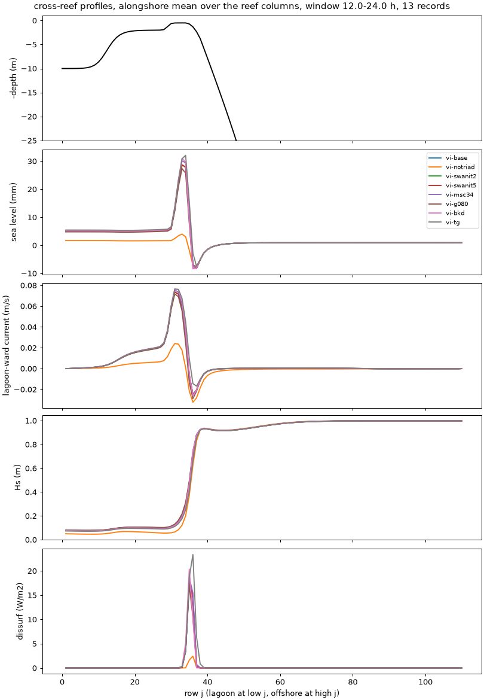

# Options campaign with triads on: noise floor, iterations, breaking (A15)

- **Date:** 2026-11-02 (late evening)
- **Status:** done (the 10 m grid member is still running)
- **Correction (2026-11-04):** "flushing time" in this entry is about 8x too long, and its relative changes don't carry over: `tests/options_compare.py` divided the lagoon volume by what is nearly only the Stokes transport. Fixed; see [default check](2026-11-04_default-check.md). Other columns are unaffected.
- **Builds:** coawst-cloud `2d5672c`, which adds
  [swan-triads-nonstationary](2026-11-02_swan-triads-skipped-first-iteration.md)
  (SWAN now computes `TRIAD` in coupled runs)

## Question / why

The [phase 0-2 results](2026-11-02_options-campaign-results-p0-p2.md) were
all made with triads silently off. With the SWAN fix, rerun what triads
change: the baseline, the SWAN iteration and frequency members, the three
breaking formulations; and measure a noise floor on a flow that moves (the
bare reef), since the constant-canopy flow is damped 95 %.

## What was run

24 h each, metrics over hours 12-24, c2d-standard-16 Spot, 10 + 6 processes.

- **Bare reef** (`options-p0tri-bare`, `-ab3am4`): baseline, DT 3 s, two SWAN
  iterations, the AB3-AM4 barotropic kernel.
- **Constant canopy, explicit drag** (`options-p1tri-a`, `-b`): baseline, no
  `TRIAD`, 2 and 5 iterations, 34 frequencies, gamma 0.80, `BKD`, `TG`.
- **Constant canopy, implicit drag** (`options-p1trivi-a`, `-b`): the same
  eight members built `+VEG_DRAG_IMPLICIT -SPLINES_VVISC`.

## Results

### Canopy runs with explicit drag blow up once triads act

Six of the eight explicit-drag canopy runs went to NaN 1.1-1.5 h in, all at
the bed of the fore reef just seaward of the crest (row 35, columns 60, 140,
143): the bottom-cell speed rose 0.5 -> 1.6 -> 12-21 m/s in three steps.
With triads the near-bed flow there reaches 0.5 m/s, and the explicit canopy
drag's stability number 2 alpha |U| DT = 2 x 1 m^-1 x 0.5 m/s x 6 s = 6 is far
above 1 (the limit already known from the patchy canopy). Only the runs with
no triads and with `TG` survived. A blow-up is a result; the same members were
rerun with the implicit canopy drag, which phase 2 found within 2.5 % of the
explicit drag at DT 3 s.

### Bare reef: the noise floor on a moving flow (reference tb-base, triads on)

| Member | set-up | crest transport | crest jet max | pass jet max | surface/mean forereef | breaking dissipation | wall s per sim h |
|---|---|---|---|---|---|---|---|
| tb-base (values) | 62.0 mm | 1396 m³/s | 0.83 m/s | 1.03 m/s | 1.36 | 3044 W/m | 81 |
| tb-dt3 (DT 3 s) | -0.2 % | -0.1 % | -1.6 % | 0.0 % | +3.4 % | -0.6 % | 126 |
| tb-ab3am4 | 0.0 % | 0.0 % | -0.8 % | -0.1 % | +0.9 % | -0.2 % | **66 (-19 %)** |
| tb-swanit2 | -0.2 % | -0.2 % | -2.0 % | -0.5 % | +4.0 % | -0.5 % | 116 |
| no triads (p2-bare-exp, unpatched) | -31.7 % | -19.3 % | -11.8 % | -17.4 % | +39.4 % | -28.5 % | 80 |

### Constant canopy, implicit drag (reference vi-base, triads on)

| Member | set-up | crest transport | crest jet max | Hs crest | surface/mean forereef | breaking dissipation | flushing time |
|---|---|---|---|---|---|---|---|
| vi-base (values) | 3.90 mm | 203 m³/s | 0.10 m/s | 0.156 m | 1.20 | 729 W/m | 79 h |
| **vi-notriad** | **-82 %** | **-69 %** | **-64 %** | **-46 %** | -45 % | **-88 %** | +96 % |
| vi-swanit2 | -0.2 % | 0.0 % | -0.1 % | 0.0 % | -0.2 % | 0.0 % | 0.0 % |
| vi-swanit5 | -0.2 % | 0.0 % | -0.2 % | 0.0 % | -0.2 % | 0.0 % | 0.0 % |
| vi-msc34 | +5.1 % | +2.9 % | +3.2 % | +0.8 % | +3.9 % | +5.5 % | -1.7 % |
| vi-g080 | -4.4 % | -4.9 % | -7.2 % | +4.1 % | -35 % | -14.5 % | -6.2 % |
| vi-bkd | +5.7 % | +7.8 % | +9.0 % | -6.2 % | -28 % | -1.7 % | +11.0 % |
| vi-tg | +12.2 % | +9.2 % | +9.4 % | -13.6 % | +145 % | +45 % | +22 % |

All stable (largest Courant numbers over the eight runs 0.032 / 0.089 / 0.19).

## What it means

- **Triads are a first-order term for this reef.** On the canopy case they
  multiply the lagoon set-up by 5.6 and the crest transport by 3.3; on the
  bare reef they raise the set-up 46 % and the crest transport 24 %. The
  likely mechanism on the canopy: triads move energy to higher frequencies,
  whose orbital motion reaches the bed less, so less is lost in the canopy
  and Hs on the crest is 86 % higher (0.156 against 0.084 m), with more
  breaking there.
- **One SWAN iteration per step is converged with the fix:** 1, 2 and 5
  iterations agree within 0.6 % (canopy) and 2 % (bare reef). The unpatched
  two-iteration run (triads in the second iteration only) went the opposite
  way (breaking dissipation -73 %): an inconsistent mix, not a converged
  answer.
- **The noise floor on a moving flow is small:** DT 3 s moves nothing by more
  than 1.6 % (3.4 % for the forereef shear ratio).
- **AB3-AM4 passes the adoption rule:** within that noise, 19 % faster.
- **Breaking is a smaller question with triads:** gamma 0.80, CON 0.73 and
  BKD span -4 % to +6 % in set-up and -5 % to +8 % in crest transport; TG is
  the outlier (+12 % set-up, forereef shear +145 %, breaking dissipation
  +45 %).
- **34 frequencies instead of 20:** 3-5 %, now with triads acting.

## Decision / outcome

Proposed to the author:
1. All runs from images with coawst-cloud `2d5672c` or later (triads on).
2. The implicit canopy drag (`VEG_DRAG_IMPLICIT`) for every canopy case: with
   triads acting, the explicit drag fails at DT 6 s even on the constant
   canopy.
3. AB3-AM4 for A15 (within the noise floor, 19 % faster).
4. Breaking: CON 0.73 stays the baseline; BKD and gamma 0.80 are within
   about 8 %; TG as the ensemble's outlier member if breaking is an axis.
5. 20 frequencies and one iteration per step stay.

## Details and links

- Cost: roughly $1.50 for these three rounds (estimate; Spot c2d-standard-16, the explicit-drag runs stopped within 2 h).
- [Phase 0-2 results without triads](2026-11-02_options-campaign-results-p0-p2.md),
  [SWAN triad fix](2026-11-02_swan-triads-skipped-first-iteration.md)
