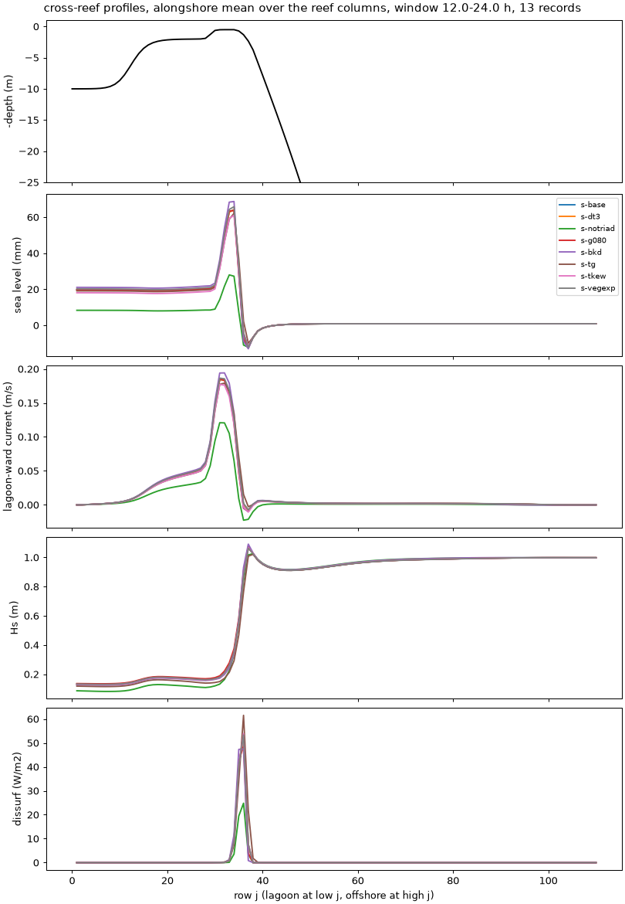

# A realistic canopy for the tests: density 1 per m², triads on, new defaults

- **Date:** 2026-11-03
- **Status:** done
- **Correction (2026-11-04):** "flushing time" in this entry is about 8x too long, and its relative changes don't carry over: `tests/options_compare.py` divided the lagoon volume by what is nearly only the Stokes transport. Fixed; see [default check](2026-11-04_default-check.md). Other columns are unaffected.
- **Builds:** coawst-cloud `f62dff3`, case defaults of 2026-11-02
  (`v3.9-ccf62dff3-reef_a15_veg-def1102`, `-tkew`, `-vegexp`)

## Question / why

The dense canopy of the vegetated case (4 plants per m², 0.5 m diameter, 0.4 m
tall: frontal area 0.8, 79 % of the bed covered) holds the reef flow at about
6 % of the bare reef's, so most canopy comparisons so far were made on a
nearly stagnant lagoon. The author suggested a sparser canopy for the tests.
Density 1 per m² (frontal area 0.2, 20 % of the bed; the sparse class of the
patchy pattern) is closer to measured reef canopies (about 0.1-0.3).

## What was run

Reef_Ideal_A15_veg with a uniform density-1 canopy (pattern `sparse.json`),
the defaults of 2026-11-02 (AB3-AM4, implicit bottom stress, implicit canopy
drag, `SPLINES_VVISC` off), triads acting; 24 h, metrics over hours 12-24,
c2d-standard-16 Spot, 10 + 6 processes. Members: baseline, DT 3 s, no
`TRIAD`, `BREAKING CON 1.0 0.80`, `BKD`, `TG`, `+TKE_WAVEDISS +ZOS_HSIG`,
explicit canopy drag (`-VEG_DRAG_IMPLICIT`) at DT 6 s.

## Results

| Member | set-up | crest transport | crest jet p99 / max | pass jet max | surface/mean crest | surface/mean forereef | Hs crest | breaking dissipation | flushing time |
|---|---|---|---|---|---|---|---|---|---|
| s-base (values) | 18.2 mm | 563 m³/s | 0.21 / 0.29 m/s | 0.46 m/s | 1.18 | 2.61 | 0.21 m | 2227 W/m | 49 h |
| s-dt3 (DT 3 s) | -0.1 % | 0.0 % | -0.1 / 0.0 % | 0.0 % | 0.0 % | +1.5 % | 0.0 % | 0.0 % | 0.0 % |
| **s-notriad** | **-61 %** | **-39 %** | **-37 / -34 %** | -34 % | -3.1 % | -2.9 % | -21 % | -54 % | +34 % |
| s-g080 | +0.5 % | -0.6 % | -0.1 / -0.4 % | -0.5 % | +0.7 % | +6.4 % | +6.3 % | -5.7 % | -9.5 % |
| s-bkd | +7.7 % | +7.4 % | +6.4 / +11.3 % | +2.7 % | +0.2 % | -11 % | -5.1 % | -2.8 % | +11 % |
| s-tg | -2.9 % | -1.9 % | -4.1 / +0.8 % | -0.3 % | -1.4 % | +62 % | -18 % | +15 % | +33 % |
| **s-tkew** | -8.6 % | -4.8 % | -10 / **-17 %** | -5.4 % | -4.5 % | **-32 %** | -0.8 % | +0.6 % | +2.3 % |
| s-vegexp (explicit drag, DT 6 s) | +2.9 % | +1.4 % | 0.0 / 0.0 % | +1.0 % | -0.1 % | +1.6 % | +0.3 % | -0.3 % | -0.5 % |

All stable (largest Courant numbers 0.07 / 0.17 / 0.24); 64-69 s of wall time
per simulated hour (115 at DT 3 s).

## What it means

- **The density-1 canopy is a good test standard:** the flow sits between
  the dense canopy and the bare reef (set-up 18 mm against 3.6 and 63 mm;
  crest jet 0.29 against 0.10 and 0.83 m/s), and the time step is converged
  (DT 3 s within 0.1 %, forereef shear 1.5 %).
- **Triads are first-order here too:** without them the set-up drops 61 %,
  the crest transport 39 % and the jets about 35 %.
- **`TKE_WAVEDISS` now does what it should.** With triads, the surface TKE
  from breaking makes the fore-reef flow less surface-intensified
  (surface/mean speed -32 %) and slows the crest jet (-17 %); with triads off
  (phase 1) the same option had increased the fore-reef shear by 23-42 %. The
  earlier "wrong direction" was a consequence of the missing triads.
- **Breaking:** gamma 0.80 is within 1 % of 0.73 on every flow metric; `BKD`
  raises the set-up and crest transport by 7-8 % and the crest jet by 11 %;
  `TG` leaves the flow within 3 % but changes the fore-reef shear (+62 %), Hs
  on the crest (-18 %) and the flushing time (+33 %).
- **The explicit canopy drag survives at this density** (within 3 % of the
  implicit drag at DT 6 s): its instability needs the dense canopy and the
  near-bed speeds triads bring there. The implicit drag stays the default.

## Decision / outcome

Proposed: the density-1 canopy as the standard for further A15 tests;
`TKE_WAVEDISS + ZOS_HSIG` for adoption (stable, physically complete, changes
the vertical structure in the expected direction); breaking: CON 0.73 as
baseline, BKD as the alternative member if breaking becomes an ensemble axis.

## Details and links

- [Results summary](../results/README.md), [triads-on entry](2026-11-02_options-triads-on.md)
- Cost: 8 runs x ~0.45 h (DT 3 s ~0.8 h) of c2d-standard-16 Spot, about $1.
