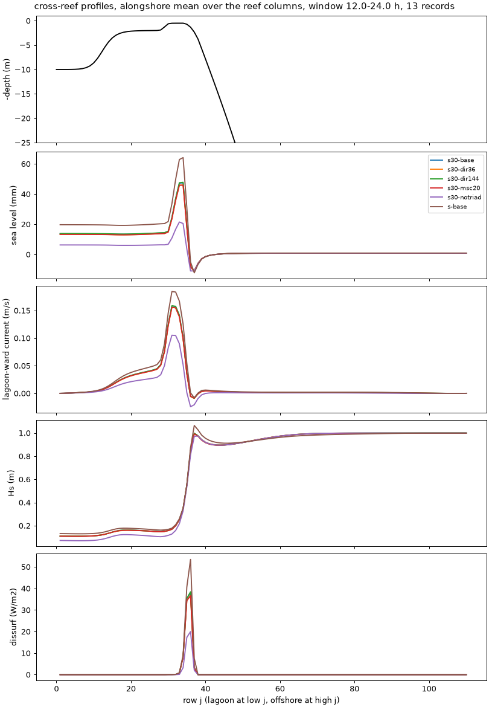

# The 30-degree spread: new baseline, and SWAN's directions are now converged

- **Date:** 2026-11-03
- **Status:** done
- **Correction (2026-11-04):** "flushing time" in this entry is about 8x too long, and its relative changes don't carry over: `tests/options_compare.py` divided the lagoon volume by what is nearly only the Stokes transport. Fixed; see [default check](2026-11-04_default-check.md). Other columns are unaffected.
- **Builds:** coawst-cloud `d0db509`, case defaults of 2026-11-03
  (`v3.9-ccd0db509-reef_a15_veg-def1103`: `TKE_WAVEDISS + ZOS_HSIG`, 30-degree
  spread, 34 frequencies, with the defaults of 2026-11-02)

## Question / why

With the old 4-degree swell, SWAN's answer depended strongly on the number of
directions (36: -16 % set-up; 144: +5 %;
[resolution entry](2026-11-03_swan-spectral-resolution.md)). The author adopted
a 30-degree spread, `TKE_WAVEDISS` and 34 frequencies. What is the new
baseline, is 72 directions now converged, and do triads still matter?

## What was run

Density-1 canopy, triads on, 24 h, the new defaults: baseline (72 x 34), 36
and 144 directions, 20 frequencies, no `TRIAD`. Also compared: the density-1
baseline of the morning (4-degree spread, 20 frequencies, no `TKE_WAVEDISS`).

## Results

| Member | set-up | crest transport | crest jet max | pass jet max | surface/mean forereef | Hs reef flat | breaking dissipation | flushing time | wall s per sim h |
|---|---|---|---|---|---|---|---|---|---|
| s30-base (values) | 12.5 mm | 465 m³/s | 0.24 m/s | 0.38 m/s | 1.82 | 0.19 m | 1709 W/m | 56 h | 109 |
| 36 directions | -3.1 % | -1.6 % | -1.2 % | -1.5 % | -0.6 % | -0.3 % | -2.5 % | +1.0 % | 82 |
| 144 directions | +0.9 % | +0.4 % | +0.4 % | +0.4 % | -0.2 % | +0.1 % | +0.7 % | -0.4 % | 194 |
| 20 frequencies | -3.4 % | -1.8 % | -1.5 % | -1.6 % | +5.6 % | -0.4 % | -3.2 % | +1.0 % | 69 |
| no triads | -58 % | -37 % | -32 % | -32 % | -58 % | -20 % | -50 % | +32 % | 91 |
| old baseline (4 deg, 20 freq, no TKE_WAVEDISS) | +45 % | +21 % | +25 % | +21 % | +43 % | +16 % | +30 % | -13 % | 69 |

All stable (Courant numbers at most 0.04 / 0.15 / 0.18).

## What it means

- **72 directions is converged with a realistic spread:** 144 moves the
  set-up by 0.9 % and everything else by less than 1 %; 36 is within about
  3 %. With the 4-degree swell the same pair had moved it by -16 % and +5 %:
  the narrow spread, not SWAN, was the problem. A 10 m check of the
  directions is no longer needed.
- **Frequencies:** 20 is again about 3 % low against 34.
- **Triads stay first-order** at 30 degrees (set-up -58 %, crest transport
  -37 % without them).
- **The new defaults lower the A15 set-up by about a third** (12.5 against
  18.2 mm on the density-1 canopy) and the crest transport by 17 %: mostly
  the broader spread (less energy arrives straight onto the reef; roughly
  -27 %), with `TKE_WAVEDISS` about -9 % and 34 frequencies +3 %.
- **Cost:** 34 frequencies make a run about 60 % slower (109 against 69 s
  per simulated hour on 16 vCPUs), about $0.13 per simulated day on Spot
  instead of $0.08.

## Decision / outcome

The defaults of 2026-11-03 stand; 72 directions stays. Every comparison from
here on uses s30-base as its reference.

## Details and links

- [Results summary](../results/README.md)
- Cost: 5 runs, about $0.80.
