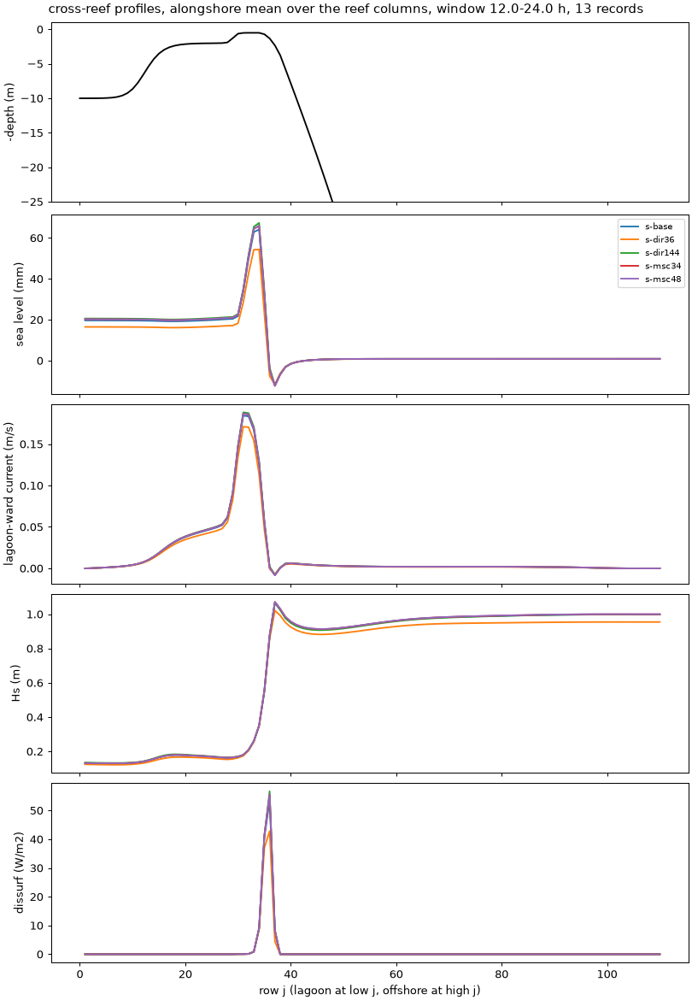

# SWAN spectral resolution with triads on: directions converge slowly, frequencies by 34

- **Date:** 2026-11-03
- **Status:** done
- **Correction (2026-11-04):** "flushing time" in this entry is about 8x too long, and its relative changes don't carry over: `tests/options_compare.py` divided the lagoon volume by what is nearly only the Stokes transport. Fixed; see [default check](2026-11-04_default-check.md). Other columns are unaffected.
- **Builds:** coawst-cloud `f62dff3`, case defaults of 2026-11-02

## Question / why

Without triads, 36 directions instead of 72 had moved the set-up and the crest
transport by about 10 %, and 34 frequencies instead of 20 by 1-6 %
([phase 0-2 results](2026-11-02_options-campaign-results-p0-p2.md)). Is A15's
SWAN resolution adequate once triads act? Is 36 directions enough?

## What was run

Density-1 canopy, new defaults, triads on, 24 h (the
[density-1 entry](2026-11-03_density1-canopy-tests.md) baseline, `CIRCLE 72
0.04 1.0 20`): `CIRCLE 36` and `CIRCLE 144` (20 frequencies), and 34 and 48
frequencies (72 directions).

## Results

| Member | set-up | crest transport | crest jet max | pass jet max | Hs crest | Hs reef flat | breaking dissipation | flushing time | wall s per sim h |
|---|---|---|---|---|---|---|---|---|---|
| 72 x 20 (values) | 18.2 mm | 563 m³/s | 0.29 m/s | 0.46 m/s | 0.21 m | 0.22 m | 2227 W/m | 49 h | 69 |
| 36 directions | -16.4 % | -9.0 % | -3.9 % | -8.8 % | -2.0 % | -7.9 % | -16.1 % | +8.6 % | 63 |
| 144 directions | +4.9 % | +2.8 % | -0.1 % | +2.5 % | +0.2 % | +2.8 % | +4.1 % | -2.3 % | 110 |
| 34 frequencies | +2.9 % | +1.5 % | +1.4 % | +1.4 % | +0.3 % | +0.2 % | +2.9 % | -0.8 % | 107 |
| 48 frequencies | +3.1 % | +1.5 % | +1.4 % | +1.5 % | +0.3 % | +0.2 % | +3.3 % | -0.9 % | 155 |

## What it means

- **Frequencies converge by 34:** 48 adds 0.0-0.4 % over 34; 20 frequencies
  is about 3 % low in set-up and breaking dissipation, 1.5 % in transport.
- **Directions converge slowly.** The set-up changes 16 % from 36 to 72 and
  5 % from 72 to 144 (ratio 4.4, about second order). Extrapolating: 72
  directions under-predicts the set-up by about 6 % and 36 directions by
  about 22 %; the crest transport about 3 % and 12 %.
- **Why directions matter so much on A15:** the incoming swell is very
  narrow (directional spreading 4 degrees, `wavebc_north.txt`), so 5-degree
  bins (72) or 10-degree bins (36) do not resolve its directional spectrum;
  refraction over the fore reef and into the pass then depends on the bin
  width. A broader spread needs fewer directions: with a 30-degree spread,
  36 directions put three bins across it, and the sensitivity should be
  smaller than A15's (to be measured on such a case).
- Cost: 144 directions or 34 frequencies each add 55-60 % to the wall time;
  48 frequencies 125 %.

## Decision / outcome

Proposed: 34 frequencies for A15 (converged, +55 % wall time, or keep 20 and
quote 3 %); keep 72 directions and quote about 6 % for the set-up, or 144
when the set-up itself is the target; reconsider the 4-degree spread, which is
narrower than most measured swell (10-30 degrees) and is what makes the
directional resolution so demanding. A case run with 36 directions should be
checked against 72 before relying on it.

## Details and links

- [Results summary](../results/README.md)
- Cost: 4 runs, about $0.60.

