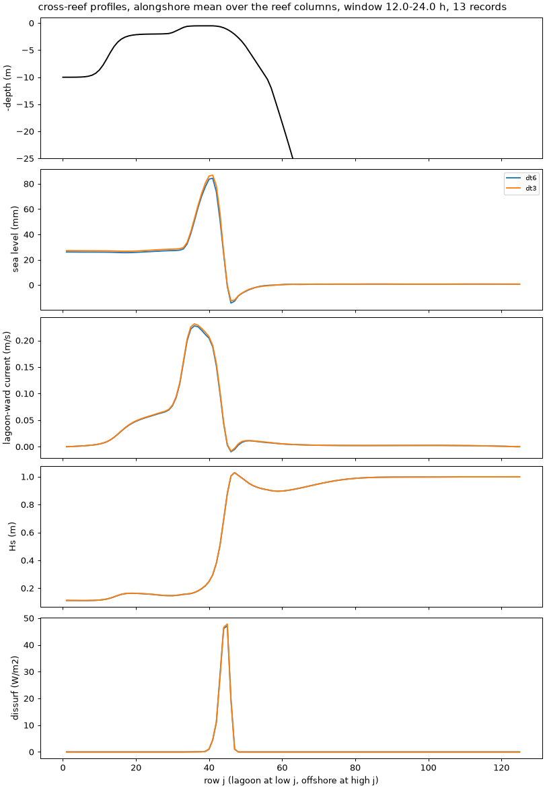
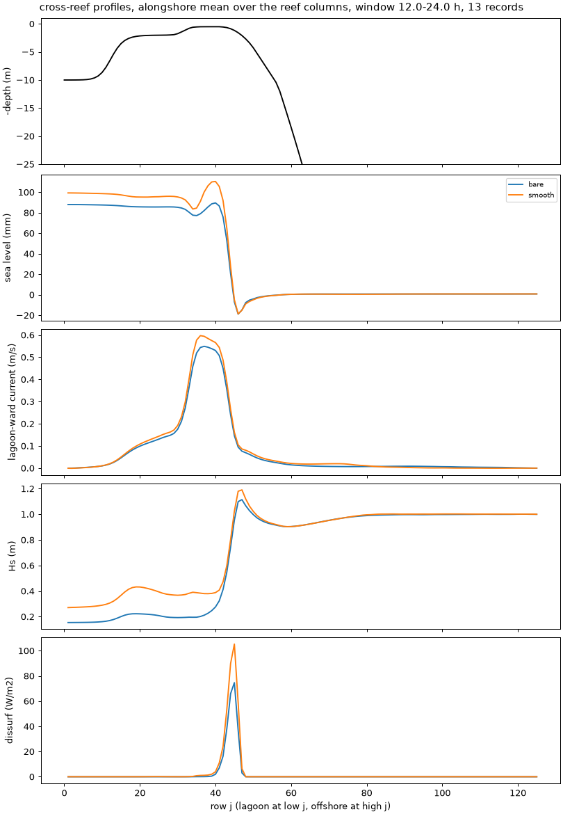

# All the A15 defaults together: time step, Courant numbers and restarts

- **Date:** 2026-11-04
- **Status:** decision (author): **DT 2.5 s, `NDTFAST` 10 in all A15 cases**; restarts exact again
- **Correction (2026-11-04):** "flushing time" in this entry is about 8x too long, and its relative changes don't carry over: `tests/options_compare.py` divided the lagoon volume by what is nearly only the Stokes transport. Fixed; see [default check](2026-11-04_default-check.md). Other columns are unaffected.
- **Builds:** coawst-cloud `3341634` (all-defaults runs), `26e6fb7` commit of the case repository;
  `0a177ff` (with `swan-bkd-exact-restart` and `roms-diag-implicit-drag`) for the restart fix and the
  DT 2.5 s and DT 2 s runs. `c2d-standard-16` Spot, 10 ROMS (1 x 10) + 6 SWAN

## Question / why

The defaults had been adopted one at a time. Do they work together, is every Courant number below
1 (the author: "I think we need to stay below CFL criteria"), and does a run still restart exactly?
The stress test was asked for by the author: "try a run with zob=0.001, kn=0.030 and no veg. Let's
make sure that run is stable".

## What was run

Band grid (203 x 126), N 15, 34 frequencies, 72 directions, 30-degree spread, `BKD`, triads, roller
(`WEC_ALPHA` 0.5), `BOTTOM_STREAMING`, `VEG_STREAMING`, `GLS_Kmin` 1e-8, 24 h unless stated. Region
statistics over hours 12-24 with `tests/options_compare.py --lagoon 5 25 --offshore 110 120 --flat 20 34
--crest-row 38 --forereef 45 60`, Courant numbers with [`tools/reef/courant_from_log.py`](../tools/reef/courant_from_log.py).

## Results: all defaults at DT 6 s, and why that was not good enough

No blow-ups, but the vertical Courant number Cw (Cw above 1 means more than one layer per step):

| Case, canopy | Set-up | Crest transport | Peak Cw | Cw above 1 |
|---|---|---|---|---|
| veg, density 1 | 24.6 mm | 699 m³/s | 2.65 (j 43, k 15) | 96 % of steps |
| veg, density 4 | 8.8 mm | 310 m³/s | 0.36 | 0 |
| strat, density 1 / 4 | 24.2 / 8.3 mm | 707 / 311 m³/s | 2.68 / 0.36 | 96 % / 0 |
| therm, density 1 / 4 | 24.2 / 8.9 mm | 693 / 310 m³/s | 2.50 / 0.36 | 95 % / 0 |

What causes the Cw on density 1 (8 h runs at DT 6 s, median / peak):

| Run | Cw median / peak |
|---|---|
| all defaults | 1.68 / 2.65 |
| `BREAKING CON` instead of `BKD` | 1.23 / 2.10 |
| `GLS_Kmin` 7.6e-6 | 1.67 / 2.79 |
| no streaming | 0.65 / 0.96 |
| DT 3 s (hours 4-8) | 0.13 / 0.16 |

Halving DT cut Cw by 13x, so at DT 6 s with streaming at N 15 it is numerical, a noisy crest.

**The bare reef** (`options-bare-dt`) blew up at DT 6 s (46 min) and DT 4 s (56 min); DT 3 s ran clean: Cw
0.53, Cv 0.23, set-up 84.5 mm, crest 1751 m³/s, currents to 1.55 m/s.

## Results: how biased was DT 6 s?

Density 1, DT 3 s against DT 6 s, 24 h:

| Metric | DT 6 s | DT 3 s |
|---|---|---|
| set-up | 24.6 mm | +4.4 % |
| set-up range | 17.7 mm | +8.0 % |
| crest / pass transport | 699 / 797 m³/s | +3.0 / +2.0 % |
| crest jet p99 / max | 0.252 / 0.354 m/s | +1.6 / -6.4 % |
| pass jet p99 / max | 0.473 / 0.554 m/s | +2.1 / +2.6 % |
| surface / mean speed, crest / fore reef | 1.10 / 1.07 | +0.8 / -7.0 % |
| Hs crest, dissipation | 0.196 m, 1591 W/m | +0.7, -0.2 % |
| flushing time | 62.5 h | +5.1 % |
| peak Cw | 2.65 | 0.19 |
| wall s per simulated hour | 130 | 239 (1.84x) |

So the earlier DT 6 s results hold in direction and rough size, not better than about 8 %.

## Results: the smooth bare reef, and why DT 3 s was not enough

Canopy build with density 0 (the coupler floors KN at 0.05 m in the true bare build), `grain_diameter`
0.012 m (z0 0.001 m), `FRICTION MADSEN 0.03`; `frcoef.nc` is 0.0300 m everywhere. SWAN's KN has three
floors, all below that here: z0 >= 5e-5 m in ROMS (`ssw_bbl.h`), 0.0015 m (`VEG_SWAN_COUPLING`) or 0.05 m in the
coupler (`mct_roms_swan.h`), and `MAX(coupled KN, FRICTION MADSEN)` in SWAN (`waves_coupler.ftn`).

| | Bare, KN 0.3, DT 3 s | Smooth, KN 0.03, DT 3 s | Smooth, DT 2.5 s, `NDTFAST` 10 | Smooth, DT 2 s, `NDTFAST` 10 |
|---|---|---|---|---|
| blow-up | no | no | no | no |
| peak Cw | 0.53 | **1.39** (hour 14.7) | 0.61 | 0.49 |
| Cw above 1 | 0 | **7.3 % of steps** | 0 | 0 |
| peak Cv / Cu | 0.23 / 0.04 | 0.50 / 0.06 | 0.41 / 0.08 | 0.33 / 0.04 |
| set-up | 84.5 mm | 95.0 mm | 95.2 mm | 94.8 mm |
| crest / pass transport | 1751 / 1872 m³/s | 1958 / 2124 m³/s | 1954 / 2132 m³/s | 1960 / 2130 m³/s |
| crest / pass jet max | 0.89 / 1.18 m/s | 1.03 / 1.40 m/s | 1.09 / 1.34 m/s | 1.03 / 1.40 m/s |
| Hs crest | 0.23 m | 0.38 m | 0.38 m | 0.38 m |
| flushing time | 51 h | 37 h | 35 h | 36 h |
| wall s per simulated hour | 228 | 240 | 292 (1.22x) | 350 (1.46x) |

- Cw above 1 at DT 3 s comes only at low tide (hours 2-4 and 14-16), in the top layer, about 6 cm thick, at
  the back edge of the crest (rows 34-36, 925-945 m from shore).
- **A 17 % shorter step cut the peak by 56 %.** Scaling with DT alone would leave 1.16, so part of the
  low-tide peak at DT 3 s is numerical. Not yet explained. Both low tides stay near 0.6 at DT 2.5 s.
- DT 2.5 s and DT 2 s agree on the bulk flow: set-up -0.5 %, transports within 0.3 %. The set-up range (+13 %), largest jets (up to 5.5 %) and flushing time (+4.7 %) still move a little, so those are not converged in DT to better than that.
- `OMEGA_IMPLICIT` at DT 3 s does not change this as logged: peak Cw 1.45 and Cu 0.10, set-up -0.6 %, set-up range
  +11 %. Whether the logged number reflects what the implicit scheme sees was not checked; it is not
  needed at DT 2.5 s.
- Roughness and set-up on a bare reef: rough (KN 0.3) lowers the set-up by 11 % against smooth. Buckley et
  al. (2016) find a net difference of under 10 % in a flume, from two opposing effects (radiation stress -18 %,
  bottom stress +16 %). A flume and a model with a tenfold change are not the same, but the size agrees.

## Results: restarts

| Pair | Result |
|---|---|
| DT 6 s, all defaults, 8 h, restart at 4 h | exact to hour 4, then noise on the crest: 950-1050 m from shore rms 8 mm, vbar 1.5 cm/s, u up to 0.2 m/s; lagoon set-up within 0.05 mm |
| DT 3 s, density 1, 8 h, restart at 4 h | u 1e-7 m/s after an hour, 5e-5 at hour 7, 1e-6 at hour 8: the noisy crest had amplified a small difference |
| 2 h, restart at 1 h, `BKD` (with or without triads; `GLS_Kmin` 1e-8 or 7.6e-6) | differs, from the first SWAN exchange after the restart (70 min) |
| the same with `CON` | bit-identical in the 16 fields compared |
| after `swan-bkd-exact-restart`, canopy and bare | bit-identical in every history variable, every record after the restart |
| the same, three 1 h segments, canopy | bit-identical at each segment end |

**Cause:** `BKD`'s breaker index is frozen once in every non-stationary run, when the accuracy first
reaches 95 % (a one-way switch `MODGAM`), and the switch was not in the restart file; a restarted run
recomputed the index once. The fix saves it. Yesterday's exact-restart fixes were tested with `CON`,
before `BKD` was adopted. Remaining differences are harmless: a restarted segment's first history record
differs in output-only fields (`w`, `zetaw`, `qsp`, `bernoulli_head`, `*_wec_stress`), and
`tools/merge_segments.py` keeps the earlier copy; `ru`, `rv` differ only in the periodic ghost columns of the restart
file.

**Is the freeze itself a problem?** It happens at 50 min on A15. A 24 h run with the index never frozen is
within 2e-6 mm of set-up and 1e-3 m³/s of transport. Where kD is below about 1, the index depends only on the bed slope,
so it does not change anyway. To recheck on a domain with steep waves over deeper slopes.

## Results: streaming roughness

`ks` in the streaming thickness, 0.03 m (hard-coded) against 0.3 m (debug patch): flow within 1.2 %.
`KWD` is at its cap of 20 on this reef, which sets the shape ([force shapes](2026-11-04_force-shapes-and-budget.md)).

## Figures

Cross-reef profiles, alongshore mean over the reef columns, hours 12-24: depth, sea level, lagoon-ward
current, Hs, breaking dissipation. `tests/options_compare.py --png`.

The same, smooth bare reef (KN 0.03) against bare (KN 0.3), both at DT 3 s.

## Decision / outcome

> "I think we need to stay below CFL criteria"; DT 3 s first, then for DT 2.5 s, `NDTFAST` 10: "Yes, adopt".

DT 2.5 s, `NDTFAST` 10, `NTIMES` 34560 in all A15 cases. The fast step stays 0.25 s; `NDTFAST` 10 is the lower
limit for the barotropic averaging. It is 1.22x the cost of DT 3 s on this case. Images from coawst-cloud `3930b2a` on for
exact restarts with `BKD`. Check Cu, Cv and Cw in the log of every new setup. N 20 would need its own check.

## Open questions

- Why the low-tide Cw at DT 3 s is so sensitive to the step.
- ~~The canopy cases have not yet run at DT 2.5 s~~: clean, peak Cw 0.16 ([default check](2026-11-04_default-check.md)). The strat and therm cases have not.

## Details and links

- coawst-cloud: `swan-bkd-exact-restart`, `roms-diag-implicit-drag`
- [Force shapes and the budget](2026-11-04_force-shapes-and-budget.md), [wave streaming](2026-11-03_wave-streaming.md),
  [results summary](../results/README.md)
- Cost: all-defaults and attribution about $1.3 (not every member recorded here), bare DT test $0.28,
  smooth at DT 3 s $0.28, DT 2.5 s $0.36, DT 2 s $0.42, `OMEGA_IMPLICIT` $0.29, 5 h runs $0.25, restart pairs
  about $0.9 (including attr-dt3-seg and the first DT 6 s pair).
