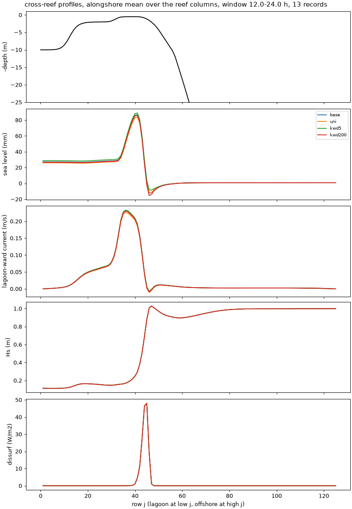

# Force shapes, vertical convergence and the momentum budget

- **Date:** 2026-11-04
- **Status:** done; no change to the shapes or to N 15 (the author asked for the checks; `KWD` and breaking
  shape left at stock pending the author's confirmation); **diagnostics patch adopted**
- **Correction (2026-11-04):** "flushing time" in this entry is about 8x too long, and its relative changes don't carry over: `tests/options_compare.py` divided the lagoon volume by what is nearly only the Stokes transport. Fixed; see [default check](2026-11-04_default-check.md). Other columns are unaffected.
- **Builds:** coawst-cloud `896232a` plus `+WEC_BREAK_UNIFORM`, or debug patches (`KWDmax`, Kumar's form, never-frozen
  index, untracked `patches/9-debug`); `0a177ff` adds `roms-diag-implicit-drag`. Density 1, DT 3 s, N 15, 24 h,
  `c2d-standard-16` Spot, 10 + 6

## Question / why

With wave streaming on, about half of the depth-integrated wave force comes from a term the model
places by assumption. Does the assumed vertical shape of the breaking and streaming forces matter, and is
N 15 converged with them on? The earlier N test ran without streaming, and the streaming test at N 10. The author
also asked for a budget: "We will 100% be doing budgets later and need to be able to have everything".

## What the code assumes (N 15, hours 12-24, reef columns)

| Force | Shape | Where it lands | What sets it |
|---|---|---|---|
| Breaking and roller | cosh(2 pi gamma (z+h)/D), gamma = min(2 x 0.707 D/(1.25 Hs), 1) | upper third 87 %, lower half 4 % | gamma = 1 in the whole breaking zone, so depth alone |
| Bottom streaming | cosh(`KWD` (surface-z)/D), `KWD` = min(D/delta, 20), delta = 0.09 ks (A/ks)^0.82, ks 0.03 m, `awd` 1 | bottom layer about 75 %, next 19 % | the cap: `KWD` 20 in every zone (delta alone would give 0.6-4 cm) |
| Canopy streaming | frontal area, uniform over the plant height | 11 of 15 layers at 0.57 m depth, 3 at 2 m, part of one at 12 m | plant height and density |

(Both COAWST formulas are as in the unpatched source on GitHub.)

## What the literature says

Read for this entry: Uchiyama et al. 2010, Kumar et al. 2012, Wu et al. 2024, Luhar et al. 2010, Beudin et al. 2017;
from the author's notes on the first two plus Buckley et al. 2015, 2016, 2018, 2022, Rijnsdorp et al. 2021,
Sous et al. 2020, Wang et al. 2020.

- **Breaking:** Uchiyama: k_b^-1 = a_b H (H = Hs/sqrt 2), DUCK94 u error 0.413 at a_b 0.1, 0.427 at 0.2, 0.462 at
  0.5, 0.566 at 1.0, 0.817 for k_b = 2k; a surface-concentrated force is essential. Kumar: cosh[2 pi (z+h)/H], so a_b 0.16.
  Stock COAWST's cap gives a_b = 0.225 D/Hs, **0.29-0.45 across our breaking zone**. Wu: different profiles for breaking and
  roller give unrealistic offshore surface currents; COAWST uses one for both.
- **Roller:** alpha_r = 1 best at DUCK94 (Uchiyama, Kumar); Wu finds the vortex-force model only weakly sensitive at LIP11D.
  Ours is 0.5, an ensemble axis.
- **Bottom streaming:** k_wd^-1 = a_wd delta_w, a_wd 3 (Uchiyama, Wu) or 1 (Kumar). **No paper has a cap like 20**; Uchiyama's
  only rule is to apply an unresolved layer as a stress in the bottom cell.
- **Resolution:** no paper sets a requirement for these forces.
- **Reef set-up:** none splits set-up into friction and breaking. Rijnsdorp: bottom stress can lower set-up where there is a net onshore flow.
- **Canopy streaming:** the total force follows Luhar (wave stress = (k/omega) x canopy dissipation, balanced by mean canopy
  drag) and Beudin Eq. 4. Neither sets a vertical shape, and **Beudin: it "remains to be verified against laboratory
  and field measurements"**. Luhar's model holds for orbital excursion over stem spacing A/S >= 1, and overpredicts below.
  With S = n^-1/2: crest 0.70, top of fore reef 0.57, elsewhere at most 0.21 at density 1; 1.40, 1.15, at most 0.41 at density 4.

## Results: shapes and vertical levels

Against the density-1 baseline:

| Metric | Baseline | N 20 | Uniform breaking | Kumar's form | `KWD` cap 5 | `KWD` cap 200 |
|---|---|---|---|---|---|---|
| set-up | 25.7 mm | -2.8 % | -4.7 % | +0.7 % | +6.1 % | -1.8 % |
| set-up range | 19.1 mm | -2.8 % | -4.5 % | +0.5 % | +3.5 % | -0.9 % |
| crest transport | 720 m³/s | +1.1 % | -2.7 % | +0.4 % | +1.3 % | -0.5 % |
| pass transport | 814 m³/s | +1.0 % | -2.5 % | +0.4 % | +1.3 % | -0.4 % |
| crest jet max | 0.331 m/s | +0.9 % | -4.6 % | +0.6 % | +1.5 % | -0.3 % |
| pass jet max | 0.568 m/s | +4.0 % | -2.4 % | +0.3 % | +2.3 % | -0.6 % |
| surface/mean speed, crest | 1.11 | -0.1 % | -3.1 % | +1.1 % | +0.7 % | -0.1 % |
| surface/mean speed, fore reef | 1.00 | +4.1 % | **+43 %** | -5.4 % | -1.1 % | +1.2 % |
| Hs crest | 0.198 m | +0.1 % | -0.7 % | +0.1 % | +0.5 % | -0.2 % |
| flushing time | 65.7 h | 0.0 % | +1.1 % | -0.2 % | -0.8 % | +0.3 % |
| peak Cw | 0.19 | 0.34 | 0.21 | 0.19 | 0.21 | 0.20 |
| wall s per simulated hour | 239 | 317 | 241 | 236 | 231 | 248 |

- **N 15 is converged with streaming on**, to about the size of DT 6 s against DT 3 s, at 1.33x the cost for N 20.
- **The bulk flow barely depends on the shapes**, since the depth-integrated force sets it; the size of the streaming force
  matters far more than where it sits. Fore-reef shear is the exception, so revisit breaking shape for a question that depends on it.
- The literature's breaking form differs from stock by under 1 %, and the missing source for the cap of 20 hardly matters on this reef.

## Results: the momentum budget

Depth-integrated, hours 12-24, reef columns, across 0-1500 m from shore, m³/s² per metre alongshore, before the diagnostics fix
(so bed stress and canopy drag are one leftover term). Force is lagoon-ward (negative here), so a balancing term is positive:

| Term | Density 1, DT 3 s | Bare, DT 3 s |
|---|---|---|
| breaking and roller | -0.607 (47 %) | -0.925 (65 %) |
| streaming (friction + canopy; friction only when bare) | -0.676 (53 %) | -0.493 (35 %) |
| pressure gradient | +0.508 (40 %) | +0.929 (66 %) |
| drag, bed + canopy | +0.799 (62 %) | +0.601 (42 %) |
| advection and vortex force | -0.023 (-2 %) | -0.113 (-8 %) |

By dissipation, the streaming on density 1 divides about 56 / 44 between friction and canopy. Total force is 2.1x the
breaking force alone and the set-up rose 1.95x with streaming, so near-bed forcing is not simply lost to the bed. This supports
the +95 % ([wave streaming](2026-11-03_wave-streaming.md)) but does not validate it independently. This budget closes only by
construction: the drag row is the leftover. It was first read as canopy drag alone, until the bare reef showed
the same term with no canopy.

## Results: the diagnostics fix

`*_bstr` held only the explicit remainder of the implicit bottom stress (0.001 of 0.60 on the bare reef), the implicit canopy drag was
mixed into `*_vvis` in 3-D and absent in 2-D, and `*_fveg` was never written because `vegetation.in` had no `Dout` lines.
`roms-diag-implicit-drag` records both. On 2 h runs, sum of all terms minus acceleration, largest residual against largest term:

| Kernel | `vbar` | `v` |
|---|---|---|
| AB3-AM4 | 1.8e-9 of 3.0e-2 | 8.6e-9 of 8.8e-2 |
| LF-AM3 | 2.0e-9 of 3.0e-2 | 8.2e-9 of 8.8e-2 |

About 1e-7 of the largest term, single-precision rounding. With AB3-AM4, every history variable was bit-identical to a build
without the patch. Turning `vbar_fveg` on with LF-AM3 first crashed the run (NetCDF error -60): `roms-veg-implicit` had left
that kernel's `M2fveg` slot unset, garbage among the diagnostic arrays only, which cannot reach the solution. Fixed in the same patch.

## Figures

Cross-reef profiles, alongshore mean over the reef columns, hours 12-24: baseline, uniform breaking, `KWD` caps 5 and 200.
`tests/options_compare.py --png`.

## Decision / outcome

> "you need to add the implicit bottom stress and canopy drag to diagnostics. We will 100% be doing budgets later and need to be able to have everything"

`roms-diag-implicit-drag` adopted, `Dout(M2fveg)`, `Dout(M3fveg)` in the canopy cases' `vegetation.in`. N 15, the stock breaking shape and `KWD` 20
unchanged.

## Open questions

- ~~Splitting bed stress and canopy drag over a full day~~: pressure 41 %, canopy 37 %, bed 24 % ([default check](2026-11-04_default-check.md)).
- Whether the canopy streaming force's total and shape hold: Luhar's Eq. 21, U_c = [(4/3 pi)(k/omega) u^3]^0.5, gives about 0.12 m/s on the
  crest, against 0.25 m/s for our depth-mean jet; not directly comparable, because set-up also drives our flow. It needs a run without
  set-up forcing, or a flume-like case, ideally against data.
- A/S crosses 1 along a density axis, where the force's vertical shape is most uncertain: record A/S per member.

## Details and links

- coawst-cloud: `roms-diag-implicit-drag`, `roms-veg-streaming-fixes`, `wec-break-uniform`
- [All defaults](2026-11-04_all-defaults.md), [wave streaming](2026-11-03_wave-streaming.md), [vertical resolution](2026-11-03_vertical-resolution.md)
- Cost: N 20 $0.37, uniform $0.28, `KWD` 5 $0.27, `KWD` 200 $0.29, Kumar $0.29, never frozen $0.28, diagnostics tests about $0.15.
