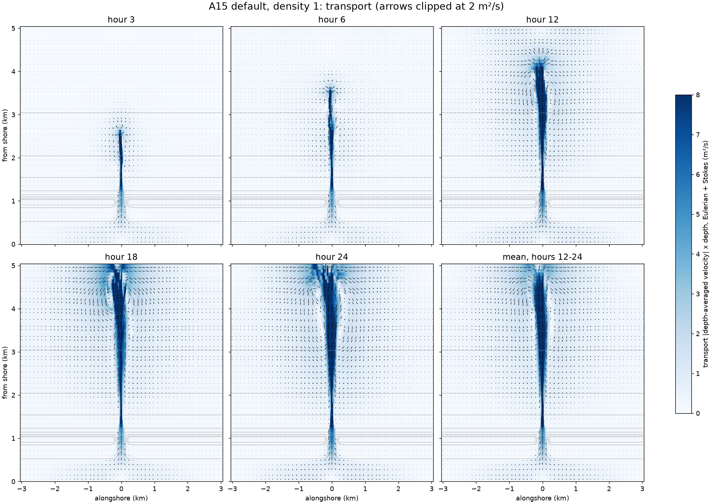
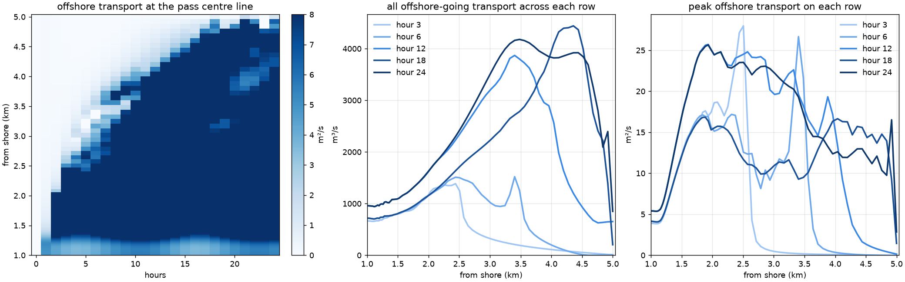

# How far the pass jet goes, and what needs the 10 m rows

- **Date:** 2026-11-04
- **Status:** analysis of the default run, no new runs; which rows need 10 m is inferred, not yet tested
- **Build:** `def1104-check` (A15 default, density 1, DT 2.5 s, 24 h) and `grid-u10` (2x finer outside the band), coawst-cloud `ca5316d`

## Question / why

The author is asking for a cheaper grid that keeps the reef's physics: "how far does the jet tend to go offshore?", "what is limiting us to 10m resolution? Is it breaking or the crest dynamics? Would thickening the crest still require 10m resolution?"
The author also ruled out one saving: "we cant assume canopies will be uniform alongshore".

## Results: the jet

Transport is depth-averaged velocity x depth, Eulerian + Stokes ([`tools/reef/jet_reach.py`](../tools/reef/jet_reach.py)).

**The jet has no natural end in this domain.** Its head, a dipole, reaches about 2.6 km from shore at hour 3, 3.6 km at hour 6, 4.2 km at hour 12, and the 5 km open boundary by about hour 18, then spreads along the boundary.

| From shore, hour 24 | Depth | Peak depth-mean speed | Width at half peak | All offshore-going transport |
|---|---|---|---|---|
| 1.2 km | 15 m | 0.42 m/s | 160 m | 959 m³/s |
| 1.5 km | 45 m | 0.37 m/s | 60 m | 1089 m³/s |
| 1.75 km | 72 m | 0.34 m/s | 40 m | 1321 m³/s |
| 2 km | 94 m | 0.27 m/s | 40 m | 1599 m³/s |
| 2.5 km | 146 m | 0.16 m/s | 40 m | 2421 m³/s |
| 3 km | 197 m | 0.11 m/s | 120 m | 3528 m³/s |
| 4 km | 300 m | 0.04 m/s | 261 m | 3820 m³/s |

- Offshore-going transport grows to about 5x the pass outflow (790 m³/s) by entrainment, while the net across each row stays 12-50 m³/s in hours 12-24: the water comes back onshore around the jet.
- The jet narrows from 160 to 40 m as the water deepens, with the speed falling slowly. That narrowing would fit a barotropic jet stretched over deepening water (no Coriolis, no stratification, `VISC2` 0), but the mechanism wasn't tested. It isn't grid-limited: the width is the same at dx 10 m out to 2 km. Farther out the two grids differ in a single snapshot (at 4 km, 3820 against 5080 m³/s), so the far field isn't converged at any one instant.
- This run is homogeneous, so the whole water column moves. A stratified offshore would likely behave differently.
- Whether the boundary contact feeds back on the reef isn't known yet; the 7-day run should show it.

## Results: what needs 10 m

Reef columns, hours 12-24, 10-90 % of each term:

| Feature | Where (m from shore) | Width | 10 m rows | 20 m rows |
|---|---|---|---|---|
| Breaking and roller force | 1000-1040 | 40 m | 4 | 2 |
| Pressure on the crest front | 1010-1050 | 40 m | 4 | 2 |
| All wave force | 1000-1060 | 60 m | 6 | 3 |
| Streaming force | 1000-1081 | 80 m | 8 | 4 |
| Pressure at the back of the crest | 920-980 | 60 m | 6 | 3 |
| Canopy drag | 920-1000 | 80 m | 8 | 4 |

Bathymetry: back slope 1:57, crest top (h < 0.6 m) 935-1005 m, front slope 1:39 at 1000-1050 m, then 1:13 and 1:10.

**Inferred: breaking on the front slope is the limit.** It is the sharpest feature, two rows on a 20 m grid, and the earlier test put the 20 m grid's -16 % there (dissipation the same, but the force handed to the water differently; [grid-10m](2026-11-03_grid-10m.md)). The back of the crest is smoother and may tolerate coarser rows. **No run has separated the two.**

**A wider crest wouldn't lift the limit.** The breaking width follows from wave height and the front slope, not the crest's width, so the front would still need 10 m rows. It would spread the back-of-crest head loss, and would be a different reef with more drag and less flow. **A gentler front slope would help:** doubling it to 1:78 should about double the breaking width, to 4 rows at 20 m, and if DT follows the row spacing (not yet separated from a plain DT limit) DT could rise too. That also changes the reef.

## Decision / outcome

> "we cant assume canopies will be uniform alongshore"

No alongshore stretching in a cheaper grid. Spacing stays at 20-40 m at most; patches need several cells, so at least about 100-200 m.

## Open questions

- A run with 10 m rows only on the front and 20 m on the back, and the reverse, would test the inference.
- Whether an offshore boundary at 1.75 km changes the reef. It would cut the jet near its peak transport per metre (about 20 m²/s), so it's riskier than first thought.

## Details and links

- SWAN's spectrum is settled elsewhere: 34 frequencies, 72 directions ([spectral resolution](2026-11-03_swan-spectral-resolution.md)).
- Cost: none, analysis only.
