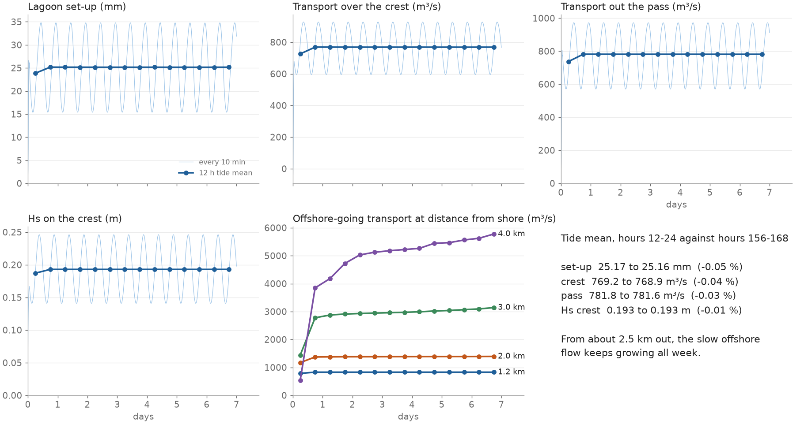
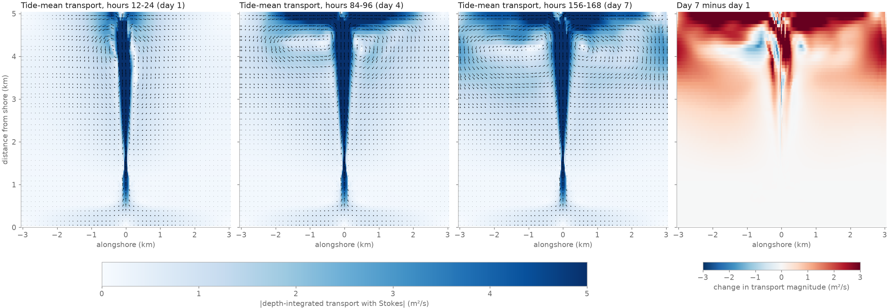

# Seven days of the A15 default: when does it settle?

- **Date:** 2026-11-05 (UTC; run 2026-11-04 17:14 to 2026-11-05 06:39)
- **Status:** result; the reef and lagoon settle within the first tide. No default changed; run length is the author's call
- **Build:** coawst-cloud `ca5316d`, image `coawst@sha256:a544f70f`, case commit `26e6fb7`. `c2d-standard-16` Spot, us-west4-b, 10 ROMS + 6 SWAN

## Question / why

The author asked for the default case to run on Spot with restarts, with a movie. It also answers three open questions: how long a member has to run, whether the jet reaching the 5 km boundary (about hour 18, see [the jet](2026-11-04_jet-and-10m-limit.md)) disturbs the reef, and whether a real segmented run behaves like an uninterrupted one.

## What was run

`spinup7d`: `Reef_Ideal_A15_veg` as it stands (density 1 everywhere, DT 2.5 s, `NDTFAST` 10, N 15, 203 x 126), steady 1 m waves, 0.15 m 12 h tide, 7 days in 28 segments of 6 h. `ocean_qck.nc` every 10 min, history and diagnostics hourly. Tide means below are over 12 h cycles.

## Results: the reef and lagoon

| Tide mean | Hours 0-12 | Hours 12-24 | Hours 84-96 | Hours 156-168 | 12-24 against 156-168 |
|---|---|---|---|---|---|
| lagoon set-up (mm) | 23.86 | 25.17 | 25.16 | 25.16 | +0.05 % |
| set-up range (mm) | 34.81 | 19.36 | 19.36 | 19.37 | |
| crest transport (m³/s) | 726 | 769.2 | 768.9 | 768.9 | +0.04 % |
| pass transport (m³/s) | 737 | 781.8 | 781.5 | 781.6 | +0.03 % |
| Hs crest (m) | 0.187 | 0.193 | 0.193 | 0.193 | +0.01 % |

- Over all 13 tides after the first, set-up stays within 0.10 %, transports within 0.06 %, with no trend in them.
- Compared with the same phase of the last tide, the crest and pass transports are within 1 % from about hour 1.5, and set-up too. Any 12 h window starting at hour 2 or later gives the same tide means within 0.07 %. Most of the 5 % low bias of hours 0-12 is the first hour or so, starting from rest.
- Tide-mean sea level in the lagoon and on the crest changes by 0.1 mm or less over the week. Tide-mean `vbar` there changes by 0.1 mm/s rms.
- **The budget is the same at both ends of the week.** Hours 156-168 against hours 12-24: every term in every zone within 0.0005 m³/s², about 0.1 % of the largest (for example 0-1500 m breaking and roller -0.5965 against -0.5970, canopy 0.4688 against 0.4690).

## Results: offshore, and the boundary

Offshore-going transport by distance from shore (tide means, m³/s; net transport through each row stays within 0.1 m³/s of zero after the first tide), and the largest `vbar` of the last tide:

| Distance | 1.2 km | 1.5 km | 2 km | 2.5 km | 3 km | 3.5 km | 4 km | 4.5 km | 4.9 km |
|---|---|---|---|---|---|---|---|---|---|
| hours 12-24 | 829 | 939 | 1374 | 2082 | 2777 | 3341 | 3848 | 3156 | 1311 |
| hours 84-96 | 829 | 939 | 1386 | 2139 | 2974 | 3803 | 5221 | 5176 | 2904 |
| hours 156-168 | 829 | 940 | 1394 | 2185 | 3142 | 4375 | 5778 | 5415 | 3089 |
| change, day 1 to 7 | 0 | 0 | +1.5 % | +5 % | +13 % | +31 % | +50 % | +72 % | +136 % |
| largest `vbar`, day 7 (m/s) | 0.44 | 0.38 | 0.29 | 0.17 | 0.11 | 0.09 | 0.06 | 0.05 | 0.12 |

- **The offshore water doesn't settle in a week.** Beyond about 2.5 km the transport keeps growing to the end: a slow recirculation either side of the jet, with currents of centimetres per second in water hundreds of metres deep. There is no natural end to it in this domain.
- **The jet spreads along the boundary**, carrying more than 5 m²/s at the last rows by day 4, and the flow in the last few hundred metres changes from tide to tide (largest `vbar` at 4.9 km 0.04 to 0.14 m/s). The 3.5-5 km flow depends on the boundary, so it shouldn't be read as a physical result.
- **None of this reaches the reef in 7 days**: transport inside 1.5 km doesn't change, and tide-mean `vbar` from 1150 m to 2 km changes by 0.5 mm/s rms or less. No growth in alongshore variation of sea level at the boundary (0.02 mm).
- That holds for reef and lagoon momentum. Anything that depends on where the offshore water goes does not get the same answer: water leaving by the jet and coming back over the crest, as in a residence-time calculation, sees the unsettled and boundary-affected flow.

## Results: turbulence (added 2026-11-05, the author asked whether TKE had been checked)

It hadn't been. `tke` and `AKv` from the hourly history files, tide means, hours 12-24 against hours 156-168, compared point by point in every layer (rms and largest change, where the value is above 10 % of the zone's largest):

| Zone (from shore) | TKE rms | TKE largest | `AKv` rms | `AKv` largest |
|---|---|---|---|---|
| lagoon, 233-815 m | 0.07 % | 0.10 % | 0.05 % | 0.09 % |
| back of crest, 815-1000 m | 0.07 % | 0.94 % | 0.06 % | 1.8 % |
| crest front, 1000-1150 m | 0.09 % | 0.27 % | 0.13 % | 8.4 % |
| slope, 1150-1500 m | 0.22 % | 2.4 % | 1.9 % | 36 % |
| slope, 1500-2000 m | 1.5 % | 11 % | 5.0 % | 76 % |
| 2-3 km | 4.4 % | 23 % | 6.8 % | 54 % |
| 3-3.8 km | 12 % | 72 % | 25 % | 151 % |
| 3.8-5 km | 70 % | 185 % | 89 % | 136 % |

- **On the reef and in the lagoon, turbulence settles as fast as the flow.** Depth-integrated TKE in hours 12-24 is within 0.08 % of day 7 in both.
- **Offshore, viscosity is the slowest thing measured.** Zone-mean `AKv` at 3.8-5 km is 86 % below its day 7 value on day 1 and still 10 % below at hours 108-120, reaching a largest tide mean of 0.56 m²/s. At 1150-2000 m it is 13 % low on day 1 and 1.4 % low at hours 132-144, while TKE there barely moves, so the turbulence length scale is what keeps growing.
- This case is unstratified, so nothing limits how deep the jet's turbulence spreads. We'd expect stratification to change the offshore numbers (not tested). The stratified case needs its own check before any run length is applied to it.

## Results: numerics and restarts

- **Courant numbers:** all 28 segments peak at Cu 0.018, Cv 0.179, Cw 0.16, Cw never above 1. Fastest current 0.75 m/s.
- **Restarts:** at hours 18, 23 and 24, all 62 history fields compared are bit-identical to the uninterrupted `def1104-check`, through three restarts. Hourly diagnostics are too, except below.
- **Diagnostics after a restart do not close for one hour.** The first `ocean_dia.nc` record of every restarted segment (hours 12.5, 18.5, ...) has `*_accel` wrong, by 1.5e-4 m/s² against a true largest 1.7e-5, and `*_wbrk`, `*_wrol`, `*_bstm` off by about 3e-4 of their size. The solution isn't affected. Those records close to 2.5e-5 m/s² instead of 2e-9. In `tools/reef/momentum_budget.py` the `accel` and `resid` columns of a 6 h-segment run therefore show about 5e-3 m³/s² (under 1 % of the largest term) where an uninterrupted run shows 1e-10; the force columns match the uninterrupted run's table to three decimals. Not fixed. For a closure check on a segmented run, leave those records out.
- **Spot:** no interruptions on this run (one VM throughout), so recovery from a real preemption wasn't exercised here. It was tested earlier ([all defaults](2026-11-04_all-defaults.md)).

## Cost

13.43 h on `c2d-standard-16` Spot at $0.174/h: **$2.34**. 288 s wall per simulated hour, including 28 restarts. 10.6 GB in the bucket, about $0.20 a month.

## Decision / outcome

No default changed. **For the author to decide:** a 24 h member (analysed over hours 12-24) gets the reef and lagoon numbers of a 7-day one within 0.05 %, at $0.33 against $2.34. For 100 members that is about $33 against $234.

That is measured on one member: uniform density 1, unstratified, steady waves, one tide. It holds for the reef and lagoon, including their turbulence; the jet's turbulence past the crest (about 1150 m on) keeps changing. Not shown yet:

- A bare or sparse reef, or a patchy canopy, might take longer to settle. Check at the two ends of a canopy axis before relying on it.
- The strat and therm cases: tracers and heat have their own, longer time scales.
- Lagoon residence time (deferred; see the caveat under the boundary results).

## Details and links

- Spec: `batch/ensemble/tests/spinup7d` in the case repository; output `gs://coawst-runs-nj/ensembles/spinup7d/out/0000/seg_NNN/`, join with `tools/merge_segments.py`
- [The jet and the 10 m limit](2026-11-04_jet-and-10m-limit.md), [default check](2026-11-04_default-check.md), [results summary](../results/README.md)
