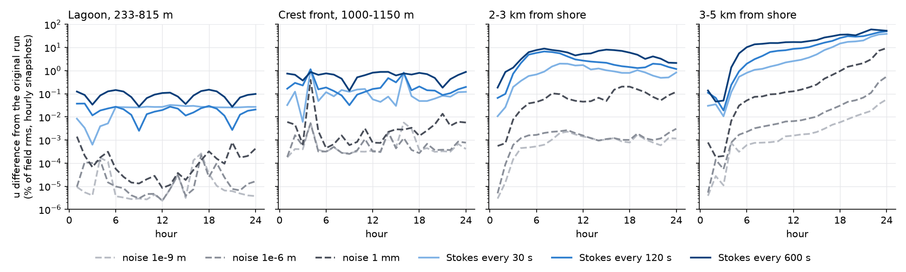
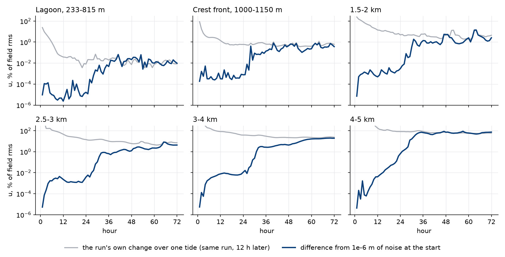

# Making A15 faster: Stokes drift updates, machines and process split

- **Date:** 2026-11-05
- **Status:** result; the Stokes option works and is off by default until the author decides. Offshore flow stops being repeatable from about hour 30 at 4-5 km and later closer in; on the reef that leaves a chance level of about 0.03 % of set-up
- **Build:** coawst-cloud `ca5316d` (`a544f70f`, `def1104-check`); `ca5316d` plus `roms-stokes-interval` (`f0bfd5c`) with `+STOKES_INTERVAL` (`e01ef5a1`). `Reef_Ideal_A15_veg`, density 1, DT 2.5 s, N 15, 34 frequencies, 72 directions

## Question / why

The author: "can we do anything to speed these runs up? How do they scale onto bigger machienes?" and, on Stokes drift: tie the update "to the coupline interval (or some multiple shorter than the coupling interval)?"

## Where the time goes

ROMS, 6 h of `spinup7d`, 10 ROMS + 6 SWAN: WEC kernel 60 %, GLS 10 %, barotropic kernel 6 %, canopy 4 %, time-averaged output 4 %. MPI halo exchanges are 23 %, counted inside those.

We use `SPECTRUM_STOKES`. ROMS redoes the sum over the 34 frequency bins in every layer and column on every baroclinic step, 240 times per SWAN exchange at DT 2.5 s, on the same spectrum.

## The option

`roms-stokes-interval`: `STOKES_NCPL` in `ocean.in` is the number of updates per wave-to-ocean exchange (0 every step, 1 at the exchange, 5 every 120 s, 20 every 30 s). Only the spectral sum is held. `W_stokes` and `ubar_stokes`, `vbar_stokes` are still computed every step from the current depths, so the 2-D and 3-D Stokes transports stay consistent.

## Results: accuracy and speed

24 h (`stokes-int`), against every step (`def1104-check`), hours 12-24:

| | Every step | 600 s | 120 s | 30 s |
|---|---|---|---|---|
| wall s per simulated hour | 280 | 135 | 127 | 144 |
| WEC kernel, share of ROMS time | 59 % | 11 % | 13 % | 19 % |
| set-up, 25.69 mm | | -0.03 % | -0.003 % | -0.001 % |
| set-up range, 19.08 mm | | -0.4 % | -0.01 % | -0.01 % |
| crest transport, 720 m³/s | | +0.01 % | under 0.001 % | under 0.001 % |
| pass transport, 814 m³/s | | -0.01 % | -0.002 % | under 0.001 % |
| surface/mean speed, fore reef | | +2.1 % | -0.02 % | +0.09 % |
| Hs crest | | under 0.03 % | under 0.01 % | under 0.01 % |
| peak Cw, 0.160 | | -1.1 % | -0.3 % | -0.1 % |

- Wall times are from separate VMs; a few percent is noise, since 120 s can't really be cheaper than 600 s.
- The budget by zone is unchanged to three decimals at all three intervals (the 0-1500 m canopy term at 600 s moves in the fourth) and closes to about 1e-10.
- Tide-mean TKE and `AKv`, point by point where they exceed 10 % of the zone's largest, rms and largest change. At 120 s: TKE at most 0.01 % rms and `AKv` 0.02 % rms on the reef and in the lagoon, largest `AKv` change 2.2 % at the crest front. At 600 s: rms 0.12 % at most, largest 8.5 %.
- Stokes velocity on the reef and in the lagoon: under 0.2 % rms even at 600 s, so the change in depth between updates doesn't matter here.
- **Control:** `STOKES_NCPL` 0 for 2 h, all 62 history and 83 diagnostic fields bit-identical to the build without the patch (`stokes-ctl`).
- **Restart:** `STOKES_NCPL` 1, 8 h with a restart at 4 h, bit-identical to the straight run from hour 5 in every field (`stokes-rst`). The first record after the restart differs only in the same output-only fields and diagnostics as without the patch.

## Results: machines and split

2 simulated hours from rest, one run each, wall time including start-up; 24 h runs are a little quicker per hour, since start-up counts for less (127-135 s against 147 s). The price is us-west4 Spot ($0.174/h for `c2d-standard-16`; 8 and 32 scaled from it, 56 estimated), and cost is per 24 h simulated.

| Machine | ROMS + SWAN | Stokes every step | Stokes every 120 s |
|---|---|---|---|
| `c2d-standard-8` | 6 + 2 | 948 s | 667 s |
| `c2d-standard-8` | 5 + 3 | 1056 s | **476 s** |
| `c2d-standard-16` | 9 + 7 | | 306 s |
| `c2d-standard-16` | 10 + 6 | 642 s | **294 s** |
| `c2d-standard-16` | 12 + 4 | **565 s** | 362 s |
| `c2d-standard-32` | 20 + 12 | 333 s | **179 s** |
| `c2d-standard-32` | 24 + 8 | **293 s** | |
| `c2d-standard-56` | 36 + 20 | 213 s | |
| `c2d-standard-56` | 40 + 16 | **209 s** | |

- **The best split depends on the Stokes setting.** Every step: ROMS is the bottleneck, so 12 + 4 beats 10 + 6 by 12 %. Every 120 s: SWAN limits, and 10 + 6 beats 12 + 4 by 19 %, and on 8 vCPUs 5 + 3 beats 6 + 2 by 29 %. 10 + 6 remains right if the option is adopted.
- With Stokes at 120 s, per 24 h at the best split in each row:

| Machine | Best split | Wall, 2 h test | Cost per 24 h | Members per hour, 100 vCPUs (one region) |
|---|---|---|---|---|
| `c2d-standard-8` | 5 + 3 | 476 s | $0.14 | 7.5 (12 VMs) |
| `c2d-standard-16` | 10 + 6 | 294 s | $0.17 | 6.1 (6 VMs) |
| `c2d-standard-32` | 20 + 12 | 179 s | $0.21 | 5.0 (3 VMs) |

## Results: the offshore flow

Beyond 2 km, hourly snapshots differ from the every-step run by 7-30 % rms at all three intervals, and in hours 12-24 that hardly shrinks with the interval (`u` 30 % at 600 s, 16 % at 30 s). I suggested this was small differences growing chaotically, not an error of the option. Twin runs tested that: the same case and the same image, with white noise added to the initial `zeta` and nothing else (`twin24h`: 1e-9 m, 1e-6 m with two seeds; `twinbig`: 1e-3 m with two seeds; [`tools/reef/perturb_init.py`](../tools/reef/perturb_init.py)). **The suggestion was only partly right.**

`u` difference from the original run in hourly snapshots, % of the field's rms, 3-5 km from shore (first seed of each noise size):

| Hour | Noise 1e-9 m | 1e-6 m | 1 mm | Stokes 30 s | 120 s | 600 s |
|---|---|---|---|---|---|---|
| 6 | 0.0006 | 0.002 | 0.05 | 0.8 | 2.0 | 10 |
| 12 | 0.002 | 0.007 | 0.13 | 2.6 | 8.7 | 17 |
| 18 | 0.006 | 0.03 | 0.96 | 15 | 26 | 36 |
| 24 | 0.06 | 0.56 | 9.4 | 39 | 50 | 53 |

- **The flow beyond 3 km does amplify differences.** Each noise run grows about 40-150x between hours 12 and 24, doubling about every 2 h, and the differences are largest near the 5 km boundary, where the jet's front arrives after about hour 16. Two seeds of the same size differ from each other as much as from the original run.
- **Noise doesn't reach the size of the Stokes differences in a day.** 1 mm of noise at the start gives 0.13 % at hour 12, against 2.6-17 %, and 9.4 % at hour 24, against 39-53 %. Holding the Stokes drift is a larger seed than that, and one that keeps acting at every update, unlike noise at the start.
- **Those differences come first from the interval, then level off.** At hour 6 they shrink with the interval (10, 2.0, 0.8 %); by hour 24 they are 53, 50, 39 %, and the 600 s run's growth has slowed most. "Hardly shrinks" holds only late in the run.
- **From 2-3 km there is no growth.** The differences peak at hours 6-10, then fall (`u` at hour 24: 2.1, 1.2, 0.8 %), about 6-16x the 1 mm noise.
- **Noise size is not simply carried through:** 1000x more noise gives 10-17x more at hour 24. I'd guess that any change at all flips rounding in SWAN's single-precision fields, which would set a floor; not checked. Most of the 1 mm noise also leaves or is damped early: in the lagoon its difference falls about 100x by hour 8.

**Reef and lagoon: no sign of chaos in the first day.** Every noise run is within 0.001 mm of set-up and 0.001 m³/s of transport, against -0.0008 mm and +0.002 m³/s for Stokes at 120 s, and Courant numbers don't change. So the small Stokes changes on the reef are real, not noise, and well below anything we would read. Lagoon `u` differs by about 0.02 % at both 120 s and 30 s, so it stops shrinking there; not explained, and too small to pursue.

**Tide means are much closer than snapshots** (hours 12-24, `vbar` rms in mm/s, then offshore-going transport against every step):

| From shore | Field | Noise 1 mm | Stokes 30 s | 120 s | 600 s |
|---|---|---|---|---|---|
| 233-1150 m | 68-183 | 0.000 | 0.008-0.011 | 0.001-0.009 | 0.012-0.044 |
| 1.5-2 km | 28 | 0.001-0.002 | 0.03 | 0.03 | 0.11 |
| 2.5-3 km | 14 | 0.000-0.001 | 0.03 | 0.09 | 0.13 |
| 3.5-4 km | 11 | 0.002-0.004 | 0.08 | 0.29 | 0.40 |
| 4.5-4.8 km | 5.6 | 0.03-0.06 | 0.80 | 1.4 | 1.4 |
| 4.8-5 km | 2.2 | 0.12-0.17 | 0.81 | 0.82 | 1.6 |
| Transport at 2 km, 1388 m³/s | | 0.00 % | +0.05 % | +0.07 % | +0.15 % |
| at 3 km, 2780 m³/s | | 0.00 % | +0.04 % | +0.30 % | +0.41 % |
| at 4 km, 3715 m³/s | | 0.00-0.01 % | +0.01 % | +0.92 % | +0.92 % |
| at 4.9 km, 863 m³/s | | -0.3 to -0.4 % | +0.08 % | -4.4 % | -10 % |

So at 30 s the tide-mean transport stays within 0.13 % everywhere, while at 120 s it departs by about 1 % at 3.5-4 km and 4 % at 4.9 km, far more than the noise. That zone already depends on the boundary ([seven-day run](2026-11-05_seven-day-run.md)). Snapshots out there differ by tens of percent at any interval.

## Results: how long the flow stays repeatable

`twin72`: 1e-6 m of noise on the initial `zeta`, 72 h on 6 h segments, against the seven-day run. Its first 24 h is bit-identical to `twin24h` with the same seed, and `spinup7d` to the original 24 h run, so the difference is the noise and nothing else.

`u` in hourly snapshots, rms over each window, % of the field's rms. The noise difference comes first, then the run's own change over one tide (the same run, 12 h later; in the first day that includes the flow still developing):

| Hours | Lagoon | Crest front | 1.5-2 km | 2.5-3 km | 3-4 km | 4-5 km |
|---|---|---|---|---|---|---|
| 12-24 | 0.00006 / 0.023 | 0.001 / 0.69 | 0.002 / 9.2 | 0.002 / 24 | 0.008 / 61 | 0.24 / 102 |
| 24-36 | 0.004 / 0.027 | 0.15 / 0.68 | 0.80 / 4.7 | 0.49 / 13 | 1.8 / 35 | 38 / 86 |
| 36-48 | 0.024 / 0.023 | 0.38 / 0.60 | 2.6 / 3.8 | 1.1 / 8.4 | 4.0 / 23 | 60 / 68 |
| 48-60 | 0.024 / 0.018 | 0.43 / 0.55 | 2.3 / 6.0 | 2.2 / 6.4 | 11 / 23 | 66 / 59 |
| 60-72 | 0.013 / 0.013 | 0.54 / 0.71 | 5.9 / 5.9 | 4.7 / 6.7 | 18 / 23 | 61 / 56 |

- **The outer kilometre stops being repeatable first.** 4-5 km grows about 20-25x per 6 h through hour 30 (doubling every 1.3-1.4 h) and stops at about hour 34, at 60-70 %. That's as large as the run's own snapshots one tide apart, so past that hour a snapshot there tells you nothing about the same time in a twin.
- **It then creeps shoreward.** 3-4 km reaches the run's own level at about hours 60-72, 2-3 km at about the same time, and 1.5-2 km at about hours 36-60. It levels off at those sizes: from hours 60-72 the two runs differ about as much as one run differs from itself a tide later, everywhere. So whatever still changes from tide to tide in a settled run is this unrepeatable part.
- **A tiny seed gives these times.** A larger one gets there sooner: the Stokes runs are already at 39-53 % at 3-5 km by hour 24. Members with different canopies will be larger seeds still, so don't count on the hour 30 onset when comparing members.
- **The reef and lagoon feel it, and very little.** Nothing shows until hours 26-30, when the difference jumps about 100x; it stops growing by about hour 48, at a size matching the run's own tide-to-tide change:

| Hours | Set-up, 25.2 mm: mean difference, largest snapshot (mm) | Crest transport, 769 m³/s (m³/s) | Pass transport, 781 m³/s (m³/s) |
|---|---|---|---|
| 12-24 | under 0.00001, 0.00001 | under 0.0001, 0.0001 | under 0.0001, 0.0002 |
| 24-36 | +0.0004, 0.005 | +0.004, 0.05 | -0.002, 0.05 |
| 36-48 | +0.005, 0.020 | +0.05, 0.22 | -0.05, 0.24 |
| 48-60 | +0.008, 0.026 | +0.09, 0.23 | -0.09, 0.21 |
| 60-72 | -0.003, 0.013 | -0.03, 0.11 | +0.04, 0.12 |

So the chance level on the reef is about **0.03 % of set-up and 0.01 % of transports** in tide means. A difference between members below that means nothing. These are from hourly snapshots, 12 per tide. Lagoon set-up measured against 2-3 km instead of beyond 3.8 km agrees, so this isn't an artefact of the noisy outer water. TKE and `AKv` on the reef and in the lagoon (to 1150 m) differ by at most 0.14 % rms, in any window.

**Tide means offshore aren't repeatable either**, once it has saturated. Offshore-going transport, difference from the original run, tide means:

| From shore | Hours 12-24 | 24-36 | 36-48 | 48-60 | 60-72 |
|---|---|---|---|---|---|
| 1.5 km, 944 m³/s | 0.00 % | 0.00 % | +0.02 % | +0.03 % | +0.01 % |
| 2 km, 1400 m³/s | 0.00 % | 0.00 % | 0.00 % | +0.04 % | +0.13 % |
| 3 km, 2800-2970 m³/s | 0.00 % | +0.03 % | -0.08 % | +0.27 % | +0.56 % |
| 4 km, 3820-5160 m³/s | 0.00 % | +0.63 % | -1.0 % | +0.94 % | +2.6 % |
| 4.5 km, 3180-5130 m³/s | 0.00 % | +2.7 % | -4.6 % | +1.8 % | +13 % |
| 4.9 km, 915-1880 m³/s | +0.13 % | -6.3 % | -13 % | +14 % | -5.1 % |

**This weakens the far-field case for 30 s.** At 120 s the departures in hours 12-24 were +0.30 % at 3 km, +0.92 % at 4 km and -4.4 % at 4.9 km. They are larger than the noise in those hours, but no larger than what a 1e-6 m seed reaches by itself within the next two days. 30 s stays closer to the every-step run in the first day, but it only delays differences that nothing can prevent.

The lagoon `u` floor at Stokes 120 s and 30 s (about 0.02 %) is the same size as the noise's plateau here, but it's already there at hour 12, when the far field has barely diverged, so it isn't the same thing. Still not explained, still too small to pursue.

Covers one seed and one size, on density 1, unstratified. Bare and patchy have faster jets and were unsteadier past the crest, so they may behave differently.

## Decision / outcome

No default changed. **For the author to decide:** adopt `STOKES_NCPL` in the A15 cases. I'd use **5 (120 s)**. I briefly preferred 20 (30 s) because it keeps the first day's tide-mean offshore flow closer to every step, but `twin72` shows that difference is no larger than what the flow does by chance within two days. The reef and lagoon are the same at both. 30 s costs about 13 % more per run (144 against 127 s per simulated hour, single runs, about $0.02 per member-day), so it's a cheap choice if first-day offshore tide means will be compared to every step. Then 10 + 6 on `c2d-standard-16`, or 5 + 3 on `c2d-standard-8` for ensembles: smaller machines are cheaper per member and get through more members under the 100 vCPU limit per region. Don't read snapshots past 4 km as repeatable after the first day, or past 2 km after the third, with or without the option; nor tide-mean transport past 4 km after the first day. Read differences between members on the reef only if they exceed about 0.03 % of set-up, 0.01 % of transports.

## Open questions

- Tested on one case. Before using it on a bigger tide or shallower water: repeat the accuracy test, since the layers change more between updates. On bare and patchy reefs, too.
- The split was tested with `STOKES_NCPL` 5 on the 2 h benchmark only; 30 s has run at 10 + 6 only.
- Whether the seed of the far-field differences is the hold itself or something specific to deep water wasn't traced.

## Details and links

- Patch: coawst-cloud `3-experimental/roms-stokes-interval`
- Specs: `batch/ensemble/bench/a15def-*`, `a15stk-*`, `batch/ensemble/tests/stokes-int`, `stokes-ctl`, `stokes-rst`, `twin24h`, `twinbig`, `twin72`
- Cost: `a15def` about $0.60, `a15stk` about $0.30, Stokes tests about $0.60, `twin24h` $0.99, `twinbig` $0.65, `twin72` $1.00
