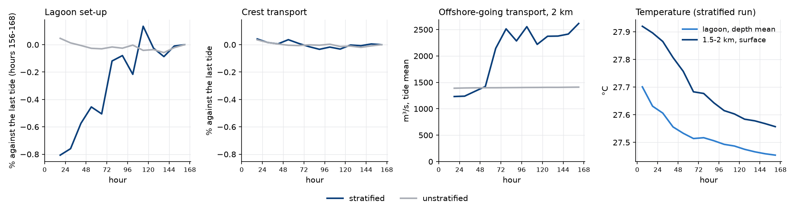

# Seven-day stratified run

- **Date:** 2026-11-06
- **Status:** result; no default changed. Run length stays the author's call
- **Build:** `Reef_Ideal_A15_veg_strat` with all defaults, density 1, N² 1e-4, DT 2.5 s, `NDTFAST` 10, N 15, image `42d56f9a`. `c2d-standard-16` Spot, 10 ROMS + 6 SWAN, 6 h segments. North boundary RadNud plus the 1 km nudging band toward the initial state. No surface heat flux

## Question / why

The [seven-day run](2026-11-05_seven-day-run.md) and the [bare and patchy runs](2026-11-05_settling-bare-patchy.md) settle within the first tide, but all without stratification. The author: "do a 7day stratified run", and for spin-up, "are you looking at tke to determine spin up duration?"

## What was run

`strat7d`, 28 segments, no preemption, against the unstratified `spinup7d` (same canopy, waves and tide). Bulk numbers are tide-cycle means from 10-minute records, Eulerian plus Stokes; `tools/reef/momentum_budget.py` for the budget; TKE and `AKv` as tide means from hourly records, point by point where they exceed 10 % of the zone's largest; temperature and offshore-going transport from hourly records.

## Results: reef and lagoon flow

| Tide mean | Hours 12-24 | 60-72 | 156-168 | Day 1 against last tide | Unstratified, same comparison |
|---|---|---|---|---|---|
| Lagoon set-up, mm | 24.63 | 24.70 | 24.83 | -0.81 % | +0.05 % |
| Crest transport, m³/s | 768.0 | 767.8 | 767.7 | +0.04 % | +0.04 % |
| Pass transport, m³/s | 780.4 | 780.2 | 780.2 | +0.04 % | +0.03 % |
| Hs crest | | | | -0.06 % | +0.01 % |

- **Transports settle within the first tide, as without stratification.**
- **Set-up takes about three days.** It steps up between hours 60-72 and 72-84, then stays within about 0.2 % of the last tide, wandering more than the unstratified run does. Against water at 1.4-1.6 km, not the deep water, it goes 24.69 to 24.90 mm (+0.84 %), so this isn't a change in the far-field level.
- **Budget, hours 12-24 against 156-168:** every term above 0.01 out to 1150 m changes by at most 0.6 % (lagoon pressure and canopy; at the crest front 0.11 %). On the slope, 1150-1500 m, small terms move a lot (pressure 0.0084 to 0.0124, advection -0.0010 to -0.0062). Residuals are as in the unstratified run.
- **Stratification itself changes little here.** Hours 156-168 against unstratified: set-up -1.3 %, crest transport about -0.15 %.
- **Courant numbers:** peak Cu 0.018, Cv 0.185, Cw 0.16 across all segments, no step above 1. Fastest current 0.75 m/s. Same as unstratified.

## Results: turbulence

Tide means, point by point rms, then the zone mean in brackets:

| Zone | TKE, day 1 against last tide | TKE, day 3 | `AKv`, day 1 | `AKv`, day 3 | `AKv` against unstratified, last tide |
|---|---|---|---|---|---|
| Lagoon | 1.6 % (-1.2 %) | 0.9 % (-0.8 %) | 22 % (-7.1 %) | 20 % (-6.1 %) | -8 % |
| Back of crest | 1.0 % (0.0 %) | 0.3 % (0.0 %) | 2.1 % (0.0 %) | 1.2 % (0.0 %) | -0.1 % |
| Crest front | 1.0 % (-0.2 %) | 0.4 % (0.0 %) | 14 % (-3.4 %) | 9.7 % (-2.0 %) | -4 % |
| 1150-1500 m | 24 % (-3.7 %) | 15 % (-2.9 %) | 30 % (-25 %) | 22 % (-13 %) | -43 % |
| 1500-2000 m | 60 % (-7.9 %) | 31 % (-9.2 %) | 67 % (-53 %) | 52 % (-22 %) | -76 % |
| 2-3 km | 115 % (-14 %) | 80 % (-4.9 %) | 86 % (-62 %) | 69 % (-19 %) | -95 % |
| 3-3.8 km | 72 % (-25 %) | 88 % (+1.8 %) | 80 % (-35 %) | 80 % (-23 %) | -99.6 % (3-5 km) |

- **TKE on the reef and in the lagoon settles about as it does unstratified:** 1.6 % rms at most on day 1.
- **`AKv` doesn't, at low TKE:** lagoon 22 % rms on day 1 and still 20 % on day 3, crest front 14 % and 9.7 %. It's unstratified's under 1 %. The likely reason, not tested directly: stratification in the lagoon keeps fading (top-to-bottom temperature 0.05 °C at hours 12-24, 0.02 at 60-72, 0.007 at 156-168), and `AKv` where TKE is small responds to very weak stratification. The flow doesn't feel it: lagoon budget terms hold within 0.6 %.
- **Deep water mixes far less than unstratified.** `AKv` at 3-5 km is 0.4 % of the unstratified value. So the far-field turbulence of the [seven-day run](2026-11-05_seven-day-run.md) was a result of having no stratification.

## Results: past the crest

Offshore-going transport, tide means, m³/s:

| From shore | Hours 12-24 | 60-72 | 156-168 | Unstratified, 156-168 |
|---|---|---|---|---|
| 1.2 km | 845 | 840 | 849 | 838 |
| 1.5 km | 1027 | 1260 | 1541 | 945 |
| 2 km | 1232 | 2145 | 2615 | 1410 |
| 3 km | 1904 | 3039 | 3327 | 3173 |
| 4 km | 2371 | 2601 | 3016 | 5848 |
| 4.5 km | 1009 | 1218 | 1312 | 5382 |

- **Out to 1.2 km it holds.** Every tide is within 1.4 % of the last.
- **At 1.5-2 km the flow changes around hours 48-72.** At 2 km it jumps from 1420 to 2510 m³/s in two tides, then swings between 2220 and 2615. At 1.5 km it swings between 1331 and 1643 from hour 60 on, while the unstratified run stays at 944-945. The set-up's step comes right after, but I didn't trace whether they are linked.
- **I can't say how much of this repeats.** The noise twins were unstratified, and that flow's chance level at 1.5-2 km (0.13 % at most) clearly doesn't apply to these swings.

## Results: temperature

- **It doesn't settle in a week, anywhere.** Lagoon depth mean: 27.63 °C at hours 12-24, 27.51 at 60-72, 27.45 at 156-168, still falling 0.005 °C per tide. Surface at 1.5-2 km: 27.93 at hours 0-12, 27.54 at 156-168.
- **The upper layer is eroded past the crest while the water below warms.** At 2 km: 20 m goes from 26.80 to 27.10 °C, 50 m from 25.01 to 25.29.
- **The whole domain warms steadily, about 0.027 °C per day.** The isotherms sink about 5 m at 50 m depth and about 2 m at 300 m in the week, out to the boundary. There are no surface fluxes, so the heat comes through the boundary. Stokes drift brings 0.0405 m²/s of surface water shoreward at 27.4 °C, and the Eulerian return flow takes the same volume back cooler (25.8 °C at 3 km, 17.5 °C at 4.95 km).
- **That budget closes:** the net advective flux against the storage shoreward of each line, C m²/s, is 0.064 against 0.077 at 3 km and 0.171 against 0.173 at 4 km (hours 12-24), and 0.066 against 0.061, and 0.131 against 0.146 (hours 156-168). In the nudging band the inflow exceeds storage (0.405 against 0.261 at 4.95 km), so the band removes part of it.
- **Read it as a property of this setup.** It comes from steady waves against an open boundary that keeps supplying initial-state water, with no fluxes at the surface.

## Decision / outcome

No default changed. **For the author to decide**, by what a member will read:

- **Reef and lagoon flow:** 24 h, averaged over hours 12-24, still holds. Transports within 0.04 %, large budget terms within 0.6 %, TKE within 1.6 % rms, set-up 0.8 % low. If that set-up offset matters, about 3.5 days removes it, at 3.5x the cost.
- **Lagoon or crest `AKv` under stratification, temperature, or anything past 1.2 km:** not settled at any length tested, so a week doesn't answer these either. They need a different setup to be steady (surface fluxes, a treatment of the boundary supply) or to be read as a transient.
- Whether the 0.8 % offset is common to all members, so that differences between them are still good on day 1, isn't known.

## Open questions

- Is the change at 1.5-2 km around hours 48-72 repeatable? A noise twin of this case would show it, and would give the stratified chance level. It's only worth running if stratified members are planned.
- Restart exactness isn't verified for this case: no straight run was made to compare with.
- One canopy (density 1). Bare and patchy under stratification, and the thermal case with its heat fluxes, aren't covered.

## Details and links

- Spec: `batch/ensemble/tests/strat7d`
- Cost: $2.54 (14.6 h, about $0.17/h, 8 % slower than `spinup7d`; I had estimated about $2.45)
