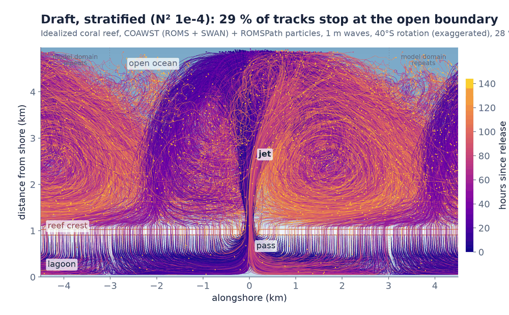
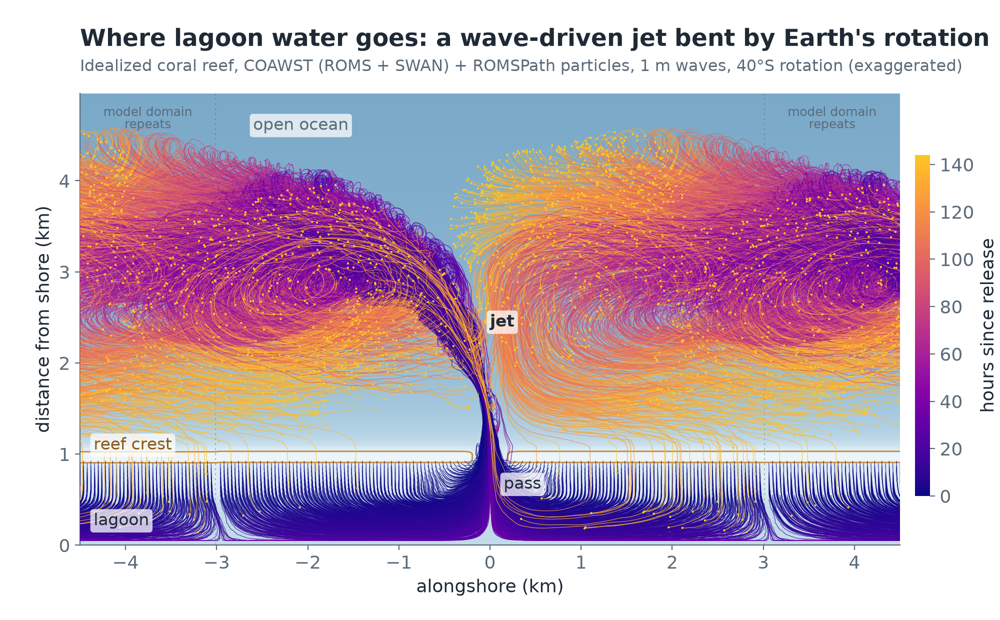
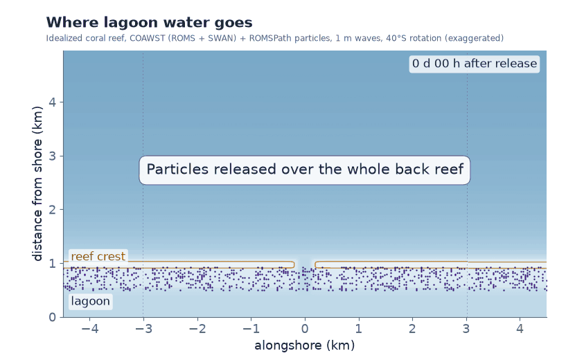
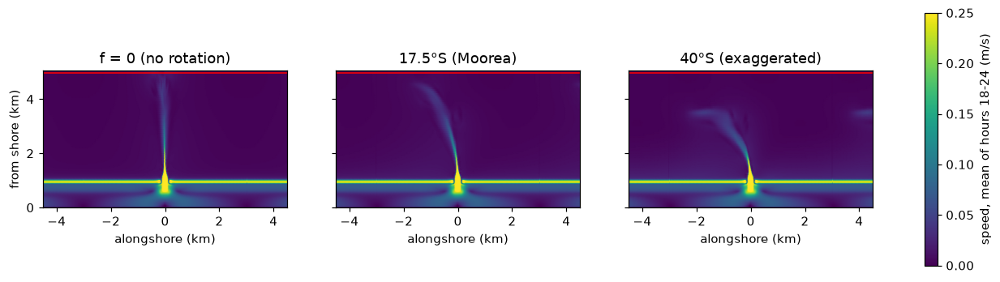
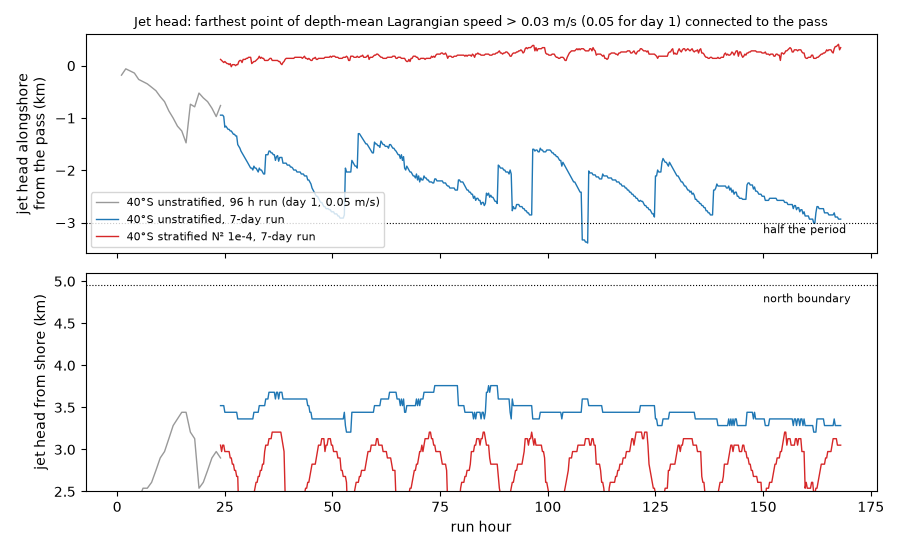
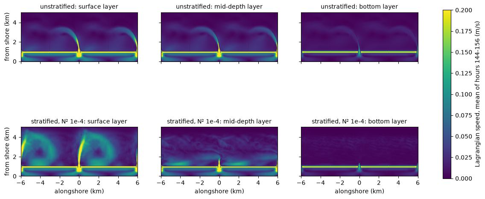

# Rotation bends the pass jet: Coriolis variants and particle tracking

- **Date:** 2026-11-12 (runs and analysis into the evening, US Pacific)
- **Status:** done for the unstratified 40°S case (README figure and GIF made); the stratified case is waiting on a decision by the author, because its surface jet reaches the north boundary
- **Build:** unstratified runs with the default `Reef_Ideal_A15_veg` image (coawst-cloud ca5316d plus `roms-stokes-interval`, digest `e01ef5a1`); the grid alone carries f, read at run time. Stratified run with an image built from `cases/Reef_Ideal_A15_veg_strat_cor40s` (coawst-cloud eee8646, digest `ef03f006`). `c2d-standard-32` Spot in us-west4, 20 ROMS (2 x 10 tiles) + 12 SWAN, 6 h restart segments

## Question / why

Every A15 run so far had f = 0: the grids carry no Coriolis parameter, although every A15 header compiles `UV_COR`. The author wanted one striking figure (and a GIF) for the top of their GitHub profile README: particle tracks of lagoon water leaving through the pass, with the jet bent by Earth's rotation. Their brief: a Coriolis variant at a tropical South Pacific reef latitude (17.5°S), at least 72 h on Spot in exact-restart segments, 15 min 3-D history for the tracking window, then three checks before any figure (jet head against time, periodic wrap, set-up and transports against f = 0), and "If the jet still runs into the boundary, stop and tell me". Later: "if it doesnt curve before hitting the boundary, lets crank f up to something like 40 or 60 degrees south" (then "I am good with going with the 40deg S option"), "start the particles at the 24 hr mark then run it out like 2 days or maybe longer if we can eventually see the jets interacting with each other", and "do this on a constant stratification run ... surface temp 28C ... N2 = 1E-4".

## What was run

New case folders, each a copy of its parent with only `f` in the grid changed, made with [`tools/reef/set_coriolis.py`](../tools/reef/set_coriolis.py):

| Case | Parent | f (s⁻¹) | Inertial period |
|---|---|---|---|
| [`Reef_Ideal_A15_veg_cor`](../cases/Reef_Ideal_A15_veg_cor/README.md) | `Reef_Ideal_A15_veg` | -4.3856e-5 (17.5°S, tropical South Pacific) | 39.8 h |
| [`Reef_Ideal_A15_veg_cor40s`](../cases/Reef_Ideal_A15_veg_cor40s/README.md) | `Reef_Ideal_A15_veg` | -9.3745e-5 (40°S, exaggerated) | 18.6 h |
| [`Reef_Ideal_A15_veg_strat_cor40s`](../cases/Reef_Ideal_A15_veg_strat_cor40s/README.md) | `Reef_Ideal_A15_veg_strat` (N² 1e-4, 28 °C at the surface) | -9.3745e-5 | 18.6 h |

| Run | Case | Length | 15 min history | Wall | Cost (Spot, about) |
|---|---|---|---|---|---|
| `a15cor96` | 17.5°S | 96 h | from hour 48 | 8760 s | $0.85 |
| `a15cor40s96` | 40°S | 96 h | from hour 48 | 8808 s | $0.85 |
| `a15cor40s168` | 40°S | 7 days | from hour 24 | 4.5 h | $1.60 |
| `a15scor40s168` | 40°S stratified | 7 days | from hour 24 | 5.0 h | $1.75 |

The 15 min records come from a new `late_output` option in the ensemble spec (in the author's working repository: from a given hour on, each segment's `NHIS` is changed). All four ran without preemption; peak Courant numbers Cu 0.016-0.018, Cv 0.17-0.19, Cw 0.14-0.16, no NaN, `stokes_ncpl` 5 in every log. Hourly comparisons use the f = 0 seven-day run `spinup7d` ([entry](2026-11-05_seven-day-run.md)), which ran on an older image with the Stokes drift updated every step; the [speed entry](2026-11-05_speed-stokes-and-machines.md) found that within 0.003 % of set-up.

**Particles:** [ROMSPath](https://github.com/NicJeffress/ROMSPath) (fork f9058a4, image built locally by coawst-cloud `build/romspath/build.sh`, with `-DSTOKES`), run by [`tools/reef/track_particles.py`](../tools/reef/track_particles.py) on the control machine (4 runs in parallel, about 16 min for 6 days). Eulerian velocity plus Stokes drift, vertical turbulence from `AKs`, horizontal turbulence 0.001 m²/s, passive neutral particles, internal step 10 s, positions every 15 min, periodic in x. Seeding `backreef`: a regular 40 m x 25 m grid over the whole back reef, 0.5-0.925 km from shore, across the full alongshore period, at mid-depth: 2,682 particles, released at hour 24 and tracked 6 days.

## Results: the jet (checks before the figure)

| Depth-mean jet head (speed above 0.05 m/s, connected to the pass) | f = 0 | 17.5°S | 40°S |
|---|---|---|---|
| Hour 12, distance from shore | 3.9 km, straight | about 3.4 km, bent about 13° | 2.9-3.1 km, bent about 25° |
| Hour 15-24, sideways | none | -0.5 km | -0.8 to -0.9 km |
| Reaches the north boundary in day 1 | yes, by about hour 18 | no | no |

- **At 17.5°S the jet still bends too little** for the figure: 2.1 % of the lagoon particles released at hour 48 reached the north edge within 24 h. Hence 40°S, at the author's request.
- **40°S, 7 days:** from about hour 48 the tidal-mean jet is a steady hook that turns left (to -x, as it should in the southern hemisphere) 3.3-3.8 km from shore. With a 0.03 m/s threshold its head moves back and forth between x -1.3 and -3.4 km from the pass, in a saw-tooth: the hook grows to the left until an eddy breaks off, irregularly (at hours 53, 88, 96, 109, 125 and 138, so every 8-33 h, about 13-16 h in days 4-6). It never wraps the 6 km period, never touches the north boundary (5.0 km), and never reaches the neighbouring pass's jet (6 km away), so the jets don't interact directly. Their eddies do: see the particles below.
- **Rotation doesn't change the reef (hours 48-72 and 72-96, hourly records matched; `options_compare.py`):**

| Tide mean, hours 72-96 | f = 0 | 17.5°S | 40°S |
|---|---|---|---|
| Lagoon set-up, mm | 25.43 | 25.20 | 25.22 |
| Crest transport, m³/s | 719.7 | 720.2 | 719.9 |
| Pass transport, m³/s | -808.3 | -804.8 | -804.5 |
| Pass jet, 99th percentile, m/s | 0.480 | 0.478 | 0.477 |
| Hs on the crest, m | 0.1934 | 0.1934 | 0.1934 |
| Flushing time, h | 7.90 | 7.89 | 7.90 |
| Surface to depth-mean speed, fore reef | 1.004 | 1.239 | 1.259 |

The set-up difference (-0.9 %) is mostly a sampling artifact: the rotating runs had 15 min records, f = 0 hourly; with the same hourly records the three are 25.41, 25.39 and 25.37-25.40 mm (-0.1 to -0.2 %). Transports are within 0.5 %. Only the fore-reef shear changes (+21-25 %): the Ekman veering of the offshore flow.

## Results: where the back-reef water goes (40°S, unstratified)

| Hours after release | Still on the back reef or in the lagoon | Offshore of the crest | Back on the reef after leaving | Farthest from shore |
|---|---|---|---|---|
| 6 | 68 % | 31 % | 0 | 3.5 km |
| 12 | 37 % | 63 % | 0 | 3.9 km |
| 24 | 10 % | 90 % | 0 | 4.1 km |
| 48 | 0.6 % | 99.4 % | 0 | 4.1 km |
| 96 | 0 | 100 % | 0 | 4.5 km |
| 144 | 1.9 % | 98 % | 1.9 % | 4.5 km |

- All the back reef drains through the pass: water near the pass first, water 2-3 km away along the shore (lagoon) last, the latest after about 48 h. The divide between neighbouring passes sits at ±3 km.
- Offshore, the water fills one large eddy per pass, turning clockwise (anticyclonic in the southern hemisphere), centred about 2.8 km from shore and 2 km to the left of its pass.
- **From about day 4 some of it comes back:** water from the eddy is carried onshore over the crest by the waves, into the back reef of the next stretch of reef, and drains to the pass again (71 particles over the crest, 4 back through the pass, 1.9 % by day 6). That is the interaction between neighbouring passes the author asked about: through the shared eddies, not the jets themselves.
- No particle got within 0.4 km of the north boundary in 6 days.

## Results: stratified (40°S, N² 1e-4)

The same canopy, waves, tide and rotation with constant stratification (N² 1e-4 s⁻², 28 °C at the surface, linear to about 5 °C at 400 m; north boundary RadNud plus the 1 km nudging band toward the initial state):

- **Reef and lagoon:** same start-up checks as the other runs (peak Cu 0.018, Cv 0.085, Cw 0.16 in the first segment, fastest current 0.73 m/s).
- **The jet stays at the surface and doesn't bend.** The depth-mean jet head stays within 0.1-0.35 km of the pass's line, 3.0-3.2 km out, all week (unstratified: -1.3 to -3.4 km sideways). In the top layer it runs straight offshore at up to 0.18 m/s through 4.5 km (hour 36) and still 0.04-0.09 m/s there on days 4-6, and it moves 0.02-0.04 m/s in the rows next to the boundary, inside the nudging band. Without stratification the surface flow there is under 0.005 m/s. Two large eddies sit on either side of it, about 2.5 km from shore. Mid-depth and bottom layers offshore are nearly still.
- **So the jet runs into the north boundary.** Per the brief, this one stops here for the author's decision.

| Hours after release | Back reef or lagoon | Offshore of the crest | Reached the north edge (track stopped) | Back on the reef after leaving | Median depth, particles beyond 1.5 km |
|---|---|---|---|---|---|
| 6 | 68 % | 29 % | 2.5 % | 0 | 7.9 m (unstratified 42 m) |
| 24 | 13 % | 73 % | 15 % | 0 | 13.5 m (90 m) |
| 48 | 5.5 % | 73 % | 21 % | 4.4 % | 16.1 m (111 m) |
| 144 | 2.6 % | 68 % | 29 % | 2.6 % | 21.0 m (91 m) |

- The back reef drains about as fast as without stratification for the first half day, then 15 % of the water is carried to the boundary within a day, 29 % within 6 days.
- Exported water stays in the top 8-21 m; without stratification it mixes down to about 100 m (the deep water offshore is 400 m).
- Return over the crest starts on day 2 instead of day 5 and is larger (4-6 % on days 2-3): the eddies hold the water near the surface, where the wave-driven onshore flow is.

Draft only (same script; title says why): tracks pile up along the north edge where they stop.

## Figures

`figures/make_profile_figure.py` (`--lat -40 --images --every 2 --jet-label -0.2 2.4`): every second of the 2,682 tracks, coloured by hours since release, end positions as dots, over the bathymetry (log depth), tiled one period each side; each track also drawn shifted by ±6.02 km, because the model is one period of an endless reef. Tracks stop at the north boundary (none got there). Also `reef_jet_40S.svg` (tracks rasterized, text vector) and the GIF:

`--gif --step 4 --tail 6 --gif-every 5 --fps 10`: a random fifth of the particles (the same ones in every copy), one frame per hour with a 6 h fading tail, a 2 s labelled pause at the release, 18 s, 4.8 MB. Saved with one palette for all frames and no dithering: Pillow's default palette per frame made the background flicker and the file 2-3x larger.

Depth-mean Lagrangian speed, mean of hours 18-24, three periods wide: straight to the boundary at f = 0, bent at 17.5°S, bent more at 40°S.

[`tools/reef/jet_bend.py`](../tools/reef/jet_bend.py) on every record: top, the head's alongshore distance from the pass; bottom, its distance from shore. Grey: day 1 of the 96 h 40°S run (0.05 m/s threshold). Blue: unstratified, 7-day run (0.03 m/s). Red: stratified. The depth-mean measure misses the stratified case's surface jet (next figure).

Lagrangian speed (u + u_stokes) in the top, middle (level 8 of 15) and bottom layers, mean of hours 144-156, both 40°S runs.

## Decision / outcome

> "I am good with going with the 40deg S option" (author)

The 40°S unstratified figure and GIF are made. The stratified figure waits for the author: per the brief ("If the jet still runs into the boundary, stop and tell me. Options are a longer domain offshore or a different figure window, and that choice is mine").

## Open questions

- The stratified case needs a longer domain offshore, or a figure window that leaves out the outer kilometre, or a figure that says the tracks stop at the boundary.
- 40°S is more than twice the rotation at 17.5°S. There the jet bends too little for the 5 km domain, so the bend at a tropical latitude can't be shown without a longer domain.
- Particles are passive and neutral, with a constant 0.001 m²/s horizontal diffusivity; ROMSPath's open-boundary escape is not active, so tracks are cut 100 m inside the north edge (none reached it here).
- Not done: lagoon residence time from these tracks. The author's plan is ROMSPath residence time later, once physics and numerics are settled.

## Details and links

- Newer images write the periodic ghost columns of `x_rho`, `x_u`, `x_v`, `x_psi` already wrapped (`x_rho[0]` = +2990 m). The three scripts rebuild them from `pm`, and `track_particles.py --grid` writes the case's grid fields into the history file before ROMSPath reads it.
- Particles seeded 50 m from shore lie shoreward of the first interior row (50.8 m); ROMSPath marks them outside the grid (status 9). Seeding starts at 100 m; the figure script drops any particle outside at release.
- Merging the 15 min history from hours 24-168 keeps only the variables ROMSPath, the jet check and the figure need, compressed: 4.5 GB a run instead of about 19 GB.
- Cases: [docs/Reef_Ideal_A15_veg.md](../docs/Reef_Ideal_A15_veg.md), [docs/Reef_Ideal_A15_veg_strat.md](../docs/Reef_Ideal_A15_veg_strat.md)
