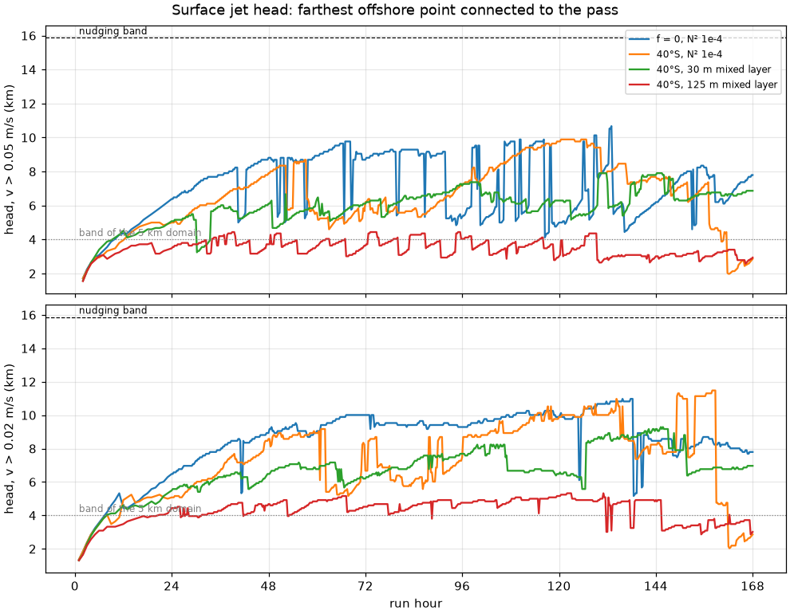
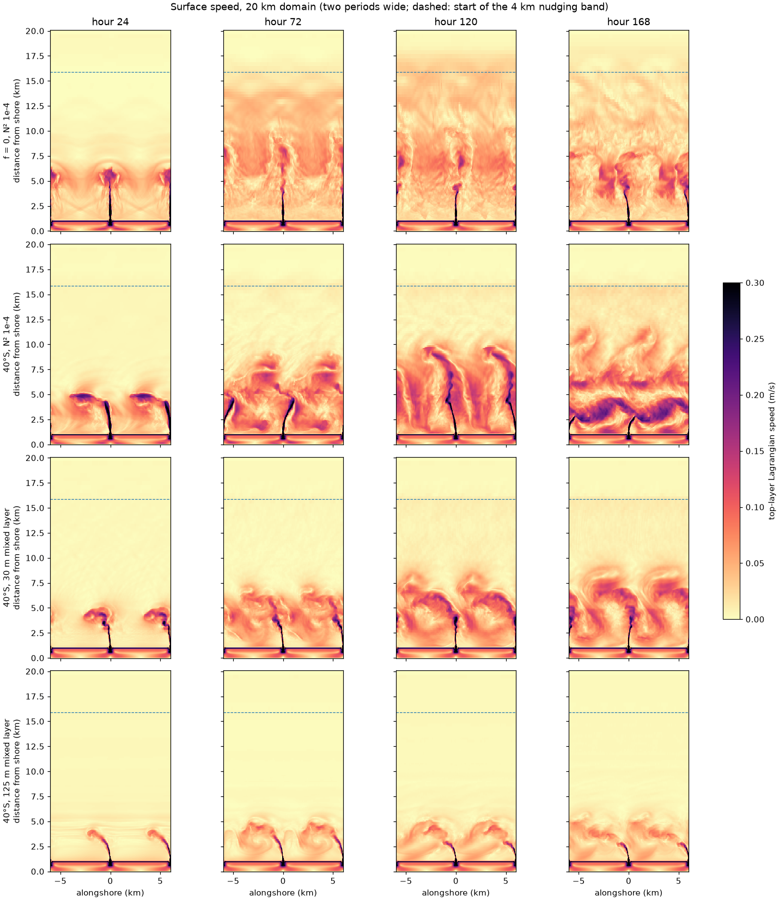
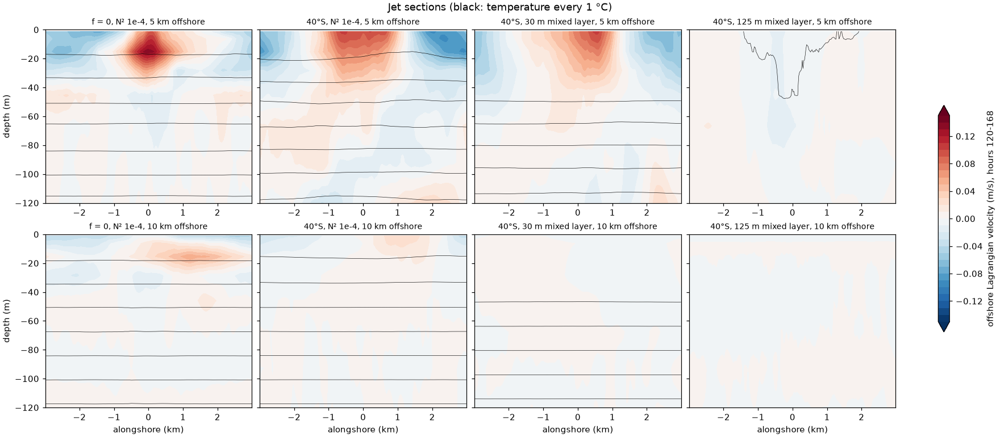
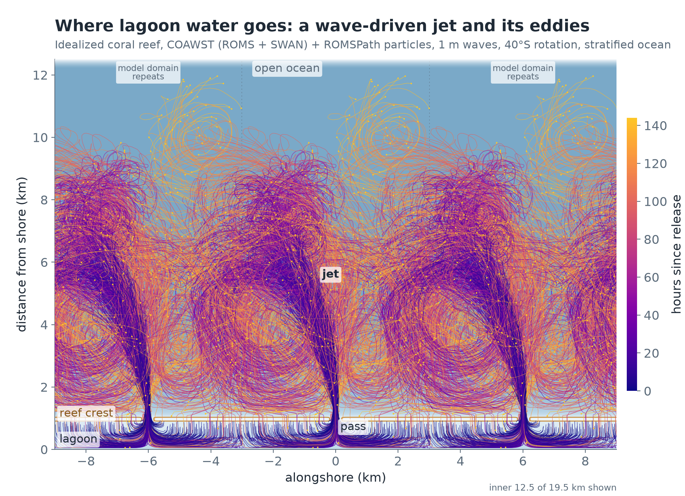
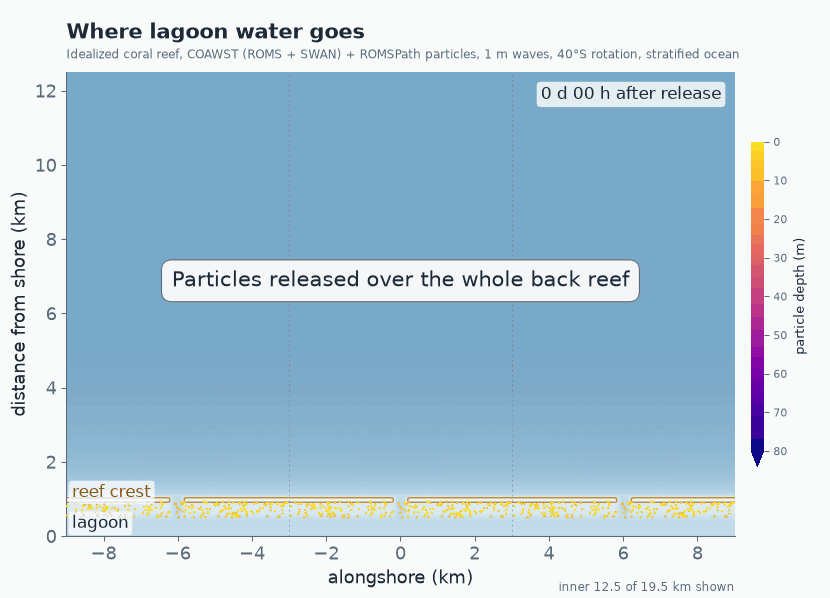
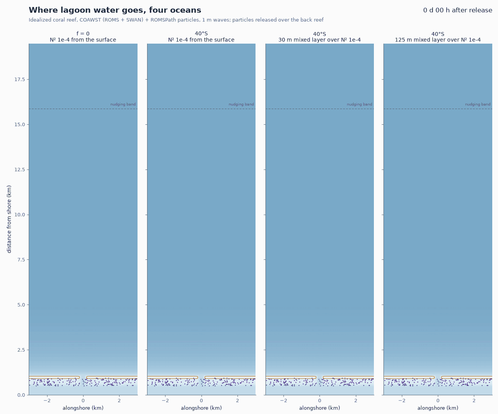
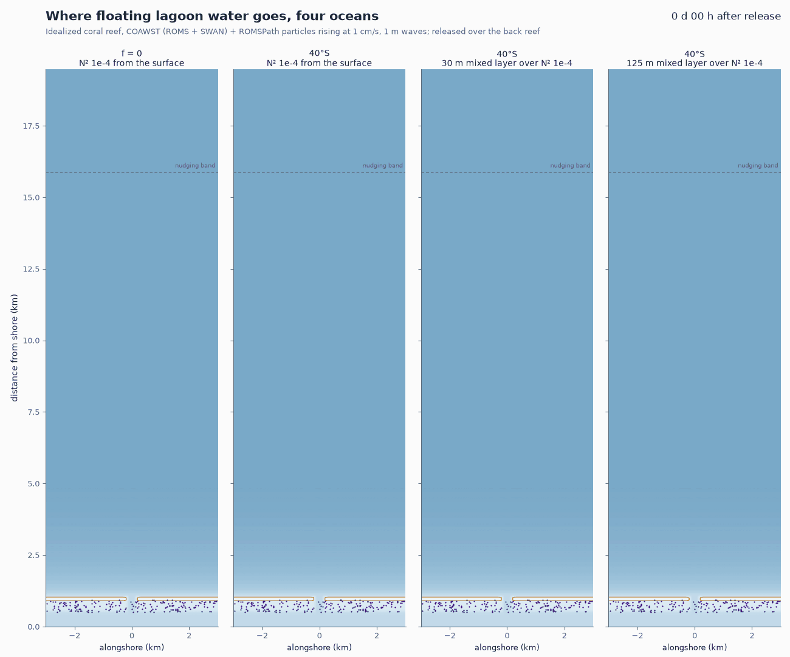

# A 20 km domain: where the stratified pass jet goes without a nearby boundary

- **Date:** 2026-11-13 (runs overnight, analysis in the morning, US Pacific)
- **Status:** done. No surface jet reaches the nudging band in a week, and at 40°S no particle does; at f = 0 the jet stalls at about 10 km but 12 % of the back-reef particles drift on into the band from day 3. The 5 km domain had changed the stratified 40°S jet near the reef, so the README figure was remade from the 20 km run (author: "Yes, remake it"). A side-by-side GIF and a movie of the particles in all four runs; floating particles (1 cm/s rise) in all four runs: with rotation more of them come back over the crest (37 % against 12 % with a 30 m mixed layer), at f = 0 none do; surface-trapped particles (ROMSPath `nsb = 1`) match the 1 cm/s ones except with the 125 m mixed layer, where 1 cm/s is mixed down in the jet (return 12 % against 21 % trapped)
- **Build:** image built from `cases/Reef_Ideal_A15_veg_strat_cor40s` (coawst-cloud eee8646, digest `ef03f006`); the 20 km grid, initial state and SWAN files are copied into each member at run time, so no new image. `c2d-standard-32` Spot, 20 ROMS (2 x 10 tiles) + 12 SWAN, 6 h restart segments, 15 min history from hour 24

## Question / why

In the 5 km domain the stratified 40°S jet ran straight into the north boundary, and the README figure had to be cut at 3.9 km ([entry](2026-11-12_coriolis-and-particles.md), "Figure window"). The estimate there said a boundary at 9-10 km or more might hold the 40°S jet, and that at f = 0 nothing would. The author:

> "lets do flat at 400m ... Lets fire off a 20km run with f=0 and 40 deg S"

Then, after looking at two CTD casts from the region (summer: a 25-30 m mixed layer; winter: about 125 m):

> "i think the next variants should have a 30m mixed layer over N2,1E-4 and then a 125m mixed layer over N2,1E-4"

## What was run

[`tools/reef/extend_a15_grid.py`](../tools/reef/extend_a15_grid.py) adds 86 rows beyond the 5 km boundary: 80 m rows growing 1 % per row to 120 m at 10 km, then 4 % per row to 400 m from about 15.6 km. The bottom continues the 1:10 slope until it reaches 400 m and stays flat at 400 m beyond (the old grid reached 400 m only at its last row). Grid 203 x 212, north boundary at 19.87 km, nudging band widened to 4 km (USER(3) 4000 m, so it starts at 15.87 km). Barotropic Courant number 0.81, as before.

| Run | Case | f | Initial stratification | Region | Wall | Cost (Spot, about) |
|---|---|---|---|---|---|---|
| `a15s20km168` | [`Reef_Ideal_A15_veg_strat_20km`](../cases/Reef_Ideal_A15_veg_strat_20km/README.md) | 0 | N² 1e-4 from the surface (28 °C to 4.9 °C at 400 m) | us-west4 | 8.3 h | $2.70 |
| `a15scor40s20km168` | [`Reef_Ideal_A15_veg_strat_cor40s_20km`](../cases/Reef_Ideal_A15_veg_strat_cor40s_20km/README.md) | 40°S | same | us-west4 | 7.9 h | $2.60 |
| `a15scor40s20kml168` 0000 | same, `make_strat_init.py --mixed-layer 30` | 40°S | 28 °C to 30 m, N² 1e-4 below (6.7 °C at 400 m) | us-east4 | 7.5 h | $4.30 |
| `a15scor40s20kml168` 0001 | same, `--mixed-layer 125` | 40°S | 28 °C to 125 m, N² 1e-4 below (12.4 °C at 400 m) | us-east4 | 7.5 h | $4.30 |

All 7 days, 28 segments each, no preemption, about $14 in total (more than the $10 expected: us-east4 Spot was $0.57/h against $0.33/h in us-west4). Peak Courant numbers over all 112 segment logs: Cu 0.019, Cv 0.19, Cw 0.16; fastest current 0.75 m/s; no NaN or blow-up. The f = 0 twins of the mixed-layer runs were not run.

**Analysis:** [`tools/reef/extract_jet_fields.py`](../tools/reef/extract_jet_fields.py) keeps the top-layer and depth-mean fields at every record (hourly to hour 24, then every 15 min), plus full-depth sections at 2.5, 5, 10 and 15 km: 0.8 GB a run instead of 19 GB. [`tools/reef/jet_head.py`](../tools/reef/jet_head.py) finds the jet head: the farthest offshore point whose top-layer Lagrangian offshore velocity (v + v_stokes) is above 0.05 (or 0.02) m/s and is connected to the pass mouth. [`tools/reef/jet_core_path.py`](../tools/reef/jet_core_path.py) gives the time-mean core path. Figures by [`figures/jet_20km.py`](../figures/jet_20km.py).

## Results

### No jet reaches the nudging band

| Run | Head (0.05 m/s) at hour 24 | at hour 48 | Farthest in the week (0.05 / 0.02 m/s) |
|---|---|---|---|
| f = 0, N² 1e-4 | 6.4 km | 8.8 km | 10.7 / 11.0 km (hour 133-136) |
| 40°S, N² 1e-4 | 5.0 km | 7.9 km | 9.9 / 11.5 km (hours 120, 158) |
| 40°S, 30 m mixed layer | 5.1 km | 6.1 km | 7.9 / 9.3 km |
| 40°S, 125 m mixed layer | 3.5 km | 3.7 km | 4.4 / 5.3 km |

- The band starts at 15.87 km; the closest any head came is 4.4 km short of it. The jumps in the curves are eddies breaking off the jet's tip: the measure follows the connected jet, not water already shed.
- Against the 5 km 40°S run (same measure): the 20 km heads are 0.3-0.4 km behind at hours 2-4 (1.7 against 2.1 km at hour 2, 2.6 against 2.9 km at hour 4), then within 0.2 km of it from hour 6 to 18 (4.9 against 4.8 km at hour 18). Why the first hours differ is not checked.
- **At f = 0 the jet stalls, its water doesn't.** The jet reaches 9-10 km by day 3 and then stops advancing: past about 5 km it spreads into a field of eddies 5-14 km out (maps below), with weak flow (0.02-0.03 m/s) reaching about 14 km. But the water it carried keeps spreading offshore in that weak flow: 39 % of the back-reef particles get past 12 km, and 12 % into the nudging band (from about hour 60; 8-10 % are in it at any time from day 4; the farthest 18.4 km). So for f = 0 the 20 km domain holds the jet but not its water, much as the estimate in the [previous entry](2026-11-12_coriolis-and-particles.md) said (band of a 20 km domain reached in 4-12 days).
- **40°S, N² 1e-4** gets about as far as f = 0, but bent (next section).

Top-layer Lagrangian speed, two alongshore periods, the dashed line the start of the nudging band.

### The jet bends left, as rotation predicts; the 5 km run's drift to the right was the boundary

Time-mean surface jet core, alongshore position (km, + is to the right looking offshore) and top-layer offshore velocity (cm/s):

| Run, hours | 2.5 km | 3.0 km | 3.5 km | 4.0 km | 4.5 km | 5.0 km | 6.0 km | 8.0 km |
|---|---|---|---|---|---|---|---|---|
| 5 km domain, 40°S, N² 1e-4, 24-96 | +0.1 / 28 | +0.1 / 22 | +0.2 / 19 | +0.2 / 15 | +0.2 / 7 | | | |
| same, 96-168 | +0.1 / 30 | +0.2 / 24 | +0.4 / 19 | +0.7 / 13 | +0.8 / 8 | | | |
| 20 km, 40°S, N² 1e-4, 24-96 | -0.1 / 19 | -0.1 / 12 | -0.3 / 11 | -0.4 / 12 | -0.6 / 10 | -1.0 / 6 | -1.3 / 1 | -2.4 / 2 |
| same, 96-168 | -0.2 / 16 | -0.3 / 12 | +0.4 / 12 | +0.1 / 13 | +0.1 / 13 | +0.2 / 12 | -0.1 / 12 | -0.8 / 5 |
| 20 km, f = 0, N² 1e-4, 24-96 | 0.0 / 29 | 0.0 / 23 | 0.0 / 19 | 0.0 / 14 | 0.0 / 14 | 0.0 / 10 | 0.0 / 10 | -0.1 / 7 |
| same, 96-168 | 0.0 / 28 | 0.0 / 17 | 0.0 / 13 | 0.0 / 10 | 0.0 / 11 | +0.1 / 9 | +0.4 / 7 | +0.8 / 5 |
| 20 km, 40°S, 30 m mixed layer, 24-96 | -0.1 / 23 | -0.3 / 17 | -0.4 / 15 | -0.5 / 13 | -0.5 / 12 | -0.9 / 10 | -1.4 / 5 | -2.2 / 0 |
| 20 km, 40°S, 125 m mixed layer, 24-96 | -0.3 / 15 | -0.5 / 10 | -0.8 / 7 | -1.1 / 4 | -1.5 / 2 | -2.1 / 0 | | |

- In the 20 km domain the 40°S jet turns left (in the southern hemisphere rotation turns a current to its left): on days 1-4 its core is 0.6 km left at 4.5 km and 2.4 km left at 8 km, and its tip hooks left by about 2 km on day 1 (head position at hours 18-24).
- In the 5 km domain the same jet drifted 0.2-0.8 km to the **right**, and was 30-80 % faster at 2.5-4 km (28-30 against 16-19 cm/s at 2.5 km). With a boundary 1.5-2.5 km beyond, the jet's near field was not free. **The README figure and GIF come from that 5 km run**, so the straight jet with its strong eddy on the right is partly the boundary's doing.
- On days 4-7 the 20 km 40°S jet is straighter out to 6 km and slower near the reef than on days 1-4, and in the last day it broke up: at hour 168 the surface flow 2.5-4 km out is an alongshore meandering current (alongshore mean +12.6 cm/s at 3.5 km, -5.8 cm/s at 1.5 km) and the jet head is back at 2.9 km. Before that the alongshore mean flow had stayed within about ±5 cm/s. One week is too short to say whether this repeats or grows. Rotation acting on a mean offshore flow at the surface and a return flow at depth would drive opposite alongshore currents in the two layers, and the periodic domain has no alongshore pressure gradient to stop them; not checked.

### The mixed layer decides how far the jet gets

Offshore Lagrangian velocity, mean of hours 120-168, at 5 km (top) and 10 km (bottom); black, temperature every 1 °C.

- **125 m mixed layer:** behaves like the unstratified 40°S run. The water near the reef is deeper than the jet but shallower than the mixed layer, so nothing holds the jet near the surface: it slows from 42 cm/s at 1.5 km to 7 cm/s at 3.5 km, turns left within 1-2 km and never gets past 4.4 km. At 5 km there is almost no offshore flow.
- **30 m mixed layer:** in between. The jet is about 30-40 m thick (the whole mixed layer) at 5 km, against about 25 m with stratification from the surface, slows faster (12 cm/s at 4.5 km, 5 cm/s at 6 km) and turns left beyond 5 km; its eddies fill 3-9 km.
- **N² 1e-4 from the surface:** the thinnest and farthest-reaching jet at 40°S. At f = 0 the 5 km section has the core below the surface, at about 15 m.

### Particles and the README figure

> "Yes, remake it" (author, on remaking the README figure from the 20 km run)

> "it would be really cool if we had a GIF of all 4 of these side by side" and "i would also like a full blown particle tracking movie of the 4 runs" (author)

The same back-reef seeding as before (2,682 particles at mid-depth over the whole back reef, released at hour 24, tracked 6 days with [ROMSPath](https://github.com/NicJeffress/ROMSPath), `tools/reef/track_particles.py --seeding backreef --days 6 --dt 900`), on each run's merged 15 min history (hours 24-168, 7.6 GB a run). On the control machine: about 20 min for one run alone, about 2 h for three at once.

| Run | Farthest | Beyond 4 km at day 1 / day 6 | Beyond 8 km at day 6 | Median depth off the reef, day 1 / day 6 | Deepest | Back over the crest |
|---|---|---|---|---|---|---|
| f = 0, N² 1e-4 | 18.4 km | 88 / 79 % | 55 % | 11 / 14 m | 74 m | 5 % |
| 40°S, N² 1e-4 | 12.0 km | 75 / 66 % | 21 % | 11 / 15 m | 80 m | 19 % |
| 40°S, 30 m mixed layer | 9.4 km | 68 / 59 % | 7 % | 23 / 26 m | 113 m | 12 % |
| 40°S, 125 m mixed layer | 6.2 km | 48 / 38 % | 0 | 62 / 62 m | 166 m | 5 % |

"Back over the crest": had been more than 1.2 km from shore and later came back shoreward of 0.95 km. Every particle leaves the reef within the 6 days in every run.

- The mixed layer sets the depth the exported water goes to: half of it sits within about 11-15 m of the surface with stratification from the surface, about 25 m with a 30 m mixed layer, about 60 m with 125 m. Deeper water goes less far offshore.
- Rotation brings water back: at 40°S with stratification from the surface, a fifth of the particles come back over the crest within 6 days, against 5 % at f = 0.

The README figure, remade: `figures/make_profile_figure.py ... --lat -40 --images --every 10 --xlim 9 --ytop 12.5` with the same title and subtitle. Three alongshore periods (±9 km) so the three jets and their eddies show side by side, the inner 12.5 km (the farthest particle reaches 12.0 km, so nothing is cut). With 6 days of tracks a random tenth of the particles is drawn (every second one was an unreadable tangle). `make_profile_figure.py` now draws as many periodic copies as the window needs and picks the drawn particles at random per particle, so every copy shows the same ones. GIF: `--gif --step 4 --tail 6 --gif-every 13 --fps 10`, 146 frames, 6.0 MB:

The four runs side by side ([`figures/make_compare_gif.py`](../figures/make_compare_gif.py), the whole 19.5 km of each domain, one alongshore period each, the nudging band dashed):

`--ytop 19.47 --band 15.87 --step 4 --tail 6 --every 14 --fps 10`: a random fourteenth of the particles, 145 frames, 1300 x 1082 px, 6.8 MB. The movie (`--movie --step 1 --tail 8 --every 1 --fps 24`): every particle, every 15 min record, particles coloured by depth below mean sea level (0-80 m), 577 frames at 24 fps, 27 s, 2600 x 2027 px, 88 MB, about 35 min to render; kept with the author's movies, not in this repository.

### Why less of the 125 m water comes back over the crest (checked)

The neutral particles that stay closest to the reef (125 m mixed layer) come back over the crest least (5 %, against 19 % with stratification from the surface). [`tools/reef/crest_inflow_profile.py`](../tools/reef/crest_inflow_profile.py) gives the time-mean (hours 24-168) cross-shore Lagrangian velocity against depth offshore of the crest, averaged alongshore over the crest away from the pass (|x| > 0.4 km):

- The crest takes in the same volume in every run: about 0.14 m³/s per metre of crest (0.118 at 0.97 km from shore, 0.136-0.165 at 1.05-1.5 km), set by the waves.
- With stratification from the surface (and at f = 0) the inflow 0.3-0.5 km offshore of the crest is in the top 10-20 m: the top 30 % of the water column carries 58-83 % of it at 1.3-1.5 km, and the water below about 20 m is nearly still. With the 125 m mixed layer the inflow is spread over the whole column, slightly bottom-heavy (top 30 %: 18 %). The 30 m mixed layer is in between (34-45 %).

The particles (table below, last two columns, and by depth): after leaving the reef, the 125 m particles spend about half as much of their time 1.15-1.5 km from shore, where the crest draws from (1.2 % against 2.5 %), because they sit deep over deeper water farther out; and there they cross back within 6 h less often (17 % against 25 %). With stratification from the surface depth decides it: a particle in that zone in the top 10 m crosses within 6 h about 40 % of the time, at 20-40 m 0.6 %; with the 125 m mixed layer 23-25 % in the top 20 m and 7 % at 20-40 m. Time near the crest times the chance of crossing gives most of the 19 % against 5 %.

### Buoyant particles (rising at 1 cm/s)

> "Lets also do a romspath run for those 4 cases where the particles are buoyant." (author; rise speed 1 cm/s, the author's choice of three offered)

The same seeding and release, with ROMSPath `Behavior = 1` (`swimslow = swimfast = 0.01` m/s, from release): a constant upward velocity added to the turbulent mixing every step. ROMSPath's surface-trapping switch (`nsb`) exists only in its CROCO version. At 1 cm/s the particles sit in the top 10 cm off the reef (median 4-6 cm; 90 % above 1.4 m at day 1 and above 0.1-0.2 m at day 6), so these are floating particles. About 20 min a run on the control machine.

| run | farthest km | into band | >4 km d1/end | >8 km end | depth off reef d1 (p90) | depth end (p90) | back over crest | time 1.15-1.5 km | cross in 6 h |
|---|---|---|---|---|---|---|---|---|---|
| f = 0, neutral | 18.4 | 12 % | 88 / 79 % | 55 % | 11 (18) m | 14 (27) m | 5 % | 0.7 % | 27 % |
| f = 0, buoyant | 11.2 | 0 % | 94 / 94 % | 10 % | 0.044 (0.086) m | 0.044 (0.086) m | 0 % | 0.2 % | 0 % |
| 40°S N², neutral | 12.0 | 0 % | 75 / 66 % | 21 % | 11 (22) m | 15 (32) m | 19 % | 2.5 % | 25 % |
| 40°S N², buoyant | 12.0 | 0 % | 88 / 36 % | 20 % | 0.043 (0.086) m | 0.046 (0.086) m | 22 % | 1.4 % | 42 % |
| 30 m ML, neutral | 9.4 | 0 % | 68 / 59 % | 7 % | 23 (39) m | 26 (50) m | 12 % | 2.1 % | 21 % |
| 30 m ML, buoyant | 9.2 | 0 % | 83 / 58 % | 6 % | 0.058 (1.4) m | 0.05 (0.12) m | 37 % | 3.5 % | 27 % |
| 125 m ML, neutral | 6.2 | 0 % | 48 / 38 % | 0 % | 62 (1.1e+02) m | 62 (1.2e+02) m | 5 % | 1.2 % | 17 % |
| 125 m ML, buoyant | 5.9 | 0 % | 30 / 23 % | 0 % | 0.055 (1.1) m | 0.053 (0.22) m | 12 % | 3.7 % | 10 % |

Same columns for all eight: "into band", ever beyond 15.87 km; "time 1.15-1.5 km", share of particle time after first leaving the reef; "cross in 6 h", chance that a particle in that zone crosses back over the crest within 6 h.

- **f = 0: floating water goes out and stays out.** None comes back over the crest (5 % neutral) and 94 % is still beyond 4 km at day 6, but none reaches the band (12 % neutral): the floating particles collect 4-11 km out instead of spreading down and on into the band.
- **With rotation, floating water comes back more:** 22 % at 40°S with stratification from the surface (19 % neutral), **37 % with the 30 m mixed layer (12 %)**, 12 % with the 125 m mixed layer (5 %). At the surface the particles are always in the layer the crest draws from, and in the mixed-layer runs they also spend more time near the crest (3.5-3.7 % against 1.2-2.1 %).
- Floating particles gather into thin lines along surface fronts and eddy edges (GIF), which neutral particles do not.
- How far out: the same farthest point with stratification from the surface (12.0 km) and with the 30 m mixed layer (9.2 against 9.4 km), but at day 6 only 36 % of the 40°S floating particles are beyond 4 km (66 % neutral), and with the 125 m mixed layer 23 % (38 %).

`figures/make_compare_gif.py ... --ytop 19.47 --band 15.87 --step 4 --tail 6 --every 14 --fps 10` with the buoyant tracks, 5.4 MB. [`tools/reef/particle_fates.py`](../tools/reef/particle_fates.py) makes the table.

### Surface-trapped particles, against 1 cm/s

> "can we also do a set of romspath runs where the particles are actually surface trapped, and see if those are different from these 1cm/s runs?" (author)

ROMSPath's `nsb = 1` puts each particle back at `vertdist` below the moving sea surface every step (0.25 m, ROMSPath's default), with no vertical advection, mixing or rising (`ROMSPath.f90`, the vertical update; the setting is in the ROMS build as well as the CROCO one). Same seeding, release and 6 days.

| run | farthest km | into band | >4 km d1/end | >8 km end | depth off reef d1 (p90) | depth end (p90) | back over crest | time 1.15-1.5 km | cross in 6 h |
|---|---|---|---|---|---|---|---|---|---|
| f = 0, 1 cm/s | 11.2 | 0 % | 94 / 94 % | 10 % | 0.044 (0.086) m | 0.044 (0.086) m | 0 % | 0.2 % | 0 % |
| f = 0, trapped | 11.3 | 0 % | 94 / 94 % | 10 % | 0.24 (0.24) m | 0.24 (0.24) m | 0 % | 0.2 % | 0 % |
| 40°S N², 1 cm/s | 12.0 | 0 % | 88 / 36 % | 20 % | 0.043 (0.086) m | 0.046 (0.086) m | 22 % | 1.4 % | 42 % |
| 40°S N², trapped | 12.0 | 0 % | 89 / 38 % | 22 % | 0.24 (0.24) m | 0.24 (0.24) m | 21 % | 1.3 % | 31 % |
| 30 m ML, 1 cm/s | 9.2 | 0 % | 83 / 58 % | 6 % | 0.058 (1.4) m | 0.05 (0.12) m | 37 % | 3.5 % | 27 % |
| 30 m ML, trapped | 9.2 | 0 % | 81 / 56 % | 5 % | 0.24 (0.24) m | 0.24 (0.24) m | 35 % | 4.6 % | 14 % |
| 125 m ML, 1 cm/s | 5.9 | 0 % | 30 / 23 % | 0 % | 0.055 (1.1) m | 0.053 (0.22) m | 12 % | 3.7 % | 10 % |
| 125 m ML, trapped | 5.9 | 0 % | 32 / 19 % | 0 % | 0.24 (0.24) m | 0.24 (0.24) m | 21 % | 9.2 % | 16 % |

- **Nearly the same where the 1 cm/s particles stay at the surface.** At f = 0, at 40°S with stratification from the surface and with the 30 m mixed layer, every number agrees within 1-3 points (return over the crest 0/0, 22/21 and 37/35 %). The 1 cm/s particles are below 0.5 m for only 1-8 % of their time, mostly in the lagoon and over the crest and fore reef, where breaking and the canopy mix strongly (9-19 % of the time there). Being at 4-5 cm or at 0.25 m hardly matters offshore: where the water is deeper than about 15 m both lie above the model's shallowest velocity point (0.35 m deep in 20 m of water, 1.1 m in 400 m), so they see the same velocity; only in a few metres of water near the reef are they at different levels.
- **Different with the 125 m mixed layer:** 21 % come back over the crest when trapped, 12 % at 1 cm/s; trapped particles spend 9.2 % of their time 1.15-1.5 km from shore against 3.7 %. In the jet the deep mixed layer carries the 1 cm/s particles down to 30-80 m for hours (the movie shows it), where they go with the deeper flow; trapped particles stay in the surface recirculation next to the reef. Rising at 1 cm/s is not enough to stay at the surface in a 125 m mixed layer.

**Why trapped particles return less with the 125 m mixed layer than with 30 m (35 against 21 %).** Not for lack of time near the reef: on days 4-6, 55-62 % of the 125 m trapped particles are 0.2-1.5 km off the crest (10-19 % with 30 m). But 35 % of all their time is spent in a patch within 0.6 km of the pass (1-4 % in the other runs), against the root of the outgoing jet, where the surface flow leads back out with the jet, not over the crest. Away from the pass the 125 m surface flow has almost no convergence fronts (strongly convergent, divergence below -1e-4 s⁻¹, on 1.9 % of the band's area and time, against 6.7 % with 30 m and 20 % with stratification from the surface), so floats are not held in lines along the crest where its inflow picks them up; and beyond about 2.5 km the mean surface Lagrangian flow is near zero (offshore Eulerian flow cancels the onshore Stokes drift), against 0.8-1.0 cm/s shoreward in the other runs, so floats out there are not brought back. With 30 m the eddies 3-9 km out bring surface water back to the crest (returners had been a median 5.7 km out). That the patch by the pass is a convergence where water sinks into a jet that mixes down to the bottom, leaving the floats behind, is an interpretation; vertical velocity there was not checked.

Movies of the 1 cm/s and the surface-trapped particles, made like the neutral one (`--movie --step 1 --tail 8 --every 1 --fps 24`, same 0-80 m depth colour bar, so particles near the surface show yellow): 27 s each, 35 and 34 MB; kept with the author's movies.

### Burger and Rossby numbers (2026-11-13)

> "what is the burger number, would it be relevant here?" ... "ya go ahead and calculate it and lets see" (author)

Bu = (N H / f L)² = (Rd / L)², with Rd = N H / |f| the deformation radius of a layer H thick in stratification N: above 1 stratification dominates at scale L, below 1 rotation does. Ro = U / (|f| L) compares the jet's inertia with rotation. [`tools/reef/burger_number.py`](../tools/reef/burger_number.py), every hour from hour 48 to 168, medians: at the 2.5 and 5 km sections the jet core (largest top-layer offshore Lagrangian velocity U), its thickness H (where the velocity falls to half its top-layer value), its width W (full width at half the velocity averaged over the top H), and the ambient N over the top H (columns more than 1 km from the core; linear equation of state, 1.7e-4 per °C). Last column: Rd for the same N and H at 17.5°S (f = -4.39e-5 s⁻¹). U in m/s, H in m, W and Rd in km, N in s⁻¹.

| run | section | U | H | W | N | Rd | Bu = (Rd/W)^2 | Ro = U/(fW) | Rd at 17.5°S |
|---|---|---|---|---|---|---|---|---|---|
| f = 0, N² 1e-4 | 2.5 km | 0.31 | 19 | 0.18 | 0.0082 | inf | inf | inf | 3.56 |
| f = 0, N² 1e-4 | 5 km | 0.14 | 26 | 0.53 | 0.0093 | inf | inf | inf | 5.38 |
| 40°S, N² 1e-4 | 2.5 km | 0.32 | 20 | 0.20 | 0.0074 | 1.58 | 61 | 17 | 3.38 |
| 40°S, N² 1e-4 | 5 km | 0.19 | 18 | 0.71 | 0.0076 | 1.49 | 4.4 | 2.9 | 3.18 |
| 40°S, 30 m ML | 2.5 km | 0.31 | 35 | 0.12 | 0.0030 | 1.12 | 85 | 27 | 2.39 |
| 40°S, 30 m ML | 5 km | 0.14 | 23 | 1.06 | 0.0026 | 0.64 | 0.36 | 1.4 | 1.36 |
| 40°S, 125 m ML | 2.5 km | 0.15 | 74 | 0.19 | 0.0001 | 0.10 | 0.24 | 8.4 | 0.21 |
| 40°S, 125 m ML | 5 km | 0.03 | 94 | 0.38 | 0.0005 | 0.53 | 2 | 0.98 | 1.13 |

- **At the pass and out to about 3 km the jet feels neither rotation nor much else but its own inertia:** Ro 17-27 and, with stratification from the surface or a 30 m mixed layer, Bu 61-85 (Rd 1.1-1.6 km against a 0.12-0.2 km wide jet). That is why every run's jet leaves the pass straight.
- **By 5 km, Bu and Ro approach 1, and that is where the jets bend:** 40°S with stratification from the surface Bu 4.4, Ro 2.9; with a 30 m mixed layer Bu 0.36, Ro 1.4 (the jet has thickened to 23-35 m in weakly stratified water, N 0.003 s⁻¹, so Rd shrinks to 0.6-1.1 km).
- **125 m mixed layer: Bu 0.24 already at 2.5 km.** The jet is 74 m thick in water with almost no stratification (N 1e-4 s⁻¹, Rd 0.1 km), so nothing but its inertia (Ro 8) resists rotation; by 5 km it is gone (U 0.03 m/s). This is the unstratified behaviour.
- **Eddy size does not follow Rd here.** Eddy cores from the Okubo-Weiss parameter of the smoothed surface flow have area-weighted radii of 0.7-1.3 km in all four runs, f = 0 included, but the number depends on the smoothing (0.3-0.4 km unsmoothed, 0.7-1.0 km at 250 m, 0.9-1.3 km at 500 m), so it is not a robust measure. The alongshore spectrum of the surface eddy kinetic energy (time mean removed, hours 48-168) is: at 40°S, 57-67 % of it is at the domain's 6 km period (with stratification from the surface and with the 30 m mixed layer), against 15-42 % at f = 0 and 24-39 % with the 125 m mixed layer. The rotating eddies fill the space between neighbouring passes, so the pass spacing, not Rd, caps their size. For stratification from the surface, 2π Rd ≈ 10 km and the fastest-growing wavelength of a baroclinic (Eady) jet, about 3.9 Rd ≈ 6 km, are both at or beyond the period, so the two can't be told apart in this domain.
- **At Moorea's latitude** Rd roughly doubles (3.2-3.4 km with stratification from the surface, 1.4-2.4 km with a 30 m mixed layer): Bu four times larger at every scale, so the jets would run about twice as far before Bu and Ro reach 1, and eddies set by Rd would outgrow a 6 km pass spacing.

## Decision / outcome

> "lets do flat at 400m ... Lets fire off a 20km run with f=0 and 40 deg S" (author)

> "i think the next variants should have a 30m mixed layer over N2,1E-4 and then a 125m mixed layer over N2,1E-4. Then we can do A 30 m mixed layer over N² 1.2e-4 (summer) and a 125 m mixed layer over about 1.5e-4 (winter) would be the natural next variants." (author)

The 20 km domain holds every one of these jets for a week, so it is the domain for stratified jet work. No decision on the README figure yet: it shows the 5 km run. The summer and winter variants are not set up yet (about $2.60-4.30 each, depending on region).

## Open questions

- **Next set, once this one is fully analysed (author: "it would be interesting to do another set with solar flux input and see how that changes the jet and particle return"):** the same four runs with surface heating (starting from the thermal case `Reef_Ideal_A15_veg_therm`: daily solar cycle, linear SST feedback, far-field nudging target). Fix the nudging-target restart issue first.

- **Nudging target resets at every restart (to fix for future runs; author: "In the future i want that fixed and changed, but i dont want to rerun all of these runs now").** `ana_tclima.h` and `ana_tobc.h` copy the target from the model state at their first call, so each 6 h segment nudges toward the state at its restart, not the initial profile. In these four runs the offshore profile at 10 and 15 km changed by 0.1-0.5 °C over the week and the mixed layers kept their depth, so the effect here is small.

- The break-up into an alongshore current at the end of the 40°S week: once, or the start of a slowly growing alongshore flow? A longer run or the momentum budget of the alongshore mean would tell.
- f = 0 twins of the mixed-layer runs were not run.
- f = 0: a fifth of the water ends up 12-18 km out, in reach of the band; a longer domain or a sponge test would show whether the band changes where it goes.

## Details and links

- Specs (author's working repository): `a15s20km168`, `a15scor40s20km168`, `a15scor40s20kml168` (2 members); each copies the 20 km grid, initial state, `swan.in` and SWAN grid and bathymetry files into the member, and the mixed-layer one writes its initial state with [`tools/stratification/make_strat_init.py`](../tools/stratification/make_strat_init.py) `--mixed-layer`.
- The linear equation of state (thermal expansion 1.7e-4 per °C) is about half of seawater's at these temperatures, so the initial temperatures match the casts' N², not their temperatures.
- Previous entry: [Coriolis and particles](2026-11-12_coriolis-and-particles.md).
